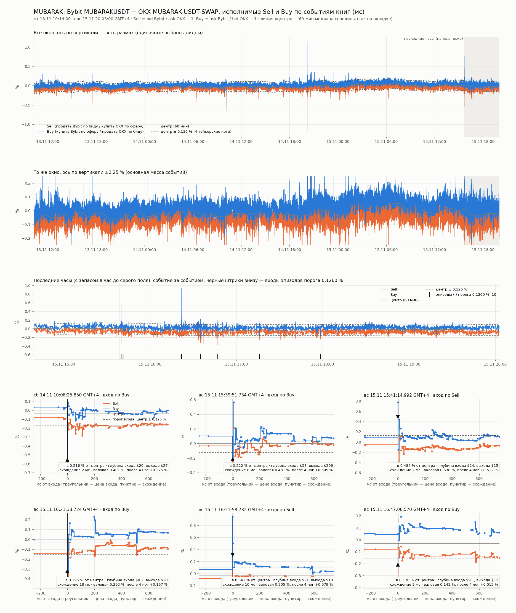

# MUBARAK, Bybit — OKX: что происходит и окупается ли круг после комиссий, всплеск последних часов (15.11.2026)

Запрос владельца (дословно, через координатора): «а mubarak bybit - okex». Вкладка (24 ч до 15.11 19:39 GMT+4): 23 эпизода в сутки, 10 из них за последние 4 ч (кучно), пик медиана 0,222 % / p95 0,47 % / макс 0,594 %, схождение медиана 18 мс / p95 0,93 с, чистая медиана +0,064 % / p95 +0,301 %.

- Окно: пт 13.11 10:14 → вс 15.11 20:03 GMT+4 (57,8 ч; 13.11 06:14 → 15.11 16:03 UTC). До 14:22 UTC — разобранные книги `/data/swings/b/parsed`; хвост 14:00–16:06 UTC разобран из живых файлов сбора (`tools/arb_stats/parse_tail.py` → `parse_inc.run` только для этих двух символов, `/data/swings/mub_tail/`; Bybit `book03-1794656680`, OKX `book02-1794656619` за 15.11); записи перекрытия сняты как дубли (Bybit 2 145, OKX 6 021).
- Инструменты: Bybit `MUBARAKUSDT` (A) и OKX `MUBARAK-USDT-SWAP` (B); цена ≈ 0,0326 $ (медиана по часам окна). Тот же счёт и те же определения, что в [skhynix-bybit-okx-2026-11-15.md](skhynix-bybit-okx-2026-11-15.md) (§ 1); код `tools/arb_stats/pair_look.py`, `pair_plot.py`; запуск `systemd-run --nice=15 -p CPUQuota=200%`, 16 с. Результаты на srv — `/data/swings/skhynix/res_mub.json` (+ `.eps`, `series_mub.npz`).
- График: [mubarak-bybit-okx-2026-11-15.png](mubarak-bybit-okx-2026-11-15.png) (копия у владельца — `Downloads/mubarak-bybit-okx.png`). Почасовая таблица — [mubarak-bybit-okx-2026-11-15-hourly.csv](mubarak-bybit-okx-2026-11-15-hourly.csv).
- Все числа — измеренные на этих данных за 57,8 ч; прогнозов нет.

## Итог (измерено на 57,8 ч)

- **Вкладка воспроизведена тем же счётом**: за 24 ч до вс 15.11 19:39 GMT+4 — 23 эпизода, пик медиана / p95 / макс 0,222 / 0,470 / 0,594 %, схождение медиана / p95 18 мс / 925 мс, чистая медиана / p95 0,064 / 0,301 %; из 23 эпизодов 10 — в последние 4 ч (с вс 15.11 15:39 GMT+4).
- **Типичные исполнимые цены**: Sell p50 -0,0636 %, Buy p50 0,0262 %; p1…p99 — Sell -0,1419…0,0321 %, Buy -0,0552…0,1250 %; полуспред пары p50 0,0452 % (4,5 bps при комиссии 4 тейкерских ног 12,6 bps). Спред p50 в тиках: Bybit 18 (0,0577 %), OKX 11 (0,0342 %).
- **Глубина лучшего уровня мала**: p50 Bybit 15 $ (bid) / 15 $ (ask), OKX 23 $ / 16 $; пара 8,5 $ (Sell) / 8,2 $ (Buy).
- **Круги по вкладочному счёту (I), порог 0,1260 %**: эпизодов 35 за 57,8 ч (14,5/сут), валовая ≥ 0,1260 % у 24 из 35; чистая медиана / p95 0,017 / 0,284 %. Порог держится после входа медиана 2 мс, максимум 44 мс; **на t + 50 мс порог держится в 0 из 35** (при 0,1071 % — 0 из 61, при 0,0882 % — 3 из 109); круг при входе на t + 50 мс окупается в 0 / 0 / 0. Глубина круга (меньшее из входа и выхода): мин / медиана / макс 0,1 / 6,9 / 37 $; при размере, равном глубине, Σ чистой прибыли 0,28 $ за окно.
- **Круги задним числом (II, верхняя граница)**: 197 при 0,1260 % (81,8/сут; валовая p50 0,173 %, макс 0,821 %), 297 при 0,1071 %, 440 при 0,0882 %. Жизнь круга (оба конца окупаются) — медиана 2 мс; ≥ 50 мс у 6 из 197, ≥ 300 мс у 3, ≥ 10 с у 1. Глубина круга p50 3,3 $; Σ чистой прибыли при размере = глубине: 1,30 $ / 1,54 $ / 1,82 $ (0,1260 / 0,1071 / 0,0882 %) за окно.
- **Всплеск последних 4 ч** (§ 5): 10 эпизодов (I) 0,1260 % за 4 ч (2,50/ч) против 25 за остальные 53,8 ч (0,46/ч); события входа — от OKX в 28 из 35 эпизодов, от Bybit в 7; середина OKX за секунду до входа сдвигается медиана 26,3 bps, Bybit — 2,7 bps. В часах с ≥ 3 эпизодами размах цены внутри часа 2,5–6,0 % (медиана по часам окна 1,8 %).

## 1. Данные и определения

Определения (исполнимые Sell/Buy, центр, комиссии, счёты (I) и (II), глубина, устойчивость на 50 / 300 / 10 000 мс) — как в § 1 [отчёта по SKHYNIX](skhynix-bybit-okx-2026-11-15.md); комиссия 4 тейкерских ног = 0,1260 %, 1 мейкер + 3 тейкера = 0,1071 %, 2 + 2 = 0,0882 % (тариф владельца, preferences п. 12). Время — E биржи, GMT+4 (если не указано иное).

- В разобранных книгах запись есть только при смене пары (bid, ask): размер на лучшем уровне — на момент смены цены, изменения одного размера между сменами цены не записаны. Глубина входа и выхода круга точна на момент события (вход и выход — события смены цены), квантили размера в § 3 — по размеру в момент последней смены цены. Отброшены пустые и пересечённые записи: Bybit 0 из 399 403, OKX 0 из 861 314.
- В окне: событий Bybit 385 141, OKX 819 631; событий объединённого ряда пары (с 13.11 08:44 GMT+4, за 1,5 ч до окна — для центра) 1 238 180. Наибольший промежуток без событий в окне: Bybit 58,5 с, OKX 44,3 с.
- **Размер контракта OKX**: `ctVal` = 100 MUBARAK на контракт (1 контракт ≈ 3,26 $), `lotSz`/`minSz` = 1 контракт, `tickSz` = 0,000001 $. Глубина в $ = размер (контрактов) × цена × `ctVal` = размер × цена × 100. Шаг цены Bybit по данным 0,000001 $ (наименьшая разность цен), OKX по данным 0,000001 $ (= `tickSz`); в % цены 0,0031 % у обеих бирж.
- Для сверки со вкладкой счёт (I) за последние 24 ч до 19:39 GMT+4 дал те же числа, что на вкладке (§ Итог).

## 2. Уровень Sell/Buy и как он двигался

Время-взвешенные квантили за окно (57,8 ч, вес интервала ≤ 60 с), %:

| ряд | 0,1 % | 1 % | 5 % | 25 % | 50 % | 75 % | 95 % | 99 % | 99,9 % | мин | макс |
|---|---:|---:|---:|---:|---:|---:|---:|---:|---:|---:|---:|
| Sell | -0,1721 | -0,1419 | -0,1181 | -0,0868 | -0,0636 | -0,0384 | 0,0034 | 0,0321 | 0,0657 | -1,208 | 0,565 |
| Buy | -0,0785 | -0,0552 | -0,0321 | 0,0029 | 0,0262 | 0,0514 | 0,0954 | 0,1250 | 0,1583 | -0,557 | 1,148 |
| середина (Sell+Buy)/2 | -0,1163 | -0,0911 | -0,0700 | -0,0402 | -0,0190 | 0,0036 | 0,0449 | 0,0731 | 0,1030 | — | — |

- Время, когда Sell > 0: 5,1 %; когда Buy < 0: 21,7 %. Средний центр c за окно -0,0180 %.
- Полуспред пары (Buy − Sell)/2: p5 / p50 / p95 = 0,0205 / 0,0452 / 0,0671 %.
- Почасовая медиана середины — от -0,0690 % до 0,0469 %; центр c на конец часа — от -0,0655 % до 0,0495 % ([CSV](mubarak-bybit-okx-2026-11-15-hourly.csv)). Цена Bybit (медиана по часам): от 0,02813 до 0,03486 $. Блоки по 6 ч (границы суток GMT+4), справа — число эпизодов, начавшихся в блоке:

| блок GMT+4 | событий Bybit | событий OKX | середина p50, % | середина p5 / p95, % | Sell p50, % | Buy p50, % | Sell макс, % | Buy мин, % | полуспред p50, % | спред Bybit, тиков | спред OKX, тиков | (I) 0,1260 / 0,1071 / 0,0882 | (II) 0,1260 / 0,1071 / 0,0882 |
|---|---:|---:|---:|---:|---:|---:|---:|---:|---:|---:|---:|---:|---:|
| пт 13.11 10:14 → пт 13.11 12:00 | 10 332 | 24 080 | -0,0485 | -0,090 / -0,003 | -0,0922 | -0,0029 | 0,154 | -0,147 | 0,0444 | 20 | 12 | 2 / 3 / 6 | 8 / 10 / 14 |
| пт 13.11 12:00 → пт 13.11 18:00 | 28 221 | 55 963 | -0,0322 | -0,076 / 0,012 | -0,0729 | 0,0088 | 0,081 | -0,232 | 0,0410 | 18 | 10 | 2 / 6 / 10 | 16 / 22 / 32 |
| пт 13.11 18:00 → сб 14.11 00:00 | 32 651 | 109 026 | -0,0423 | -0,093 / 0,007 | -0,0872 | 0,0029 | 0,052 | -0,157 | 0,0451 | 19 | 13 | 0 / 0 / 3 | 4 / 10 / 22 |
| сб 14.11 00:00 → сб 14.11 06:00 | 28 284 | 64 521 | -0,0195 | -0,067 / 0,024 | -0,0600 | 0,0210 | 0,110 | -0,226 | 0,0414 | 17 | 10 | 1 / 4 / 6 | 12 / 18 / 32 |
| сб 14.11 06:00 → сб 14.11 12:00 | 43 472 | 102 800 | -0,0270 | -0,065 / 0,009 | -0,0728 | 0,0184 | 0,088 | -0,557 | 0,0457 | 19 | 13 | 3 / 5 / 7 | 16 / 26 / 41 |
| сб 14.11 12:00 → сб 14.11 18:00 | 23 201 | 45 623 | -0,0248 | -0,064 / 0,014 | -0,0669 | 0,0153 | 0,082 | -0,181 | 0,0410 | 16 | 11 | 1 / 3 / 6 | 11 / 17 / 24 |
| сб 14.11 18:00 → вс 15.11 00:00 | 64 448 | 124 800 | -0,0174 | -0,067 / 0,036 | -0,0678 | 0,0318 | 0,565 | -0,256 | 0,0493 | 18 | 12 | 14 / 17 / 29 | 43 / 61 / 81 |
| вс 15.11 00:00 → вс 15.11 06:00 | 73 161 | 139 568 | 0,0176 | -0,040 / 0,068 | -0,0351 | 0,0673 | 0,128 | -0,138 | 0,0515 | 19 | 12 | 0 / 3 / 10 | 19 / 34 / 52 |
| вс 15.11 06:00 → вс 15.11 12:00 | 32 676 | 67 164 | 0,0119 | -0,035 / 0,074 | -0,0314 | 0,0557 | 0,138 | -0,097 | 0,0449 | 17 | 10 | 0 / 0 / 2 | 12 / 21 / 28 |
| вс 15.11 12:00 → вс 15.11 18:00 | 37 840 | 60 275 | -0,0084 | -0,054 / 0,047 | -0,0541 | 0,0389 | 0,487 | -0,323 | 0,0465 | 17 | 10 | 12 / 18 / 23 | 46 / 66 / 91 |
| вс 15.11 18:00 → вс 15.11 20:03 | 10 855 | 25 811 | -0,0243 | -0,059 / 0,009 | -0,0731 | 0,0242 | 0,090 | -0,128 | 0,0501 | 19 | 10 | 0 / 2 / 7 | 10 / 12 / 23 |

## 3. Спреды в тиках и глубина на лучшем уровне

Время-взвешенно за окно:

| биржа | тик, $ | тик, % цены | спред, тиков: p10 / p50 / p90 / p99 | спред = 1 тик, доля времени | спред ≤ 2 тика | спред p50, % |
|---|---|---:|---:|---:|---:|---:|
| Bybit | 0,000001 | 0,0031 | 8 / 18 / 25 / 29 | 0,7 % | 1,2 % | 0,0577 |
| OKX | 0,000001 | 0,0031 | 4 / 11 / 17 / 23 | 2,4 % | 4,5 % | 0,0342 |

Размер на лучшем уровне, $ (p10 / p50 / p90, время-взвешенно):

| сторона | Bybit | OKX | пара (для входа/выхода) |
|---|---:|---:|---:|
| bid (для Sell: продать Bybit / для Buy: продать OKX) | 1,0 / 15,1 / 77,8 | 3,4 / 23,1 / 109,1 | Sell: 1,0 / 8,5 / 39,1 |
| ask (для Sell: купить OKX / для Buy: купить Bybit) | 0,8 / 15,0 / 77,7 | 3,4 / 16,4 / 107,0 | Buy: 0,8 / 8,2 / 44,1 |

## 4. Круги против комиссий

Окно 57,8 ч = 2,41 сут.

### 4.1 (I) эпизоды как на вкладке

| порог F | эпизодов (в сутки) | вход Sell / вход Buy | вход выше центра, % (медиана / макс) | порог держится, мс (медиана / макс) | схождение, мс (медиана / p90 / макс) | валовая ≥ F | чистая, % (медиана / p95) | Σ чистой, % |
|---|---:|---:|---:|---:|---:|---:|---:|---:|
| 0,1260 % (4 тейкера) | 35 (14,5) | 20 / 15 | 0,186 / 0,594 | 2 / 44 | 18 / 1 091 / 32 330 | 24 из 35 | 0,017 / 0,284 | 2,078 |
| 0,1071 % (1 мейкер + 3 тейкера) | 61 (25,3) | 32 / 29 | 0,138 / 0,594 | 2 / 44 | 22 / 11 141 / 180 341 | 32 из 61 | 0,002 / 0,283 | 1,939 |
| 0,0882 % (2 мейкера + 2 тейкера) | 109 (45,2) | 62 / 47 | 0,109 / 0,594 | 2 / 182 | 210 / 31 858 / 312 530 | 39 из 109 | -0,012 / 0,181 | 1,386 |

| порог F | глубина круга, $ (мин / медиана / макс) | порог ≥ F на t+50 / 300 / 10 000 мс, эпизодов | круг при входе на t+L всё ещё ≥ F, эпизодов (50 / 300 / 10 000) | порог держится непрерывно ≥ L, эпизодов | прибыль при размере круга = его глубине, $ (Σ) |
|---|---:|---:|---:|---:|---:|
| 0,1260 % (4 тейкера) | 0,1 / 6,9 / 37 | 0 / 0 / 0 | 0 / 0 / 0 | 0 / 0 / 0 | 0,28 |
| 0,1071 % (1 мейкер + 3 тейкера) | 0,1 / 6,5 / 37 | 0 / 0 / 0 | 0 / 0 / 0 | 0 / 0 / 0 | 0,30 |
| 0,0882 % (2 мейкера + 2 тейкера) | 0,0 / 6,0 / 37 | 3 / 0 / 0 | 0 / 0 / 0 | 2 / 0 / 0 | 0,26 |

Эпизоды (I) порога 0,1260 % (всего 35) по времени входа (GMT+4). «Бирж. входа» — чьё событие дало вход; сдвиг середины — за 1 с до входа, bps (Bybit / OKX); «посл. 4 ч» — вход с вс 15.11 15:39:

| вход, GMT+4 | сторона | выше центра, % | порог держится, мс | схождение, мс | валовая, % | чистая, % | глубина вход / выход, $ | бирж. входа | сдвиг середины за 1 с, bps | посл. 4 ч | порог на t+50 мс |
|---|---|---|---:|---:|---:|---:|---:|---|---:|---|---|
| пт 13.11 10:56:03.511 | Sell | 0,132 | 1 | 1 151 | 0,084 | -0,042 | 6,9 / 198 | OKX | 0,0 / -13,7 |  | нет |
| пт 13.11 11:21:26.221 | Sell | 0,199 | 1 | 11 | 0,183 | 0,057 | 14 / 7,0 | OKX | -7,5 / -35,4 |  | нет |
| пт 13.11 14:15:57.202 | Buy | 0,138 | 1 | 11 | 0,140 | 0,014 | 35 / 6,8 | Bybit | -14,5 / -0,3 |  | нет |
| пт 13.11 14:54:56.808 | Buy | 0,183 | 4 | 30 | 0,123 | -0,003 | 6,8 / 6,8 | OKX | -3,1 / 19,4 |  | нет |
| сб 14.11 00:34:28.062 | Buy | 0,187 | 4 | 4 | 0,208 | 0,082 | 3,4 / 48 | Bybit | -18,4 / 2,2 |  | нет |
| сб 14.11 06:15:04.980 | Buy | 0,147 | 2 | 720 | 0,188 | 0,062 | 0,5 / 13 | OKX | 0,0 / 13,2 |  | нет |
| сб 14.11 09:56:12.320 | Buy | 0,133 | 2 | 1 220 | 0,075 | -0,051 | 15 / 100 | OKX | 8,8 / 27,2 |  | нет |
| сб 14.11 10:08:25.850 | Buy | 0,516 | 2 | 2 | 0,401 | 0,275 | 20 / 27 | OKX | 1,8 / 63,4 |  | нет |
| сб 14.11 15:25:18.251 | Buy | 0,147 | 1 | 11 141 | 0,114 | -0,012 | 0,5 / 3,3 | OKX | 0,0 / 13,2 |  | нет |
| сб 14.11 19:12:56.251 | Sell | 0,148 | 1 | 1 | 0,143 | 0,017 | 13 / 13 | OKX | 1,1 / -21,3 |  | нет |
| сб 14.11 19:13:21.631 | Sell | 0,186 | 1 | 21 | 0,140 | 0,014 | 16 / 57 | OKX | 0,0 / -19,7 |  | нет |
| сб 14.11 19:17:02.251 | Sell | 0,146 | 1 | 11 | 0,111 | -0,015 | 154 / 6,3 | OKX | -6,2 / -26,7 |  | нет |
| сб 14.11 20:12:10.446 | Sell | 0,594 | 6 | 6 | 0,390 | 0,264 | 9,3 / 15 | OKX | 0,0 / -78,1 |  | нет |
| сб 14.11 20:12:10.542 | Buy | 0,183 | 44 | 44 | 0,036 | -0,090 | 18 / 54 | Bybit | -216,8 / -189,4 |  | нет |
| сб 14.11 20:12:10.596 | Sell | 0,197 | 6 | 220 | 0,190 | 0,064 | 73 / 0,1 | OKX | -225,1 / -246,2 |  | нет |
| сб 14.11 20:12:10.946 | Sell | 0,136 | 10 | 146 | 0,003 | -0,123 | 24 / 18 | OKX | -184,9 / -212,6 |  | нет |
| сб 14.11 20:12:48.606 | Sell | 0,163 | 6 | 250 | 0,077 | -0,049 | 5,8 / 18 | OKX | 0,0 / -20,6 |  | нет |
| сб 14.11 20:35:36.468 | Sell | 0,269 | 4 | 10 | 0,240 | 0,114 | 10 / 10 | OKX | -0,5 / -26,9 |  | нет |
| сб 14.11 20:38:12.028 | Sell | 0,254 | 4 | 20 | 0,131 | 0,005 | 8,5 / 6,5 | OKX | 0,3 / -31,3 |  | нет |
| сб 14.11 20:39:08.678 | Sell | 0,227 | 4 | 1 000 | 0,172 | 0,046 | 27 / 89 | OKX | 3,2 / -29,3 |  | нет |
| сб 14.11 20:43:21.488 | Sell | 0,251 | 4 | 32 330 | 0,226 | 0,100 | 13 / 0,7 | OKX | -2,4 / -25,3 |  | нет |
| сб 14.11 21:05:36.478 | Sell | 0,323 | 4 | 120 | 0,281 | 0,155 | 2,5 / 7,8 | OKX | -2,7 / -33,6 |  | нет |
| сб 14.11 22:20:19.347 | Sell | 0,175 | 10 | 20 | 0,135 | 0,009 | 28 / 17 | OKX | 0,0 / -18,3 |  | нет |
| вс 15.11 13:10:56.442 | Sell | 0,309 | 2 | 20 | 0,250 | 0,124 | 2,9 / 8,7 | Bybit | 41,5 / 4,3 |  | нет |
| вс 15.11 14:33:21.591 | Sell | 0,138 | 1 | 11 | 0,042 | -0,084 | 2,9 / 5,7 | OKX | -6,8 / -21,6 |  | нет |
| вс 15.11 15:39:51.734 | Buy | 0,222 | 8 | 8 | 0,431 | 0,305 | 37 / 296 | OKX | 0,0 / 29,3 | да | нет |
| вс 15.11 15:39:51.742 | Sell | 0,209 | 2 | 2 | 0,226 | 0,100 | 296 / 14 | Bybit | 65,3 / 29,3 | да | нет |
| вс 15.11 15:41:14.992 | Sell | 0,484 | 2 | 2 | 0,638 | 0,512 | 24 / 15 | Bybit | 60,8 / -1,2 | да | нет |
| вс 15.11 15:41:14.994 | Buy | 0,153 | 8 | 8 | 0,229 | 0,103 | 15 / 2,9 | OKX | 60,8 / 97,4 | да | нет |
| вс 15.11 16:21:33.724 | Buy | 0,295 | 8 | 18 | 0,293 | 0,167 | 0,2 / 20 | OKX | 0,0 / 31,9 | да | нет |
| вс 15.11 16:21:58.732 | Sell | 0,341 | 2 | 10 | 0,205 | 0,079 | 21 / 18 | Bybit | 63,3 / 0,0 | да | нет |
| вс 15.11 16:35:07.900 | Buy | 0,196 | 2 | 12 | 0,140 | 0,014 | 0,8 / 15 | OKX | -2,7 / 26,3 | да | нет |
| вс 15.11 16:47:06.570 | Buy | 0,176 | 2 | 2 | 0,141 | 0,015 | 9,1 / 12 | OKX | 0,0 / 27,6 | да | нет |
| вс 15.11 17:16:02.110 | Buy | 0,141 | 2 | 10 | 0,024 | -0,102 | 15 / 12 | OKX | 3,6 / 19,2 | да | нет |
| вс 15.11 17:58:29.600 | Buy | 0,127 | 2 | 210 | 0,075 | -0,051 | 15 / 5,9 | OKX | 0,3 / 17,0 | да | нет |

### 4.2 (II) наилучшие круги задним числом (верхняя граница)

| порог F | кругов (в сутки) | первым Sell / первым Buy | валовая, % (p50 / p95 / макс) | чистая, % (p50 / p95) | Σ чистой, % | удержание позиции (p10 / p50 / p90) |
|---|---:|---:|---:|---:|---:|---:|
| 0,1260 % (4 тейкера) | 197 (81,8) | 98 / 99 | 0,173 / 0,414 / 0,821 | 0,047 / 0,288 | 16,373 | 18,9 с / 6,8 мин / 52,2 мин |
| 0,1071 % (1 мейкер + 3 тейкера) | 297 (123,3) | 148 / 149 | 0,151 / 0,315 / 0,821 | 0,044 / 0,208 | 20,946 | 17,6 с / 4,7 мин / 33,6 мин |
| 0,0882 % (2 мейкера + 2 тейкера) | 440 (182,6) | 220 / 220 | 0,129 / 0,274 / 0,821 | 0,040 / 0,186 | 27,826 | 14,6 с / 3,7 мин / 22,2 мин |

| порог F | жизнь входа, мс (p10 / p50 / p90) | жизнь выхода, мс | жизнь круга = min, мс | кругов с жизнью ≥ 50 / 300 / 10 000 мс | глубина круга, $ (p10 / p50 / p90) | прибыль при размере = глубине, $ (Σ) |
|---|---:|---:|---:|---:|---:|---:|
| 0,1260 % (4 тейкера) | 1 / 5 / 4 710 | 1 / 4 / 1 825 | 1 / 2 / 10 | 6 / 3 / 1 | 0,3 / 3,3 / 15 | 1,30 |
| 0,1071 % (1 мейкер + 3 тейкера) | 1 / 6 / 6 248 | 1 / 6 / 4 043 | 1 / 2 / 10 | 10 / 4 / 3 | 0,4 / 3,3 / 14 | 1,54 |
| 0,0882 % (2 мейкера + 2 тейкера) | 2 / 7 / 7 196 | 2 / 6 / 4 694 | 1 / 3 / 12 | 24 / 15 / 3 | 0,4 / 3,0 / 14 | 1,82 |

12 кругов (II) порога 0,1260 % с наибольшей валовой (по времени входа, GMT+4); все 197 — в `res_mub.json.eps` на srv:

| вход, GMT+4 | выход, GMT+4 | первым | валовая, % | удержание | жизнь входа / выхода | глубина вход / выход, $ |
|---|---|---|---|---:|---:|---:|
| сб 14.11 10:02:36.830 | сб 14.11 10:08:25.850 | Sell | 0,596 | 5,8 мин | 3,7 ч / 2 мс | 20 / 20 |
| сб 14.11 10:08:25.850 | сб 14.11 11:51:04.127 | Buy | 0,618 | 102,6 мин | 2 мс / 10,1 ч | 20 / 3,3 |
| сб 14.11 20:09:02.866 | сб 14.11 20:12:10.446 | Buy | 0,688 | 3,1 мин | 35,5 ч / 6 мс | 6,2 / 9,3 |
| сб 14.11 20:12:10.446 | сб 14.11 20:12:10.582 | Sell | 0,821 | 136 мс | 3,1 мин / 484 мс | 9,3 / 10,0 |
| сб 14.11 20:12:10.582 | сб 14.11 20:12:10.596 | Buy | 0,423 | 14 мс | 94 мс / 340 мс | 10,0 / 73 |
| сб 14.11 20:54:29.428 | сб 14.11 21:05:36.478 | Buy | 0,419 | 11,1 мин | 11,2 мин / 4 мс | 8,4 / 2,5 |
| вс 15.11 11:30:02.305 | вс 15.11 13:10:56.442 | Buy | 0,406 | 100,9 мин | 5,3 ч / 2 мс | 8,6 / 2,9 |
| вс 15.11 15:39:51.734 | вс 15.11 15:39:51.742 | Buy | 0,431 | 8 мс | 8 мс / 2 мс | 37 / 296 |
| вс 15.11 15:39:51.774 | вс 15.11 15:41:14.992 | Buy | 0,560 | 83,2 с | 83,2 с / 2 мс | 8,7 / 24 |
| вс 15.11 15:41:14.992 | вс 15.11 15:41:14.994 | Sell | 0,638 | 2 мс | 2 мс / 8 мс | 24 / 15 |
| вс 15.11 16:21:33.724 | вс 15.11 16:21:58.732 | Buy | 0,635 | 25,0 с | 38,1 мин / 6,9 мин | 0,2 / 21 |
| вс 15.11 16:21:58.732 | вс 15.11 16:24:23.230 | Sell | 0,413 | 2,4 мин | 2 мс / 10,5 мин | 21 / 18 |

### 4.3 Сколько кругов с достаточной глубиной

| порог F | (I) кругов с глубиной ≥ 10 / 30 / 100 $ | (I) наибольшая глубина, $ | (II) кругов с глубиной ≥ 10 / 30 / 100 $ | (II) наибольшая глубина, $ |
|---|---:|---:|---:|---:|
| 0,1260 % (4 тейкера) | 14 / 1 / 0 | 37 | 41 / 4 / 0 | 73 |
| 0,1071 % (1 мейкер + 3 тейкера) | 18 / 1 / 0 | 37 | 62 / 3 / 0 | 51 |
| 0,0882 % (2 мейкера + 2 тейкера) | 25 / 1 / 0 | 37 | 78 / 2 / 0 | 51 |

## 5. Всплеск последних часов

«Последние 4 ч» — с вс 15.11 15:39 до вс 15.11 19:39 GMT+4 (4 ч до времени вкладки); остальное окно — 53,8 ч (включая вс 15.11 19:39 → вс 15.11 20:03 без новых эпизодов).

| порог F | (I) за последние 4 ч (в час) | (I) за остальное окно (в час) | (II) за последние 4 ч (в час) | (II) за остальное окно (в час) |
|---|---:|---:|---:|---:|
| 0,1260 % | 10 (2,50) | 25 (0,46) | 51 (12,75) | 146 (2,71) |
| 0,1071 % | 17 (4,25) | 44 (0,82) | 65 (16,25) | 232 (4,31) |
| 0,0882 % | 26 (6,50) | 83 (1,54) | 94 (23,50) | 346 (6,43) |

Часы (GMT+4) с ≥ 2 эпизодами (I) порога 0,1260 %; в последней строке — медиана по всем часам окна:

| час GMT+4 | (I) 0,1260 / 0,1071 / 0,0882 | (II) 0,1260 | событий Bybit | событий OKX | цена Bybit (p50), $ | размах цены в часе, % | полуспред p50, % | спред Bybit, тиков | спред OKX, тиков | глубина пары Sell / Buy, $ (p50) |
|---|---:|---:|---:|---:|---:|---:|---:|---:|---:|---:|
| пт 13.11 14:00 | 2 / 3 / 5 | 5 | 4 265 | 8 255 | 0,03415 | 0,9 | 0,0396 | 19 | 10 | 6,8 / 6,9 |
| сб 14.11 19:00 | 3 / 4 / 6 | 9 | 12 445 | 24 055 | 0,03120 | 2,5 | 0,0464 | 17 | 13 | 12,7 / 11,3 |
| сб 14.11 20:00 | 9 / 11 / 15 | 19 | 15 563 | 26 537 | 0,02973 | 6,0 | 0,0493 | 18 | 12 | 12,6 / 11,9 |
| вс 15.11 15:00 | 4 / 6 / 6 | 9 | 5 390 | 8 677 | 0,02872 | 3,3 | 0,0486 | 18 | 9 | 8,6 / 8,6 |
| вс 15.11 16:00 | 4 / 7 / 11 | 20 | 8 738 | 10 942 | 0,02967 | 3,7 | 0,0500 | 18 | 12 | 12,9 / 10,0 |
| вс 15.11 17:00 | 2 / 2 / 2 | 12 | 5 138 | 10 504 | 0,02947 | 2,3 | 0,0439 | 17 | 9 | 8,8 / 5,9 |
| медиана по всем часам | — | — | 5 686 | 12 315 | 0,03260 | 1,8 | 0,0450 | 18 | 11 | 8,6 / 8,7 |

Кто двигал цену на входе (эпизоды (I) порога 0,1260 %): событие входа — от OKX или Bybit; сдвиг середины биржи за 1 с до входа, медиана модуля, bps; медиана глубины круга:

| группа | эпизодов | вход от OKX / от Bybit | сдвиг середины OKX, bps | сдвиг середины Bybit, bps | глубина круга p50, $ |
|---|---:|---:|---:|---:|---:|
| все окно | 35 | 28 / 7 | 26,3 | 2,7 | 6,9 |
| последние 4 ч | 10 | 7 / 3 | 27,0 | 3,1 | 10 |
| остальное окно | 25 | 21 / 4 | 25,3 | 2,7 | 6,8 |

Эпизоды последних 4 ч — в таблице § 4.1 (колонка «посл. 4 ч»), приближения трёх лучших из них — на графике (панель «последние часы» и нижний ряд).

## 6. График

[mubarak-bybit-okx-2026-11-15.png](mubarak-bybit-okx-2026-11-15.png): сверху — Sell и Buy по **каждому событию** за всё окно (1 193 413 событий пары; без укрупнения по слотам), линия центра и «центр ± 0,126 %»; ниже — то же окно с осью ±0,25 %; далее — последние часы (с запасом в час до отметки) с входами эпизодов порога 0,1260 %; внизу — шесть эпизодов (I) в миллисекундах от входа: три с наибольшей валовой за окно и три с наибольшей валовой среди последних 4 ч (точки — события, пунктир — момент схождения).

## 7. Чего здесь нет

- Время — E биржи; задержка доставки до srv и заявки не входит.
- Мейкерские заявки не моделировались (нет модели заполнения), пороги 0,1071 и 0,0882 % применены к тейкерским исполнимым ценам.
- Глубина — только лучший уровень, размер — на момент смены цены; исполнение крупнее глубины идёт по следующим уровням, их цены не считались.
- Фандинг и оборот бирж не считались; сроки удержания (II) показаны без платы за фандинг.
- Причину всплеска (новость, ликвидации, действия маркетмейкера) данные книг не показывают; здесь только измеренные признаки: кто давал событие входа, размах цены, спреды, глубина.
