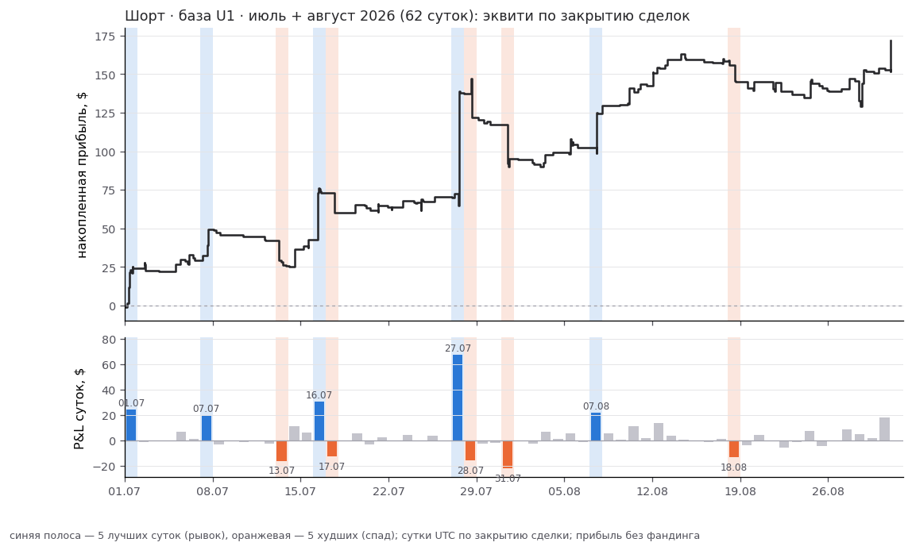
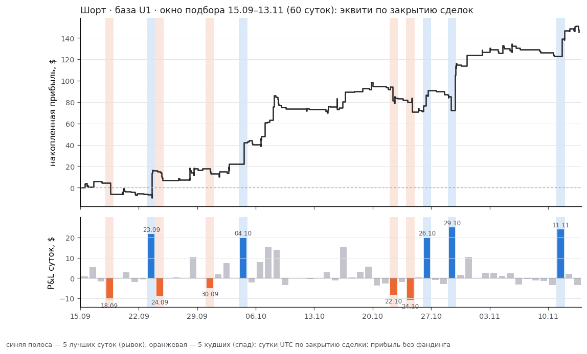
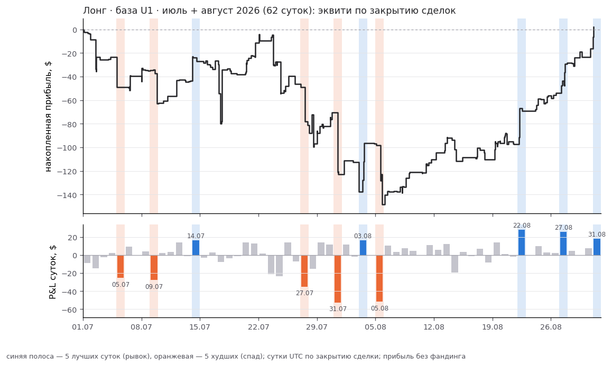
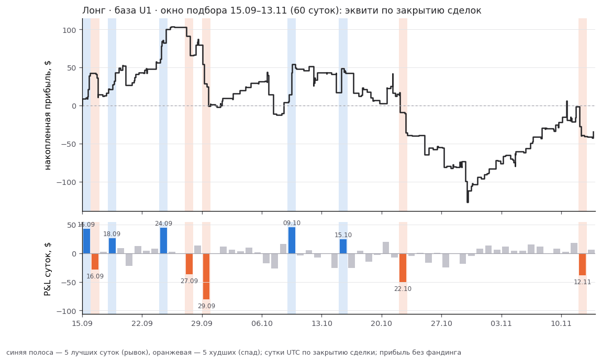

# П-42: форма эквити баз U1 — ступени или овал (TK-602, 18.11.2026)

Слова владельца (18.11, дословно): «скачки вверх вниз надо происследовать. меня интересует либо резкий набор и плато потом опять резкий набор либо медленный овалоообразный набор».

Всё ниже — **«найдено на этих данных»**, не вердикт и не торговый вывод. База U1, net без фандинга; сутки — по закрытию сделки (UTC), как в кривой эквити; рывок = одни из 5 лучших суток, спад = одни из 5 худших. Окна: июль + август 2026 (62 суток, «ja») и окно подбора 15.09–13.11 (60 суток, «fit»), по сторонам шорт и лонг.

## 1. Форма одним предложением на сторону (найдено на этих данных)

- **Шорт:** ступени вдоль почти прямой: итог набирают единичные сутки (5 суток из 62 = 95 % суммы, из 60 = 76 %; 10 сделок = 95 % и 81 %), но ступени разнесены равномерно (R² 0,89 / 0,94; плато ≤ 15 суток; порядок суток от случайного не отличим); овала нет.
- **Лонг:** ни ступеней, ни овала — волна без итога (+2,0 и −34,4 $; просадка по суткам 148 и 207 $; R² 0,13 / 0,56); те же рывки трейла и стопы около −25 $.

## 2. Ключевые числа

| | сделок | итог $ | топ-1 / 3 / 5 суток, % суммы | топ-5 / 10 сделок, % суммы | R² (перцентиль среди перестановок) | плато, сут. (перц.) | макс. просадка по суткам $ | 5 лучших суток, % положит. (iid-норм. 5–95 %) | асим. / экс. суток |
|---|--:|--:|--|--|--|--|--|--|--|
| Шорт июль+август (62 с.) | 214 | +171,71 | 39 / 71 / 95 | 58 / 95 | 0,89 (83) | 15 (37) | 46,4 | 55 % (26–39) | 2,52 / 11,4 |
| Шорт окно подбора (60 с.) | 195 | +145,62 | 17 / 48 / 76 | 48 / 81 | 0,94 (86) | 9 (12) | 27,7 | 49 % (25–38) | 1,26 / 1,3 |
| Лонг июль+август | 263 | +1,99 | 1 411 / 3 599 / 5 251 (итог ≈ 0) | — | 0,13 (53) | 61 (97) | 148,3 | 31 % (29–46) | −1,39 / 2,5 |
| Лонг окно подбора | 307 | −34,38 | доли нет (итог < 0) | — | 0,56 (95) | 49 (67) | 206,9 | 43 % (31–49) | −0,88 / 2,5 |

Что отличает рывки от плато (до торговли; найдено на этих данных):
- Рывок = сутки с трейл-сделкой (5/5 во всех окнах; лучшая сделка = 61–73 % P&L суток); спад = стоп (шорт 4/5 и 3/5, лонг 5/5 и 5/5; худшая сделка = 61–91 % P&L суток).
- Кластер монет: рывки шорта 27.07 (+67,3 $, 13 монет, 10 закрыты за 60 мин в 13:56–14:49 UTC — открытие американской сессии) и 07.08 (8 монет за час, +21,8 $); остальные рывки — 1–3 монеты. Спады — почти всегда один-два стопа.
- Соседство 10 отмеченных суток (±3 суток): не кучнее случайного (таблица ниже). Окно 13–15 UTC у шорта: 38 % сделок и +103,8 $ (июль+август), 27 % и +20,5 $ (подбор) — не устойчиво.
- ρ Спирмена (P&L сделки × ход BTC за сделку в пользу стороны): шорт +0,21 (p 0,002) и +0,13 (0,07); лонг −0,01 (0,83) и +0,195 (0,001).
- Признаки до торговли (BTC за 24 ч / 7 сут., разброс, размах, сигналы прошлых суток, фандинг BTC и монет, NATR): 144 сравнения, p < 0,05 у 5 (по случайности ≈ 7); повторяется только «сигналов в эти сутки» (ρ с |P&L| 0,29 / 0,24 / 0,30 / 0,18) — известен лишь по ходу суток, механически (больше сделок — больше |P&L|).
- «Трети» (линии T1, T2, T4, T5, T6) ступенчатее базы: шорт июль+август — топ-5 суток 109–225 % суммы, плато до 35 суток, R² 0,02–0,76; подбор — 75–101 %, R² 0,77–0,96; лонг T6: июль+август R² 0,36 и −26,63 $, подбор R² 0,01 и +20,28 $.

## 3. Сводка по четырём окнам (база U1)

**Ход BTC за сутки на отмеченных сутках (|ход|, % и размах, %; среднее)**

| Сторона · окно | \|ход\| рывки | \|ход\| спады | \|ход\| прочие | размах рывки | размах спады | размах прочие | рывков / спадов с \|ходом\| выше медианы суток |
|---|--:|--:|--:|--:|--:|--:|--:|
| Шорт · ja | 1,66 | 1,19 | 1,34 | 3,17 | 3,10 | 2,76 | 5/5 и 2/5 |
| Шорт · fit | 1,72 | 1,90 | 1,29 | 3,18 | 3,80 | 2,71 | 3/5 и 2/5 |
| Лонг · ja | 1,74 | 1,73 | 1,28 | 3,16 | 3,03 | 2,77 | 4/5 и 3/5 |
| Лонг · fit | 2,18 | 1,52 | 1,28 | 3,87 | 2,75 | 2,75 | 3/5 и 2/5 |

**Соседство: у скольких из 10 отмеченных суток (5 рывков + 5 спадов) есть другие отмеченные сутки в пределах ±3 суток** (случайное размещение 10 суток в окне: среднее и 5–95 %)

| Сторона · окно | наблюдено | случайно: среднее (5–95 %) | рывков с падением рядом (≤ 3 сут.) |
|---|--:|--:|--:|
| Шорт · ja | 6 | 6,2 (3–9) | 2 из 5 |
| Шорт · fit | 6 | 6,3 (4–9) | 2 из 5 |
| Лонг · ja | 3 | 6,2 (3–9) | 1 из 5 |
| Лонг · fit | 6 | 6,3 (4–9) | 3 из 5 |

**Закрытия 13:00–15:00 UTC (открытие американской сессии — 13:30): доля сделок и P&L окна, и P&L отмеченных суток из этого окна**

| Сторона · окно | сделок в 13–15 UTC | доля сделок | P&L в 13–15 UTC, $ | вне 13–15 UTC, $ | рывки: из 13–15 UTC / всего за 5 суток, $ | спады: из 13–15 UTC / всего за 5 суток, $ |
|---|--:|--:|--:|--:|--|--|
| Шорт · ja | 81 из 214 | 38 % | +103,8 | +67,9 | +100,5 / +163,3 | +0,7 / −80,8 |
| Шорт · fit | 52 из 195 | 27 % | +20,5 | +125,2 | +39,1 / +110,4 | −18,7 / −43,3 |
| Лонг · ja | 68 из 263 | 26 % | −50,9 | +52,9 | +17,3 / +104,7 | −64,3 / −192,1 |
| Лонг · fit | 61 из 307 | 20 % | +48,5 | −82,9 | +12,5 / +183,8 | −31,3 / −235,8 |

**Что даёт рывок и спад (по 5 суток; доля главной сделки — лучшей у рывка и худшей у спада — в P&L суток; кластер — не менее 5 монет, закрытых в пределах 60 мин)**

| Сторона · окно | рывки: суток с трейлом | рывки: монет в среднем | рывки: доля лучшей сделки | рывки: кластер | спады: суток со стопом | спады: монет в среднем | спады: доля худшей сделки | спады: кластер |
|---|--:|--:|--:|--:|--:|--:|--:|--:|
| Шорт · ja | 5/5 | 7,8 | 61 % | 2/5 | 4/5 | 4,6 | 77 % | 1/5 |
| Шорт · fit | 5/5 | 7,0 | 61 % | 2/5 | 3/5 | 3,6 | 91 % | 0/5 |
| Лонг · ja | 5/5 | 4,2 | 73 % | 0/5 | 5/5 | 5,2 | 72 % | 0/5 |
| Лонг · fit | 5/5 | 8,0 | 61 % | 0/5 | 5/5 | 4,8 | 61 % | 0/5 |

**Эквити по концу суток: пик, дно, финал, $ (сутки пика)**

| Сторона · окно | пик | сутки пика | дно | финал |
|---|--:|--:|--:|--:|
| Шорт · ja | +171,7 | 30.08 | +22,0 | +171,7 |
| Шорт · fit | +149,0 | 12.11 | −6,2 | +145,6 |
| Лонг · ja | +2,0 | 31.08 | −148,3 | +2,0 |
| Лонг · fit | +103,2 | 25.09 | −103,7 | −34,4 |

**Виды выхода: сделок, сумма $, среднее $, медиана удержания, мин (rt — возврат за уровень, trail — трейл после тейков, be — безубыток, stop — стоп)**

| Сторона · окно | вид | сделок | сумма, $ | среднее, $ | медиана удержания, мин |
|---|--|--:|--:|--:|--:|
| Шорт · ja | trail | 72 | +413,6 | +5,74 | 3,4 |
| Шорт · ja | rt | 136 | −153,4 | −1,13 | 1,5 |
| Шорт · ja | stop | 6 | −88,5 | −14,75 | 82,3 |
| Шорт · fit | trail | 72 | +349,0 | +4,85 | 2,9 |
| Шорт · fit | rt | 118 | −144,2 | −1,22 | 1,3 |
| Шорт · fit | stop | 5 | −59,2 | −11,84 | 192,1 |
| Лонг · ja | trail | 102 | +531,3 | +5,21 | 5,7 |
| Лонг · ja | rt | 76 | −169,5 | −2,23 | 1,9 |
| Лонг · ja | be | 71 | −4,9 | −0,07 | 3,7 |
| Лонг · ja | stop | 14 | −354,9 | −25,35 | 55,2 |
| Лонг · fit | trail | 116 | +676,9 | +5,84 | 6,2 |
| Лонг · fit | rt | 87 | −195,9 | −2,25 | 2,0 |
| Лонг · fit | be | 84 | −5,9 | −0,07 | 3,2 |
| Лонг · fit | stop | 20 | −509,4 | −25,47 | 141,9 |

**Признаки: сравнений 144, с p < 0,05 — 5; по случайности при 144 независимых сравнениях ожидается ≈ 7,2**

- Шорт · ja: сигналов в эти сутки (параллельно) — ρ с |P&L| 0,29 (p = 0,03)
- Шорт · fit: фандинг BTC до начала суток, бп — ρ с P&L −0,31 (p = 0,03)
- Шорт · fit: NATR монет сделок, бп — ρ с |P&L| 0,29 (p = 0,03)
- Лонг · ja: сигналов в эти сутки (параллельно) — ρ с |P&L| 0,30 (p = 0,02)
- Лонг · fit: сигналов в эти сутки (параллельно) — AUC рывок 0,82 (p = 0,01)

## 4. Шорт · июль + август 2026 (62 суток)

| Линия | Сделок | Сумма, $ | На сделку, $ | Топ-1 суток | Топ-3 | Топ-5 | Топ-5 сделок | Топ-10 сделок | k80 суток (% окна) |
|---|--:|--:|--:|--:|--:|--:|--:|--:|--:|
| база (все сделки) | 214 | +171,71 | +0,802 | 39 % | 71 % | 95 % | 58 % | 95 % | 12 (19 %) |
| T1 | 76 | +73,13 | +0,962 | 35 % | 85 % | 109 % | 80 % | 134 % | 8 (13 %) |
| T2 | 74 | +62,88 | +0,850 | 41 % | 98 % | 121 % | 91 % | 150 % | 8 (13 %) |
| T4 | 56 | +44,27 | +0,791 | 108 % | 186 % | 225 % | 158 % | 242 % | 6 (10 %) |
| T5 | 97 | +55,12 | +0,568 | 116 % | 173 % | 209 % | 146 % | 237 % | 7 (11 %) |

| Линия | R² прямой (перцентиль среди перестановок суток) | Суток без нового максимума | Самое длинное плато, сут. (перцентиль) | Макс. просадка, $ (сут.) | Суток +/−/пустых | Асимметрия суток | Эксцесс суток | Серии знаков: число, z, макс. + / − |
|---|--:|--:|--:|--:|--:|--:|--:|--:|
| база (все сделки) | 0,89 (83) | 50 (81 %) | 15 (37) | 46,4 (14) | 30/26/6 | 2,52 | 11,4 | 25, −1,05, 8 / 6 |
| T1 | 0,76 (33) | 50 (81 %) | 17 (40) | 18,6 (15) | 20/22/20 | 3,22 | 11,7 | 22, 0,01, 4 / 8 |
| T2 | 0,68 (40) | 55 (89 %) | 17 (26) | 19,8 (14) | 18/17/27 | 1,95 | 8,1 | 20, 0,52, 4 / 7 |
| T4 | 0,02 (9) | 55 (89 %) | 35 (63) | 56,5 (36) | 12/15/35 | 1,97 | 14,2 | 12, −0,93, 4 / 7 |
| T5 | 0,60 (75) | 58 (94 %) | 35 (63) | 43,4 (36) | 17/24/21 | 3,69 | 23,3 | 20, −0,29, 4 / 8 |

База: среднее суток +2,77 $, σ 12,21 $, лучшие/худшие сутки +67,3 / −22,1 $; доля 5 лучших суток в сумме положительных 55 % (iid-нормальные сутки с тем же средним и σ: 5/50/95 % — 26 % / 31 % / 39 %); перестановки: R² 5/50/95 % 0,53 / 0,82 / 0,92, плато 9 / 17 / 32 сут.

Виды выхода (сделок / сумма $): rt 136 / −153,4; trail 72 / +413,6; stop 6 / −88,5

P&L по 4-часовым окнам закрытия UTC (00–04, 04–08, …), $: +12,7, +5,2, +40,1, +85,1, +4,7, +23,9 · сделок: 40, 22, 23, 98, 20, 11

ρ Спирмена (P&L сделки в бп) × ход BTC за сделку (+ = в пользу стороны): 0,212 (n = 214, p = 0,002)

**Рывки (5 лучших суток)**

| Дата | P&L, $ | Сделок (в плюс) | Монет | Главная монета: $ (доля суток) | Выходы | Удерж. мед./макс., мин | Часы закрытия UTC | Макс. монет за 60 мин: n, $ | BTC сутки, % (размах, макс. час) | BTC за сделку, ср. % (доля в пользу) |
|---|--:|--:|--:|--|--|--:|--|--|--|--|
| 27.07 | +67,28 | 14 (6) | 13 | WDCUSDT: +21,2 (32 %) | rt 8, trail 6 | 3,2 / 54 | 1,6,13,14,14,14,14,14,14,14,14,14,14,16 | 10, +68,1 | −2,53 (3,3; −1,60 в 22ч) | +0,406 (79 %) |
| 16.07 | +30,49 | 6 (3) | 6 | BLUAIUSDT: +25,5 (84 %) | trail 3, rt 3 | 9,9 / 1 428 | 8,9,10,11,13,14 | 2, +30,4 | −1,42 (1,9; −0,85 в 07ч) | +0,214 (67 %) |
| 01.07 | +23,91 | 9 (6) | 9 | UBUSDT: +10,3 (43 %) | trail 6, rt 3 | 0,5 / 26 | 0,4,8,8,8,10,13,15,15 | 3, +20,1 | +2,38 (6,1; +1,65 в 13ч) | +0,028 (67 %) |
| 07.08 | +21,79 | 8 (3) | 8 | BEUSDT: +20,9 (96 %) | rt 5, trail 3 | 2,0 / 16 | 13,13,14,14,14,14,14,14 | 8, +21,8 | +0,91 (1,9; +0,45 в 08ч) | +0,038 (62 %) |
| 07.07 | +19,83 | 3 (3) | 3 | CRWVUSDT: +10,3 (52 %) | trail 3 | 52,8 / 1 468 | 4,14,14 | 2, +17,0 | −1,07 (2,6; −0,81 в 02ч) | −0,707 (33 %) |

**Спады (5 худших суток)**

| Дата | P&L, $ | Сделок (в плюс) | Монет | Главная монета: $ (доля суток) | Выходы | Удерж. мед./макс., мин | Часы закрытия UTC | Макс. монет за 60 мин: n, $ | BTC сутки, % (размах, макс. час) | BTC за сделку, ср. % (доля в пользу) |
|---|--:|--:|--:|--|--|--:|--|--|--|--|
| 31.07 | −22,13 | 3 (1) | 3 | AKEUSDT: −25,2 (114 %) | stop 1, rt 1, trail 1 | 3,8 / 53 | 11,13,14 | 2, +3,1 | −2,92 (4,6; −0,92 в 14ч) | +0,198 (33 %) |
| 13.07 | −16,36 | 4 (0) | 4 | OPNUSDT: −12,7 (78 %) | rt 3, stop 1 | 98,5 / 335 | 6,10,13,19 | 1, −12,7 | −2,26 (4,1; −1,03 в 01ч) | +0,225 (100 %) |
| 28.07 | −15,79 | 4 (1) | 4 | MSTRUSDT: −12,7 (80 %) | stop 2, rt 1, trail 1 | 44,7 / 94 | 0,14,15,15 | 2, −25,3 | +0,29 (2,2; +0,81 в 15ч) | −0,707 (25 %) |
| 18.08 | −13,46 | 12 (1) | 9 | CBRSUSDT: −2,9 (22 %) | rt 11, trail 1 | 2,3 / 11 | 2,3,3,13,13,13,14,14,14,14,14,15 | 8, −10,6 | +0,29 (1,7; +0,77 в 14ч) | −0,041 (25 %) |
| 17.07 | −13,02 | 3 (1) | 3 | CRCLUSDT: −12,8 (98 %) | rt 2, stop 1 | 2,7 / 164 | 0,7,16 | 1, +0,1 | +0,17 (2,9; −1,03 в 05ч) | −0,484 (33 %) |

**10 лучших сделок**

| Монета | Вход → закрытие UTC | Удерж., мин | Выход | Тейков | $ | бп | BTC за сделку, % |
|---|--|--:|--|--:|--:|--:|--:|
| BLUAIUSDT | 16.07 08:04 → 16.07 08:08 | 4,0 | trail | 16 | +25,54 | +511 | +0,08 |
| WDCUSDT | 27.07 13:56 → 27.07 14:49 | 53,7 | trail | 16 | +21,24 | +425 | +1,27 |
| BEUSDT | 07.08 13:56 → 07.08 14:13 | 16,5 | trail | 16 | +20,86 | +417 | +0,34 |
| DRAMUSDT | 27.07 13:57 → 27.07 14:44 | 47,4 | trail | 16 | +16,54 | +331 | +1,34 |
| MRVLUSDT | 27.07 14:01 → 27.07 14:46 | 45,0 | trail | 16 | +15,62 | +312 | +0,99 |
| MUUSDT | 27.07 13:59 → 27.07 14:45 | 46,5 | trail | 16 | +15,48 | +310 | +1,04 |
| CSOPSKHYNIX2LUSDT | 30.08 23:07 → 30.08 23:53 | 46,1 | trail | 16 | +15,28 | +306 | +1,08 |
| ARMUSDT | 14.07 13:32 → 14.07 13:35 | 3,2 | trail | 16 | +11,46 | +229 | +0,22 |
| KORUUSDT | 24.08 13:38 → 24.08 13:46 | 8,7 | trail | 16 | +10,66 | +213 | +0,75 |
| UBUSDT | 01.07 08:15 → 01.07 08:15 | 0,1 | trail | 16 | +10,32 | +206 | −0,02 |

**10 худших сделок**

| Монета | Вход → закрытие UTC | Удерж., мин | Выход | Тейков | $ | бп | BTC за сделку, % |
|---|--|--:|--|--:|--:|--:|--:|
| AKEUSDT | 31.07 10:27 → 31.07 11:20 | 53,4 | stop | 0 | −25,18 | −504 | −0,22 |
| CRCLUSDT | 17.07 13:45 → 17.07 16:29 | 164,5 | stop | 0 | −12,75 | −510 | −1,45 |
| OPNUSDT | 13.07 03:09 → 13.07 06:15 | 185,3 | stop | 0 | −12,71 | −508 | +0,57 |
| MSTRUSDT | 28.07 13:47 → 28.07 15:22 | 94,4 | stop | 0 | −12,68 | −507 | −1,39 |
| ORCLUSDT | 28.07 14:15 → 28.07 15:26 | 70,3 | stop | 0 | −12,66 | −506 | −1,25 |
| TUTUSDT | 28.08 09:40 → 28.08 10:46 | 65,8 | stop | 0 | −12,53 | −501 | +0,04 |
| EDENUSDT | 22.08 05:10 → 22.08 05:10 | 0,1 | rt | 0 | −6,01 | −120 | +1,34 |
| MINIMAXUSDT | 24.08 01:39 → 24.08 01:39 | 0,4 | rt | 0 | −2,36 | −47 | −0,09 |
| KORUUSDT | 01.07 13:30 → 01.07 13:30 | 0,3 | rt | 0 | −2,27 | −45 | +0,06 |
| ESPORTSUSDT | 02.08 10:51 → 02.08 10:51 | 0,4 | rt | 0 | −2,07 | −41 | −0,00 |

**Признаки суток (до торговли): AUC для «рывок против прочих активных суток» и «спад против прочих», ρ Спирмена с P&L суток и с |P&L| (активные сутки)**

| Признак | медиана рывок / прочие | AUC рывок (p) | медиана спад / прочие | AUC спад (p) | ρ с P&L (p) | ρ с \|P&L\| (p) |
|---|--|--:|--|--:|--:|--:|
| BTC, ход за прошлые 24 ч, % | −0,45 / 0,09 | 0,41 (0,53) | −0,05 / 0,09 | 0,47 (0,82) | −0,01 (0,94) | 0,04 (0,75) |
| BTC, ход за прошлые 7 сут., % | 1,05 / 1,45 | 0,45 (0,74) | 0,21 / 1,60 | 0,32 (0,20) | 0,07 (0,63) | −0,02 (0,87) |
| BTC, разброс часовых доходностей за 24 ч, % | 0,29 / 0,30 | 0,52 (0,92) | 0,30 / 0,29 | 0,51 (0,98) | −0,10 (0,46) | −0,06 (0,68) |
| BTC, размах прошлых суток, % | 2,02 / 2,44 | 0,51 (0,98) | 2,47 / 2,32 | 0,48 (0,91) | −0,03 (0,82) | −0,10 (0,45) |
| сигналов в прошлые сутки | 5,50 / 4,00 | 0,53 (0,85) | 5,00 / 4,00 | 0,56 (0,68) | −0,11 (0,42) | −0,07 (0,61) |
| сигналов в эти сутки (параллельно) | 12,00 / 4,00 | 0,73 (0,10) | 6,00 / 4,00 | 0,68 (0,19) | 0,12 (0,38) | 0,29 (0,03) |
| фандинг BTC до начала суток, бп | 0,55 / 0,71 | 0,36 (0,32) | 0,76 / 0,65 | 0,47 (0,86) | 0,00 (0,99) | 0,03 (0,82) |
| фандинг монет сделок на входе, бп | 1,12 / 0,32 | 0,61 (0,44) | 0,14 / 0,44 | 0,43 (0,63) | 0,15 (0,28) | −0,02 (0,90) |
| NATR монет сделок, бп | 61,50 / 55,96 | 0,76 (0,05) | 60,86 / 56,22 | 0,56 (0,67) | 0,13 (0,34) | 0,02 (0,90) |

## 4. Шорт · окно подбора 15.09–13.11 (60 суток)

| Линия | Сделок | Сумма, $ | На сделку, $ | Топ-1 суток | Топ-3 | Топ-5 | Топ-5 сделок | Топ-10 сделок | k80 суток (% окна) |
|---|--:|--:|--:|--:|--:|--:|--:|--:|--:|
| база (все сделки) | 195 | +145,62 | +0,747 | 17 % | 48 % | 76 % | 48 % | 81 % | 11 (18 %) |
| T1 | 65 | +77,87 | +1,198 | 24 % | 61 % | 89 % | 64 % | 102 % | 10 (17 %) |
| T2 | 65 | +52,53 | +0,808 | 31 % | 79 % | 101 % | 79 % | 131 % | 8 (13 %) |
| T4 | 65 | +59,14 | +0,910 | 18 % | 50 % | 75 % | 70 % | 120 % | 10 (17 %) |
| T5 | 65 | +86,60 | +1,332 | 37 % | 72 % | 93 % | 54 % | 89 % | 7 (12 %) |

| Линия | R² прямой (перцентиль среди перестановок суток) | Суток без нового максимума | Самое длинное плато, сут. (перцентиль) | Макс. просадка, $ (сут.) | Суток +/−/пустых | Асимметрия суток | Эксцесс суток | Серии знаков: число, z, макс. + / − |
|---|--:|--:|--:|--:|--:|--:|--:|--:|
| база (все сделки) | 0,94 (86) | 38 (63 %) | 9 (12) | 27,7 (10) | 28/24/8 | 1,26 | 1,3 | 22, −1,37, 7 / 5 |
| T1 | 0,93 (87) | 44 (73 %) | 8 (3) | 8,7 (6) | 20/12/28 | 1,78 | 4,5 | 17, 0,38, 6 / 2 |
| T2 | 0,77 (31) | 49 (82 %) | 22 (72) | 10,2 (23) | 15/14/31 | 2,26 | 7,2 | 9, −2,45, 9 / 5 |
| T4 | 0,96 (98) | 46 (77 %) | 9 (6) | 11,3 (9) | 17/12/31 | 0,78 | 1,6 | 17, 0,75, 4 / 3 |
| T5 | 0,88 (64) | 45 (75 %) | 15 (51) | 6,6 (13) | 17/17/26 | 3,85 | 17,4 | 19, 0,35, 4 / 4 |

База: среднее суток +2,43 $, σ 7,92 $, лучшие/худшие сутки +24,9 / −10,9 $; доля 5 лучших суток в сумме положительных 49 % (iid-нормальные сутки с тем же средним и σ: 5/50/95 % — 25 % / 31 % / 38 %); перестановки: R² 5/50/95 % 0,71 / 0,89 / 0,95, плато 7 / 13 / 25 сут.

Виды выхода (сделок / сумма $): rt 118 / −144,2; trail 72 / +349,0; stop 5 / −59,2

P&L по 4-часовым окнам закрытия UTC (00–04, 04–08, …), $: +40,9, +15,0, −13,3, +44,6, +17,5, +40,8 · сделок: 42, 8, 12, 83, 29, 21

ρ Спирмена (P&L сделки в бп) × ход BTC за сделку (+ = в пользу стороны): 0,132 (n = 195, p = 0,067)

**Рывки (5 лучших суток)**

| Дата | P&L, $ | Сделок (в плюс) | Монет | Главная монета: $ (доля суток) | Выходы | Удерж. мед./макс., мин | Часы закрытия UTC | Макс. монет за 60 мин: n, $ | BTC сутки, % (размах, макс. час) | BTC за сделку, ср. % (доля в пользу) |
|---|--:|--:|--:|--|--|--:|--|--|--|--|
| 29.10 | +24,92 | 17 (9) | 17 | WETUSDT: −12,6 (−51 %) | trail 9, rt 7, stop 1 | 0,6 / 407 | 0,1,2,2,8,20,20,20,20,20,20,20,20,20,20,22,23 | 10, +32,7 | −4,12 (5,0; −2,46 в 20ч) | +0,308 (82 %) |
| 11.11 | +23,88 | 3 (2) | 3 | SKDDUSDT: +16,3 (68 %) | trail 2, rt 1 | 49,8 / 838 | 16,22,22 | 2, +7,6 | +0,29 (2,2; +0,65 в 07ч) | −0,419 (33 %) |
| 23.09 | +21,68 | 10 (4) | 10 | BOMEUSDT: +9,5 (44 %) | rt 6, trail 4 | 2,3 / 94 | 2,13,13,13,14,14,14,14,15,16 | 7, +20,0 | −2,09 (4,4; −1,48 в 14ч) | +0,064 (50 %) |
| 04.10 | +20,07 | 1 (1) | 1 | SKYAIUSDT: +20,1 (100 %) | trail 1 | 2,9 / 3 | 14 | 1, +20,1 | +2,09 (2,5; +0,66 в 22ч) | −0,011 (0 %) |
| 26.10 | +19,86 | 4 (3) | 4 | HUMAUSDT: +9,6 (49 %) | trail 3, rt 1 | 7,5 / 19 | 1,8,14,15 | 1, +5,7 | +0,00 (1,9; +0,90 в 14ч) | −0,151 (25 %) |

**Спады (5 худших суток)**

| Дата | P&L, $ | Сделок (в плюс) | Монет | Главная монета: $ (доля суток) | Выходы | Удерж. мед./макс., мин | Часы закрытия UTC | Макс. монет за 60 мин: n, $ | BTC сутки, % (размах, макс. час) | BTC за сделку, ср. % (доля в пользу) |
|---|--:|--:|--:|--|--|--:|--|--|--|--|
| 24.10 | −10,85 | 3 (1) | 3 | BREVUSDT: −12,7 (117 %) | rt 1, trail 1, stop 1 | 5,3 / 280 | 4,15,16 | 1, −1,6 | −0,39 (2,5; −0,70 в 00ч) | +0,287 (100 %) |
| 18.09 | −10,58 | 1 (0) | 1 | TAKEUSDT: −10,6 (100 %) | stop 1 | 17,9 / 18 | 14 | 1, −10,6 | +5,86 (6,7; +2,62 в 13ч) | −0,317 (0 %) |
| 24.09 | −8,72 | 5 (0) | 4 | BTWUSDT: −6,1 (70 %) | rt 5 | 0,9 / 50 | 5,14,17,19,20 | 2, −3,2 | +0,02 (2,5; −1,01 в 08ч) | +0,011 (40 %) |
| 22.10 | −8,27 | 6 (2) | 6 | APRUSDT: −12,9 (156 %) | rt 3, trail 2, stop 1 | 4,1 / 192 | 1,9,13,14,15,15 | 3, +3,7 | −3,17 (4,1; −0,95 в 01ч) | +0,141 (67 %) |
| 30.09 | −4,88 | 4 (0) | 4 | CRDOUSDT: −1,9 (39 %) | rt 4 | 2,1 / 31 | 13,13,14,14 | 2, −3,0 | −0,06 (3,3; +1,64 в 12ч) | +0,421 (100 %) |

**10 лучших сделок**

| Монета | Вход → закрытие UTC | Удерж., мин | Выход | Тейков | $ | бп | BTC за сделку, % |
|---|--|--:|--|--:|--:|--:|--:|
| SKYAIUSDT | 04.10 14:03 → 04.10 14:05 | 2,9 | trail | 16 | +20,07 | +401 | −0,01 |
| SKDDUSDT | 11.11 15:19 → 11.11 16:09 | 49,8 | trail | 16 | +16,32 | +326 | −0,78 |
| MINIMAXUSDT | 08.10 01:45 → 08.10 01:55 | 10,3 | trail | 16 | +12,62 | +252 | +0,12 |
| TLMUSDT | 29.10 20:42 → 29.10 20:42 | 0,5 | trail | 8 | +11,03 | +221 | +0,33 |
| FLUIDUSDT | 31.10 06:01 → 31.10 07:06 | 65,1 | trail | 14 | +10,42 | +208 | −0,22 |
| AINUSDT | 08.10 04:46 → 08.10 04:46 | 0,1 | trail | 16 | +10,22 | +204 | −0,03 |
| HUMAUSDT | 26.10 08:16 → 26.10 08:25 | 8,6 | trail | 16 | +9,65 | +193 | −0,37 |
| BOMEUSDT | 23.09 14:13 → 23.09 14:13 | 0,1 | trail | 16 | +9,49 | +190 | +0,06 |
| AKTUSDT | 07.10 02:00 → 07.10 02:01 | 1,3 | trail | 16 | +9,16 | +183 | +0,59 |
| ZROUSDT | 16.10 16:46 → 16.10 17:07 | 20,2 | trail | 16 | +9,15 | +183 | +0,45 |

**10 худших сделок**

| Монета | Вход → закрытие UTC | Удерж., мин | Выход | Тейков | $ | бп | BTC за сделку, % |
|---|--|--:|--|--:|--:|--:|--:|
| APRUSDT | 22.10 06:08 → 22.10 09:20 | 192,1 | stop | 0 | −12,92 | −517 | +1,19 |
| BREVUSDT | 24.10 12:10 → 24.10 16:50 | 280,2 | stop | 0 | −12,68 | −507 | +0,48 |
| WETUSDT | 29.10 01:28 → 29.10 08:15 | 406,9 | stop | 0 | −12,59 | −504 | +1,14 |
| TAKEUSDT | 18.09 14:34 → 18.09 14:51 | 17,9 | stop | 0 | −10,58 | −423 | −0,32 |
| ANIMEUSDT | 15.10 16:59 → 15.10 16:59 | 0,0 | stop | 0 | −10,40 | −416 | +0,04 |
| BTWUSDT | 24.09 17:32 → 24.09 17:33 | 0,9 | rt | 0 | −3,88 | −78 | +0,04 |
| BULLAUSDT | 28.10 13:55 → 28.10 13:56 | 0,4 | rt | 0 | −2,90 | −58 | −0,17 |
| DATAIPUSDT | 20.10 00:22 → 20.10 00:22 | 0,1 | rt | 0 | −2,90 | −58 | +0,09 |
| BTWUSDT | 24.09 20:22 → 24.09 20:22 | 0,2 | rt | 1 | −2,25 | −90 | −0,05 |
| MINIMAXUSDT | 29.10 01:36 → 29.10 01:36 | 0,7 | rt | 0 | −2,24 | −45 | +0,01 |

**Признаки суток (до торговли): AUC для «рывок против прочих активных суток» и «спад против прочих», ρ Спирмена с P&L суток и с |P&L| (активные сутки)**

| Признак | медиана рывок / прочие | AUC рывок (p) | медиана спад / прочие | AUC спад (p) | ρ с P&L (p) | ρ с \|P&L\| (p) |
|---|--|--:|--|--:|--:|--:|
| BTC, ход за прошлые 24 ч, % | −0,49 / −0,06 | 0,40 (0,47) | 0,20 / −0,10 | 0,52 (0,88) | −0,01 (0,93) | −0,11 (0,44) |
| BTC, ход за прошлые 7 сут., % | −2,39 / −1,79 | 0,47 (0,83) | −0,20 / −1,94 | 0,70 (0,17) | −0,02 (0,91) | 0,16 (0,26) |
| BTC, разброс часовых доходностей за 24 ч, % | 0,28 / 0,31 | 0,37 (0,34) | 0,30 / 0,31 | 0,44 (0,68) | −0,01 (0,96) | 0,01 (0,96) |
| BTC, размах прошлых суток, % | 1,79 / 2,49 | 0,26 (0,08) | 2,19 / 2,48 | 0,46 (0,81) | −0,15 (0,27) | −0,16 (0,27) |
| сигналов в прошлые сутки | 1,00 / 3,00 | 0,28 (0,11) | 3,00 / 3,00 | 0,52 (0,87) | −0,22 (0,12) | −0,14 (0,31) |
| сигналов в эти сутки (параллельно) | 8,00 / 3,00 | 0,69 (0,19) | 6,00 / 3,00 | 0,58 (0,55) | 0,20 (0,16) | 0,24 (0,08) |
| фандинг BTC до начала суток, бп | 0,17 / 0,65 | 0,24 (0,05) | 0,77 / 0,59 | 0,56 (0,67) | −0,31 (0,03) | −0,19 (0,19) |
| фандинг монет сделок на входе, бп | 0,50 / 0,35 | 0,53 (0,82) | −0,01 / 0,36 | 0,36 (0,33) | 0,08 (0,57) | 0,07 (0,60) |
| NATR монет сделок, бп | 59,37 / 52,05 | 0,63 (0,36) | 80,65 / 51,83 | 0,74 (0,08) | −0,09 (0,54) | 0,29 (0,03) |

## 4. Лонг · июль + август 2026 (62 суток)

| Линия | Сделок | Сумма, $ | На сделку, $ | Топ-1 суток | Топ-3 | Топ-5 | Топ-5 сделок | Топ-10 сделок | k80 суток (% окна) |
|---|--:|--:|--:|--:|--:|--:|--:|--:|--:|
| база (все сделки) | 263 | +1,99 | +0,008 | 1 411 % | 3 599 % | 5 251 % | 4 874 % | 8 011 % | 19 (31 %) |
| T6 | 33 | −26,63 | −0,807 | (33 % пол.) | (67 % пол.) | (88 % пол.) | (79 % пол.) | (96 % пол.) | 5 (8 %) |

| Линия | R² прямой (перцентиль среди перестановок суток) | Суток без нового максимума | Самое длинное плато, сут. (перцентиль) | Макс. просадка, $ (сут.) | Суток +/−/пустых | Асимметрия суток | Эксцесс суток | Серии знаков: число, z, макс. + / − |
|---|--:|--:|--:|--:|--:|--:|--:|--:|
| база (все сделки) | 0,13 (53) | 61 (98 %) | 61 (97) | 148,3 (62) | 36/25/1 | −1,39 | 2,5 | 34, 0,93, 8 / 3 |
| T6 | 0,36 (51) | 57 (92 %) | 33 (17) | 58,9 (33) | 11/11/40 | −3,04 | 15,6 | 9, −1,31, 6 / 4 |

База: среднее суток +0,03 $, σ 15,61 $, лучшие/худшие сутки +28,1 / −52,5 $; доля 5 лучших суток в сумме положительных 31 % (iid-нормальные сутки с тем же средним и σ: 5/50/95 % — 29 % / 37 % / 46 %); перестановки: R² 5/50/95 % 0,00 / 0,12 / 0,51, плато 19 / 38 / 59 сут.

Виды выхода (сделок / сумма $): trail 102 / +531,3; rt 76 / −169,5; be 71 / −4,9; stop 14 / −354,9

P&L по 4-часовым окнам закрытия UTC (00–04, 04–08, …), $: +20,2, +67,6, −10,8, −9,3, −31,3, −34,4 · сделок: 47, 31, 41, 95, 30, 19

ρ Спирмена (P&L сделки в бп) × ход BTC за сделку (+ = в пользу стороны): −0,013 (n = 263, p = 0,833)

**Рывки (5 лучших суток)**

| Дата | P&L, $ | Сделок (в плюс) | Монет | Главная монета: $ (доля суток) | Выходы | Удерж. мед./макс., мин | Часы закрытия UTC | Макс. монет за 60 мин: n, $ | BTC сутки, % (размах, макс. час) | BTC за сделку, ср. % (доля в пользу) |
|---|--:|--:|--:|--|--|--:|--|--|--|--|
| 22.08 | +28,13 | 4 (3) | 4 | AKEUSDT: +20,9 (74 %) | trail 3, rt 1 | 0,9 / 8 | 3,5,5,13 | 2, +24,7 | −1,56 (3,0; −1,38 в 05ч) | −0,010 (50 %) |
| 27.08 | +25,58 | 7 (5) | 7 | MSTRUSDT: +11,1 (43 %) | trail 4, be 2, rt 1 | 2,8 / 21 | 5,8,13,14,14,16,22 | 3, +7,4 | +1,54 (2,9; +0,85 в 08ч) | +0,152 (71 %) |
| 31.08 | +18,03 | 2 (2) | 2 | CLOUSDT: +9,6 (53 %) | trail 2 | 3,9 / 4 | 0,1 | 2, +18,0 | +1,18 (2,4; +1,02 в 14ч) | −0,021 (50 %) |
| 14.07 | +16,53 | 5 (2) | 4 | AIOTUSDT: +15,5 (94 %) | rt 3, trail 2 | 12,5 / 51 | 2,2,3,13,14 | 2, +20,7 | +4,35 (4,6; +1,79 в 12ч) | −0,035 (0 %) |
| 03.08 | +16,41 | 4 (3) | 4 | GUSDT: −24,9 (−152 %) | trail 3, stop 1 | 55,4 / 110 | 0,10,14,15 | 2, +31,4 | −0,08 (2,8; +1,03 в 13ч) | +0,629 (75 %) |

**Спады (5 худших суток)**

| Дата | P&L, $ | Сделок (в плюс) | Монет | Главная монета: $ (доля суток) | Выходы | Удерж. мед./макс., мин | Часы закрытия UTC | Макс. монет за 60 мин: n, $ | BTC сутки, % (размах, макс. час) | BTC за сделку, ср. % (доля в пользу) |
|---|--:|--:|--:|--|--|--:|--|--|--|--|
| 31.07 | −52,50 | 5 (1) | 5 | SOONUSDT: −25,6 (49 %) | stop 2, trail 1, rt 1, be 1 | 24,6 / 52 | 11,12,13,13,13 | 3, −1,8 | −2,92 (4,6; −0,92 в 14ч) | −0,060 (40 %) |
| 05.08 | −51,54 | 7 (2) | 7 | KORUUSDT: −25,5 (50 %) | rt 2, be 2, stop 2, trail 1 | 6,2 / 319 | 1,13,13,13,14,15,19 | 4, −30,1 | +0,87 (1,8; +0,52 в 01ч) | +0,182 (86 %) |
| 27.07 | −34,92 | 5 (0) | 5 | NBISUSDT: −24,5 (70 %) | rt 4, stop 1 | 1,9 / 26 | 1,13,13,13,21 | 3, −29,1 | −2,53 (3,3; −1,60 в 22ч) | +0,176 (80 %) |
| 09.07 | −27,65 | 8 (4) | 7 | GUNUSDT: −25,6 (92 %) | be 3, trail 2, rt 2, stop 1 | 3,5 / 164 | 1,2,4,9,13,14,20,22 | 2, +0,2 | +1,51 (2,9; +0,77 в 04ч) | +0,060 (88 %) |
| 05.07 | −25,49 | 2 (0) | 2 | AIGENSYNUSDT: −25,5 (100 %) | stop 1, be 1 | 9,5 / 14 | 0,3 | 1, −25,5 | +0,80 (2,5; +1,03 в 22ч) | +0,041 (50 %) |

**10 лучших сделок**

| Монета | Вход → закрытие UTC | Удерж., мин | Выход | Тейков | $ | бп | BTC за сделку, % |
|---|--|--:|--|--:|--:|--:|--:|
| DODOXUSDT | 17.07 15:09 → 17.07 15:14 | 5,3 | trail | 8 | +29,41 | +588 | −0,16 |
| AKEUSDT | 22.08 05:25 → 22.08 05:25 | 0,6 | trail | 8 | +20,85 | +417 | +0,11 |
| ASTSUSDT | 03.08 13:51 → 03.08 15:10 | 79,2 | trail | 8 | +16,07 | +321 | +1,40 |
| AIOTUSDT | 14.07 02:49 → 14.07 02:50 | 1,0 | trail | 8 | +15,52 | +310 | −0,03 |
| COHRUSDT | 03.08 14:12 → 03.08 14:43 | 31,5 | trail | 8 | +15,32 | +306 | +0,51 |
| XPINUSDT | 12.07 04:14 → 12.07 04:15 | 0,7 | trail | 8 | +13,72 | +274 | +0,00 |
| LITEUSDT | 17.07 14:01 → 17.07 14:30 | 29,2 | trail | 8 | +12,69 | +254 | −0,04 |
| AAOIUSDT | 06.07 13:52 → 06.07 15:00 | 68,8 | trail | 6 | +12,45 | +249 | +0,03 |
| ARMUSDT | 02.07 13:46 → 02.07 14:04 | 18,0 | trail | 8 | +11,97 | +239 | −0,04 |
| ICNTUSDT | 01.08 06:18 → 01.08 06:24 | 5,8 | trail | 7 | +11,70 | +234 | +0,07 |

**10 худших сделок**

| Монета | Вход → закрытие UTC | Удерж., мин | Выход | Тейков | $ | бп | BTC за сделку, % |
|---|--|--:|--|--:|--:|--:|--:|
| APRUSDT | 24.07 14:57 → 24.07 15:13 | 15,3 | stop | 0 | −26,85 | −537 | +0,06 |
| SOONUSDT | 31.07 11:30 → 31.07 12:19 | 49,0 | stop | 0 | −25,59 | −512 | −0,30 |
| GUNUSDT | 09.07 19:20 → 09.07 20:21 | 60,7 | stop | 0 | −25,55 | −511 | +0,04 |
| KORUUSDT | 05.08 13:59 → 05.08 14:41 | 42,1 | stop | 0 | −25,52 | −510 | −0,08 |
| AIGENSYNUSDT | 05.07 00:29 → 05.07 00:43 | 13,8 | stop | 0 | −25,47 | −509 | +0,15 |
| CRWVUSDT | 23.07 14:08 → 23.07 19:08 | 300,3 | stop | 0 | −25,42 | −508 | −0,11 |
| DEXEUSDT | 17.07 06:10 → 17.07 10:06 | 236,0 | stop | 0 | −25,40 | −508 | +0,46 |
| CBRSUSDT | 05.08 14:27 → 05.08 19:46 | 318,6 | stop | 0 | −25,36 | −507 | +0,82 |
| COINUSDT | 27.07 13:44 → 28.07 13:45 | 1 441,3 | stop | 0 | −25,34 | −507 | −4,08 |
| INUSDT | 31.07 10:57 → 31.07 11:49 | 52,4 | stop | 0 | −25,07 | −501 | −0,17 |

**Признаки суток (до торговли): AUC для «рывок против прочих активных суток» и «спад против прочих», ρ Спирмена с P&L суток и с |P&L| (активные сутки)**

| Признак | медиана рывок / прочие | AUC рывок (p) | медиана спад / прочие | AUC спад (p) | ρ с P&L (p) | ρ с \|P&L\| (p) |
|---|--|--:|--|--:|--:|--:|
| BTC, ход за прошлые 24 ч, % | 0,62 / 0,08 | 0,52 (0,88) | 0,91 / 0,06 | 0,62 (0,38) | −0,09 (0,49) | −0,08 (0,54) |
| BTC, ход за прошлые 7 сут., % | −0,11 / 1,25 | 0,49 (0,97) | 1,05 / 1,25 | 0,55 (0,75) | 0,04 (0,77) | −0,15 (0,26) |
| BTC, разброс часовых доходностей за 24 ч, % | 0,33 / 0,30 | 0,67 (0,21) | 0,30 / 0,30 | 0,45 (0,75) | −0,02 (0,87) | 0,00 (0,98) |
| BTC, размах прошлых суток, % | 3,12 / 2,46 | 0,64 (0,31) | 2,02 / 2,50 | 0,48 (0,89) | −0,05 (0,68) | 0,00 (0,98) |
| сигналов в прошлые сутки | 5,00 / 9,00 | 0,46 (0,76) | 5,00 / 9,00 | 0,43 (0,63) | −0,04 (0,76) | −0,01 (0,94) |
| сигналов в эти сутки (параллельно) | 10,00 / 8,00 | 0,51 (0,93) | 7,00 / 9,00 | 0,53 (0,81) | 0,18 (0,16) | 0,30 (0,02) |
| фандинг BTC до начала суток, бп | 0,83 / 0,63 | 0,68 (0,20) | 0,77 / 0,64 | 0,61 (0,42) | 0,04 (0,79) | 0,07 (0,60) |
| фандинг монет сделок на входе, бп | 0,12 / 0,32 | 0,45 (0,70) | 0,20 / 0,32 | 0,44 (0,69) | 0,16 (0,23) | −0,01 (0,94) |
| NATR монет сделок, бп | 64,67 / 54,97 | 0,62 (0,39) | 55,53 / 54,57 | 0,59 (0,52) | −0,13 (0,30) | 0,21 (0,11) |

## 4. Лонг · окно подбора 15.09–13.11 (60 суток)

| Линия | Сделок | Сумма, $ | На сделку, $ | Топ-1 суток | Топ-3 | Топ-5 | Топ-5 сделок | Топ-10 сделок | k80 суток (% окна) |
|---|--:|--:|--:|--:|--:|--:|--:|--:|--:|
| база (все сделки) | 307 | −34,38 | −0,112 | (11 % пол.) | (31 % пол.) | (43 % пол.) | (16 % пол.) | (26 % пол.) | 17 (28 %) |
| T6 | 103 | +20,28 | +0,197 | 105 % | 271 % | 390 % | 370 % | 598 % | 10 (17 %) |

| Линия | R² прямой (перцентиль среди перестановок суток) | Суток без нового максимума | Самое длинное плато, сут. (перцентиль) | Макс. просадка, $ (сут.) | Суток +/−/пустых | Асимметрия суток | Эксцесс суток | Серии знаков: число, z, макс. + / − |
|---|--:|--:|--:|--:|--:|--:|--:|--:|
| база (все сделки) | 0,56 (95) | 54 (90 %) | 49 (67) | 206,9 (49) | 35/24/1 | −0,88 | 2,5 | 29, −0,13, 8 / 4 |
| T6 | 0,01 (10) | 55 (92 %) | 22 (17) | 91,3 (21) | 20/15/25 | −1,17 | 3,4 | 14, −1,45, 12 / 4 |

База: среднее суток −0,57 $, σ 21,45 $, лучшие/худшие сутки +45,2 / −80,5 $; доля 5 лучших суток в сумме положительных 43 % (iid-нормальные сутки с тем же средним и σ: 5/50/95 % — 31 % / 38 % / 49 %); перестановки: R² 5/50/95 % 0,00 / 0,15 / 0,56, плато 20 / 41 / 59 сут.

Виды выхода (сделок / сумма $): trail 116 / +676,9; rt 87 / −195,9; be 84 / −5,9; stop 20 / −509,4

P&L по 4-часовым окнам закрытия UTC (00–04, 04–08, …), $: −121,4, +46,3, +35,9, +80,5, −51,7, −24,1 · сделок: 60, 42, 33, 108, 51, 13

ρ Спирмена (P&L сделки в бп) × ход BTC за сделку (+ = в пользу стороны): 0,195 (n = 307, p = 0,001)

**Рывки (5 лучших суток)**

| Дата | P&L, $ | Сделок (в плюс) | Монет | Главная монета: $ (доля суток) | Выходы | Удерж. мед./макс., мин | Часы закрытия UTC | Макс. монет за 60 мин: n, $ | BTC сутки, % (размах, макс. час) | BTC за сделку, ср. % (доля в пользу) |
|---|--:|--:|--:|--|--|--:|--|--|--|--|
| 09.10 | +45,19 | 6 (5) | 5 | SKLUSDT: +28,6 (63 %) | trail 4, be 1, rt 1 | 2,0 / 10 | 3,4,11,13,13,21 | 2, +10,5 | +1,06 (2,4; +0,82 в 11ч) | +0,013 (50 %) |
| 24.09 | +44,29 | 10 (8) | 10 | LSKUSDT: +14,0 (32 %) | trail 7, rt 2, be 1 | 6,3 / 91 | 3,5,5,6,9,10,12,15,18,19 | 2, +17,3 | +0,02 (2,5; −1,01 в 08ч) | −0,018 (40 %) |
| 15.09 | +42,87 | 8 (7) | 7 | ONUSDT: +17,8 (42 %) | trail 6, rt 2 | 2,6 / 14 | 0,10,14,14,15,16,19,22 | 2, +1,0 | −3,27 (4,2; −1,27 в 18ч) | −0,038 (25 %) |
| 18.09 | +26,69 | 8 (6) | 5 | MAGMAUSDT: +11,1 (42 %) | trail 4, be 4 | 1,3 / 19 | 1,1,3,5,13,16,17,20 | 2, +5,5 | +5,86 (6,7; +2,62 в 13ч) | −0,025 (50 %) |
| 15.10 | +24,79 | 13 (3) | 13 | ARCUSDT: +31,9 (129 %) | be 5, trail 4, rt 4 | 3,3 / 155 | 1,6,7,7,11,14,14,15,16,16,16,16,18 | 4, +2,2 | +0,68 (3,6; +2,09 в 14ч) | +0,256 (77 %) |

**Спады (5 худших суток)**

| Дата | P&L, $ | Сделок (в плюс) | Монет | Главная монета: $ (доля суток) | Выходы | Удерж. мед./макс., мин | Часы закрытия UTC | Макс. монет за 60 мин: n, $ | BTC сутки, % (размах, макс. час) | BTC за сделку, ср. % (доля в пользу) |
|---|--:|--:|--:|--|--|--:|--|--|--|--|
| 29.09 | −80,54 | 5 (0) | 5 | RKLBUSDT: −25,4 (32 %) | stop 3, be 1, rt 1 | 44,8 / 4 992 | 1,3,5,13,17 | 1, −25,4 | +0,20 (2,2; −0,80 в 15ч) | −0,340 (20 %) |
| 22.10 | −50,73 | 5 (1) | 5 | WDCUSDT: −25,5 (50 %) | rt 2, stop 2, trail 1 | 3,3 / 13 | 0,1,3,17,20 | 1, −1,7 | −3,17 (4,1; −0,95 в 01ч) | −0,080 (20 %) |
| 12.11 | −38,94 | 6 (1) | 5 | MINIMAXUSDT: −25,7 (66 %) | rt 3, stop 1, trail 1, be 1 | 5,9 / 187 | 3,8,8,9,16,17 | 2, −12,6 | −3,46 (4,2; −1,20 в 14ч) | −0,061 (83 %) |
| 27.09 | −37,14 | 2 (0) | 2 | PIEVERSEUSDT: −25,4 (68 %) | rt 1, stop 1 | 117,7 / 235 | 5,14 | 1, −11,8 | +0,04 (1,3; −0,59 в 14ч) | −0,069 (50 %) |
| 16.09 | −28,43 | 8 (1) | 7 | LITUSDT: −25,3 (89 %) | rt 4, be 2, stop 1, trail 1 | 24,9 / 91 | 14,14,14,17,17,18,19,20 | 3, −1,9 | +0,76 (2,0; +0,70 в 23ч) | −0,157 (38 %) |

**10 лучших сделок**

| Монета | Вход → закрытие UTC | Удерж., мин | Выход | Тейков | $ | бп | BTC за сделку, % |
|---|--|--:|--|--:|--:|--:|--:|
| ARCUSDT | 15.10 07:36 → 15.10 07:42 | 6,2 | trail | 8 | +31,91 | +638 | +0,21 |
| SKLUSDT | 09.10 11:44 → 09.10 11:54 | 10,3 | trail | 8 | +28,59 | +572 | +0,31 |
| ONUSDT | 15.09 19:03 → 15.09 19:10 | 7,6 | trail | 8 | +17,83 | +357 | +0,11 |
| ARIAUSDT | 21.10 06:30 → 21.10 06:30 | 0,5 | trail | 8 | +16,33 | +327 | +0,07 |
| FARTCOINUSDT | 04.11 15:00 → 04.11 15:14 | 13,9 | trail | 8 | +16,05 | +321 | +1,90 |
| INTWUSDT | 10.11 14:54 → 10.11 15:03 | 9,4 | trail | 8 | +14,92 | +298 | +0,70 |
| LSKUSDT | 24.09 05:13 → 24.09 05:21 | 7,5 | trail | 8 | +14,04 | +281 | −0,14 |
| SIGNUSDT | 07.11 17:05 → 07.11 17:06 | 0,5 | trail | 6 | +13,93 | +279 | −0,01 |
| CSOPSKHYNIX2LUSDT | 11.11 15:07 → 11.11 17:11 | 124,1 | trail | 8 | +13,86 | +277 | +0,87 |
| MARSCOINUSDT | 28.09 06:23 → 28.09 06:32 | 9,3 | trail | 5 | +13,17 | +263 | +0,03 |

**10 худших сделок**

| Монета | Вход → закрытие UTC | Удерж., мин | Выход | Тейков | $ | бп | BTC за сделку, % |
|---|--|--:|--|--:|--:|--:|--:|
| DODOXUSDT | 29.10 19:28 → 30.10 00:18 | 290,9 | stop | 0 | −27,59 | −552 | −4,38 |
| MINIMAXUSDT | 12.11 02:04 → 12.11 03:28 | 84,6 | stop | 0 | −25,67 | −513 | +0,19 |
| TUTUSDT | 06.10 09:12 → 06.10 19:17 | 605,4 | stop | 0 | −25,55 | −511 | −0,60 |
| WDCUSDT | 22.10 20:03 → 22.10 20:07 | 4,7 | stop | 0 | −25,53 | −511 | −0,09 |
| ZROUSDT | 29.10 16:13 → 29.10 18:31 | 137,4 | stop | 0 | −25,53 | −511 | −1,35 |
| BULLAUSDT | 19.09 23:10 → 20.09 01:36 | 146,4 | stop | 0 | −25,49 | −510 | −0,24 |
| ARCUSDT | 22.10 03:20 → 22.10 03:33 | 13,3 | stop | 0 | −25,44 | −509 | −0,09 |
| CRCLUSDT | 16.10 13:58 → 16.10 17:04 | 185,8 | stop | 0 | −25,43 | −509 | −0,89 |
| MOVRUSDT | 20.10 16:04 → 21.10 07:40 | 935,9 | stop | 0 | −25,43 | −509 | +0,52 |
| RKLBUSDT | 25.09 14:00 → 29.09 01:11 | 4 991,9 | stop | 0 | −25,42 | −508 | −1,08 |

**Признаки суток (до торговли): AUC для «рывок против прочих активных суток» и «спад против прочих», ρ Спирмена с P&L суток и с |P&L| (активные сутки)**

| Признак | медиана рывок / прочие | AUC рывок (p) | медиана спад / прочие | AUC спад (p) | ρ с P&L (p) | ρ с \|P&L\| (p) |
|---|--|--:|--|--:|--:|--:|
| BTC, ход за прошлые 24 ч, % | −1,79 / 0,03 | 0,40 (0,46) | 0,29 / 0,01 | 0,48 (0,89) | −0,19 (0,14) | −0,13 (0,34) |
| BTC, ход за прошлые 7 сут., % | −1,17 / −1,93 | 0,57 (0,65) | −3,60 / −1,85 | 0,41 (0,55) | 0,06 (0,66) | 0,10 (0,43) |
| BTC, разброс часовых доходностей за 24 ч, % | 0,33 / 0,30 | 0,57 (0,65) | 0,33 / 0,31 | 0,50 (0,99) | 0,05 (0,72) | 0,09 (0,48) |
| BTC, размах прошлых суток, % | 3,77 / 2,42 | 0,70 (0,14) | 2,75 / 2,46 | 0,51 (0,97) | 0,14 (0,30) | 0,08 (0,57) |
| сигналов в прошлые сутки | 9,50 / 8,00 | 0,49 (0,94) | 14,00 / 7,00 | 0,58 (0,59) | −0,13 (0,33) | −0,10 (0,46) |
| сигналов в эти сутки (параллельно) | 19,00 / 7,50 | 0,82 (0,01) | 11,00 / 8,00 | 0,50 (0,99) | 0,16 (0,22) | 0,18 (0,17) |
| фандинг BTC до начала суток, бп | 0,18 / 0,61 | 0,27 (0,10) | 0,47 / 0,61 | 0,48 (0,90) | 0,01 (0,92) | −0,11 (0,43) |
| фандинг монет сделок на входе, бп | −0,16 / 0,40 | 0,46 (0,76) | 0,89 / 0,30 | 0,62 (0,39) | −0,02 (0,89) | −0,03 (0,80) |
| NATR монет сделок, бп | 59,48 / 54,57 | 0,65 (0,30) | 54,82 / 54,78 | 0,63 (0,34) | 0,12 (0,36) | 0,08 (0,57) |

## 5. Определения и ограничения

- Сутки — по дню закрытия сделки (UTC); «без 2 лучших суток» в таблице «Кривая» вкладки считается по дню сигнала — сделка может закрыться через дни (лонг подбор 29.09: RKLB 4 992 мин, стоп −25,4 $ записан на 29.09).
- R² — квадрат корреляции кумулятивной эквити по суткам с прямой; перцентиль — среди перестановок порядка суток. Плато — число суток подряд без нового максимума эквити. k80 — число лучших суток, дающих 80 % суммы. «iid-норм.» — сутки как нормальные с тем же средним и σ.
- 5 суток на рывки и спады — малая выборка. 144 сравнения признаков: p < 0,05 у 5, по случайности ≈ 7; «сигналов в эти сутки» — параллельный признак, не предиктор.
- Фандинг не учтён; числа TK-600 не использованы.

## 6. Где лежит

- Код: `tools/p42/tk602_shape.py`, `tk602_report.py`, `test_tk602.py`; сырое — `docs/findings/p42-equity-shape-2026-11-18/{out,rep,shots-*}`.
- Страница http://5.231.25.224:8090/ → «Эквити» → «Кривая | Форма» (`#equity/short|long/shape`).
