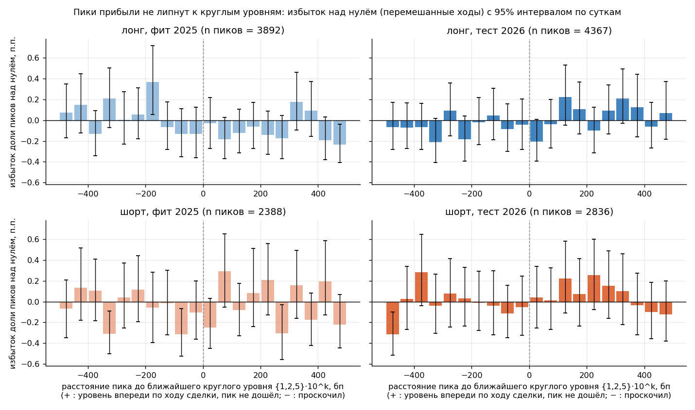
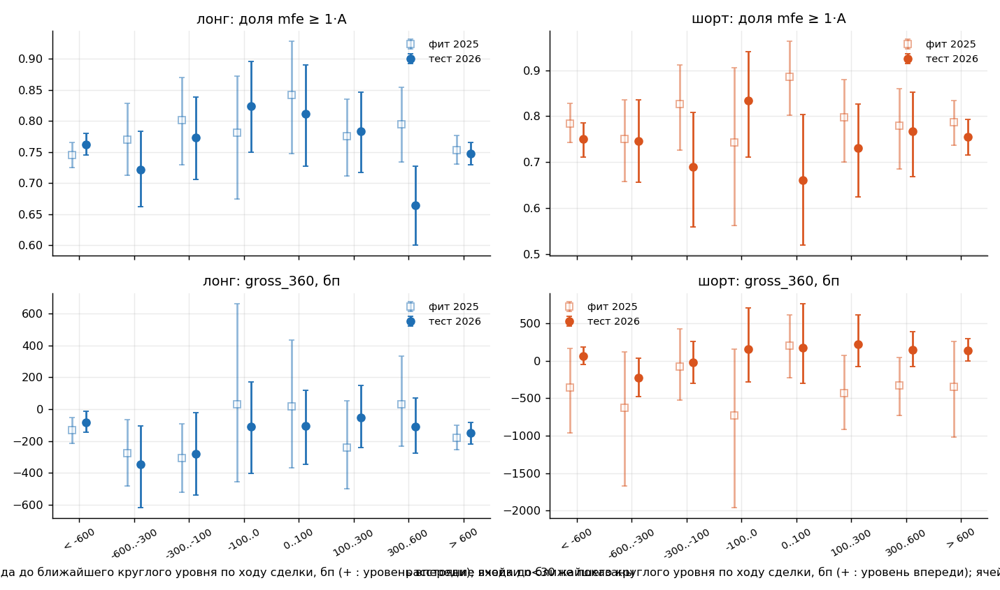
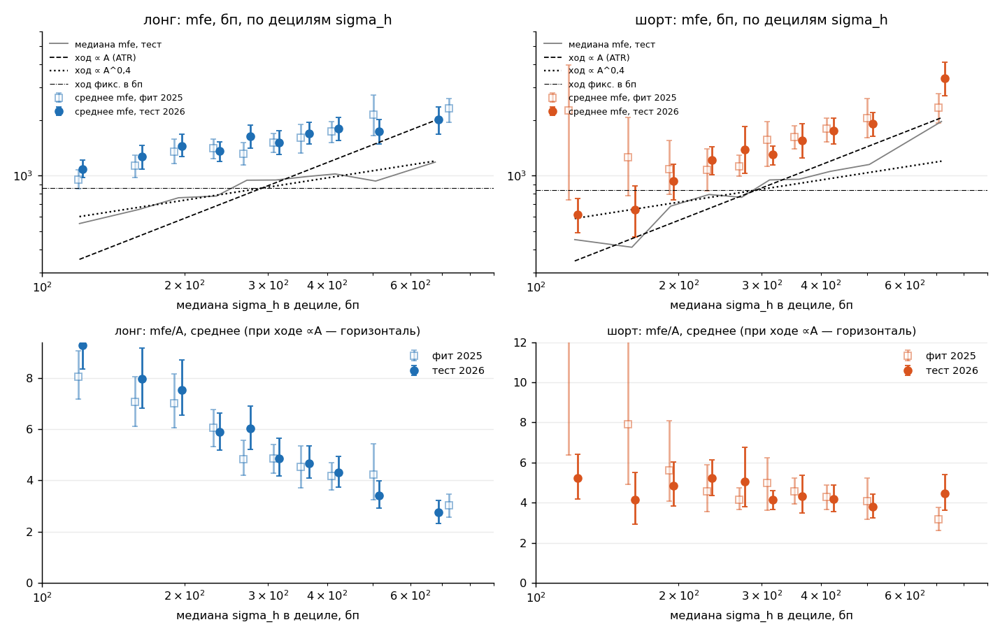
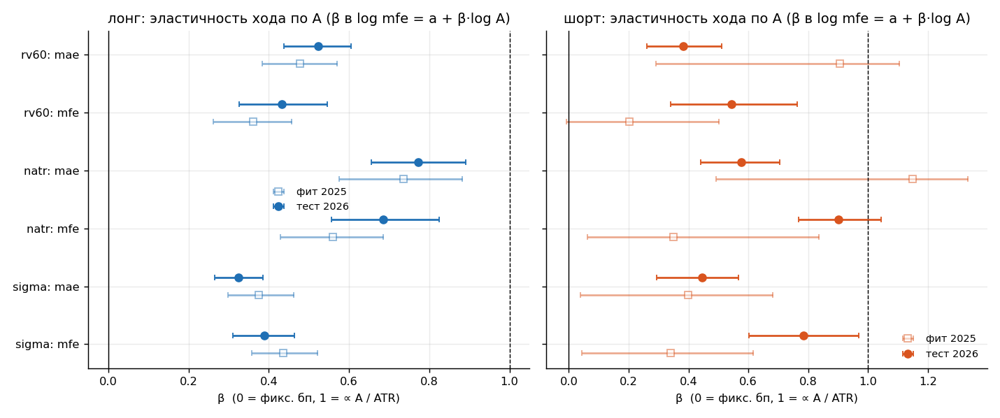
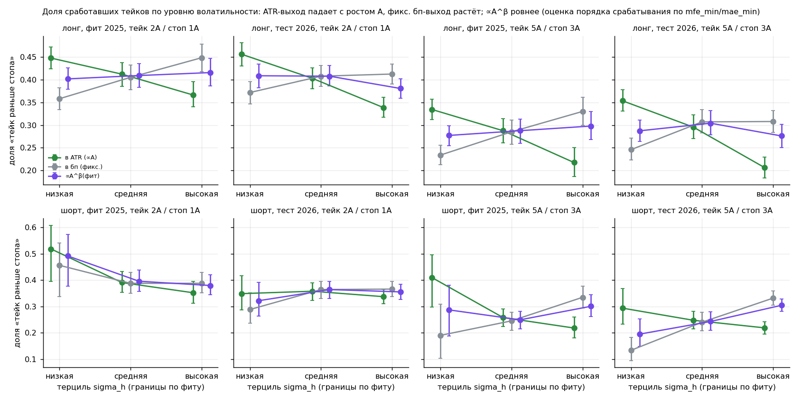
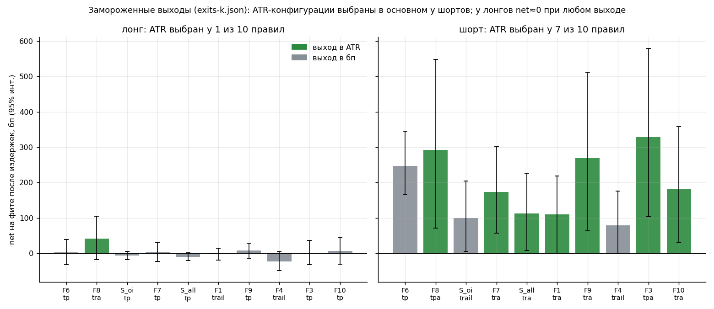

# Вопрос B: круглые числа и ATR в выходах (пампы Binance USD-M, П-34/П-35)

Аналитик B, независимый счёт на выгрузке первых срабатываний 10 замороженных правил. Фит — 2025, тест — 2026. Все доходности в файле — логарифмические, в бп (проверено: `d_*`, `pk_d_*` воспроизводятся до 1e-11 по цене входа `mfe_price·exp(−sign·mfe/1e4)`).

## Вопрос

1. Круглые числа: (а) липнут ли максимумы прибыли (`pk_d_*`) к уровням 10^k, {1,5}·10^k, {1,2,5}·10^k; (б) зависит ли исход от расстояния входа до уровня; (в) есть ли смысл ставить тейк перед круглым уровнем.
2. ATR: (а) распределения mfe/A и |mae|/A, доли «mfe ≥ k·A раньше mae ≤ −s·A»; (б) масштабируется ли ход линейно с A (терцили/децили `sigma_h_bps`, `natr_pct`, `rv60_bps`), лонг и шорт отдельно; (в) рекомендация «в bps или в ATR» с оглядкой на выбор выходов на фите (exits-k.json).

## Метод

- **Единица анализа** — дедуплицированный момент (sym, t_f, sign): 10 правил дают совпадающие моменты (исходы у дублей совпадают до 0, проверено по 8 колонкам). Фит: 13970 строк → 9071 моментов → 9042 с полным окном 1440 мин (лонг 5864 / шорт 3178; 29 моментов без окна исключены); тест: 15384 → 10400 → 10400 (лонг 6572 / шорт 3828). Сутки: 357 (фит) и 302 (тест).
- **Для пиков (блок R1)** единица — уникальный пик (sym, sign, mfe_price; первый по времени триггер), mfe>0 (пик в момент входа не пик): фит 6280 (лонг 3892 / шорт 2388), тест 7203 (4367 / 2836). Строки с несколькими правилами на один пик считаются один раз.
- **Интервалы** — бутстрэп по кластерам «сутки» (все монеты вместе), B=2000, seed=34; p-значение двустороннее по бутстрэп-распределению (минимум 0,001 из-за B=2000). Поправка Холма — на число гипотез, проверенных на тесте.
- **Знак расстояний.** Исходы знаковые (по стороне сделки). Расстояние до уровня в файле — в **логарифмических бп** до ближайшего по логарифму уровня, «+» = уровень выше цены. Я пересчитал в сторону сделки: a = sign·d (+ = уровень впереди по ходу сделки; для лонга совпадает с файлом), q = sign·pk_d — то же для пика (+ = пик «не дошёл» до уровня, − = «проскочил»).
- **Нулевая модель для пиков** (вместо аналитического равномерного ожидания): для каждого пика приращение log-цены u_j берётся у других пиков той же стороны и того же терциля sigma_h (все j≠i), прикладывается к *реальной* цене входа i, считается доля попаданий в окно ±w. Это точное ожидание «ход не знает про уровни», оно сохраняет распределение фазы цены входа. Калибровка нуля — плацебо (см. ниже): те же вычисления при сдвиге всех цен на случайную долю десятилетия (12 сдвигов, seed 34, исключены сдвиги ±0,03 от реальных уровней) дают избыток ≈0 (среднее −0,0006…+0,0006, sd 0,0011…0,0026).
- **Аналитическое ожидание для справки** (равномерный log-цена): P(|d|≤w) = n_уровней_на_десятилетие·2w/(1e4·ln10): при w=100 бп — 0,87% для 10^k, 1,74% для {1,5}·10^k, 2,61% для {1,2,5}·10^k. Нулевая модель по перемешанным ходам даёт то же с точностью до 0,05 п.п. (например {1,2,5}, w=100, лонг: 2,59%), т.е. фаза цен входа почти равномерна и результат не зависит от выбора нулевой модели.
- **Приближённый порядок «тейк раньше стопа»** (как задано): win = (mfe ≥ k·A) и (mae < s·A или mfe_min < mae_min). Нижняя граница — без ничьих (оба порога достигнуты → проигрыш), верхняя — любой mfe ≥ kA. Доля неоднозначных моментов велика при малых k,s (см. таблицу сетки) — для k,s=(1,1) результат почти ничего не говорит, для (3,2) и (5,3) терпимо. Окно — все 1440 мин (колонки mfe/mae даны за 1440; капы 360 не воспроизвести).
- **Допущения (мои, не протокола):** A_natr = natr_pct·100 (бп на минуту), A_rv = rv60_bps как есть; основная мера A — `sigma_h_bps`; терцили и децили A — по границам **фита** (границы: sigma_h 227 / 366 бп), применены и к тесту (в тесте волатильность выше: в верхнем терциле 41% моментов); окна ±w = 25/50/100 бп (заданы вопросом), «рядом с уровнем» для исходов = 300 бп (из-за малых ячеек при 100 бп: n≈26–78 в фите), диапазон до уровня для тейка 200…1500 бп, δ = 25/50/100 бп; bps-эквивалент ATR-выхода — k·A_ref и s·A_ref, где A_ref = медиана sigma_h на фите по стороне (289 бп лонг, 295 бп шорт); неизвестно, какой именно A использован в exits-k.json (unit="atr") — предполагаю sigma_h.

## Число испытаний

**Заранее зафиксировано формальных проверок: 118** (список — `prereg.csv`, составлен до счёта). Отбор на фите: гипотеза идёт на тест, если на фите p<0,05 без поправки; на тесте — поправка Холма на число прошедших (m=27). Подтверждение: тот же знак, отношение тест/фит в [1/3; 3] и p_Холм<0,05. Порог фита 0,05 без поправки пропускает ~6 случайных из 118; прошло 27, из них на блок R (78 проверок) — 8 (ожидание от случайности ≈4), на блок A (40 проверок) — 19.

| Блок | Проверок на фите | Прошло на тест | Проверено на тесте | Подтверждено |
|---|---|---|---|---|
| R1 | 36 | 3 | 3 | 0 |
| R2 | 24 | 3 | 3 | 0 |
| R3 | 18 | 2 | 2 | 0 |
| A1 | 18 | 13 | 13 | 9 |
| A2 | 8 | 6 | 6 | 3 |
| A3 | 8 | 0 | 0 | 0 |
| A4 | 6 | 0 | 0 | 0 |
| **всего** | 118 | 27 | 27 | 12 |

Сверх списка (описательно, не гипотезы и не считаются подтверждёнными): плацебо-сдвиги (калибровка), профиль пиков по корзинам 50 бп, таблицы по децилям, сетка k×s, эластичность β, проверка степенных выходов ∝A^β(фит) (6 чисел на тесте, помечена как поисковая).

## 1. Круглые числа

### 1а. Кластеризация максимумов (блок R1, 36 проверок)

Показана доля пиков с |q|≤w (обс.) против нулевой модели, избыток (обс.−нуль) в п.п. и lift=обс./нуль; тест — только для прошедших отбор.

| уровни | w, бп | сторона | пиков | обс. / нуль | lift | избыток, п.п. [95%] | p фит | тест (прошедшие) |
|---|---|---|---|---|---|---|---|---|
| dec | 25 | лонг | 3892 | 0.15% / 0.21% | 0.74 | -0.05 [-0.16; 0.08] | 0.428 | — |
| dec | 25 | шорт | 2388 | 0.17% / 0.23% | 0.74 | -0.06 [-0.19; 0.08] | 0.376 | — |
| dec | 50 | лонг | 3892 | 0.41% / 0.41% | 1.00 | -0.00 [-0.18; 0.20] | 0.966 | — |
| dec | 50 | шорт | 2388 | 0.21% / 0.45% | 0.47 | -0.24 [-0.40; -0.06] | 0.011 | -0.0013 [-0.0031; 0.0007] p_Холм=1.000; нет |
| dec | 100 | лонг | 3892 | 0.64% / 0.82% | 0.79 | -0.18 [-0.41; 0.10] | 0.183 | — |
| dec | 100 | шорт | 2388 | 0.63% / 0.90% | 0.70 | -0.27 [-0.56; 0.02] | 0.069 | — |
| half | 25 | лонг | 3892 | 0.28% / 0.42% | 0.67 | -0.14 [-0.28; 0.04] | 0.115 | — |
| half | 25 | шорт | 2388 | 0.29% / 0.41% | 0.71 | -0.12 [-0.30; 0.08] | 0.244 | — |
| half | 50 | лонг | 3892 | 0.72% / 0.83% | 0.86 | -0.11 [-0.36; 0.15] | 0.374 | — |
| half | 50 | шорт | 2388 | 0.54% / 0.82% | 0.66 | -0.28 [-0.53; 0.01] | 0.060 | — |
| half | 100 | лонг | 3892 | 1.16% / 1.66% | 0.69 | -0.51 [-0.82; -0.18] | 0.006 | -0.0025 [-0.0059; 0.0009] p_Холм=1.000; нет |
| half | 100 | шорт | 2388 | 1.38% / 1.66% | 0.83 | -0.28 [-0.68; 0.14] | 0.198 | — |
| 125 | 25 | лонг | 3892 | 0.51% / 0.65% | 0.79 | -0.14 [-0.36; 0.09] | 0.229 | — |
| 125 | 25 | шорт | 2388 | 0.50% / 0.64% | 0.78 | -0.14 [-0.39; 0.14] | 0.288 | — |
| 125 | 50 | лонг | 3892 | 1.13% / 1.29% | 0.87 | -0.16 [-0.51; 0.20] | 0.325 | — |
| 125 | 50 | шорт | 2388 | 0.92% / 1.27% | 0.72 | -0.35 [-0.68; 0.04] | 0.073 | — |
| 125 | 100 | лонг | 3892 | 2.11% / 2.59% | 0.81 | -0.48 [-0.92; -0.03] | 0.038 | -0.0038 [-0.0082; 0.0004] p_Холм=1.000; нет |
| 125 | 100 | шорт | 2388 | 2.18% / 2.55% | 0.85 | -0.37 [-0.88; 0.16] | 0.163 | — |

Асимметрия «пик не дошёл до уровня» минус «проскочил» (барьер) — 18 проверок: ни одна не прошла отбор на фите (p от 0,12 до 0,98); в диапазоне |q|≤100 бп разность долей лежит в пределах ±0,5 п.п. (таблица `t_all_hypotheses.csv`, строки R1:*:barrier).

Плацебо (калибровка нулевой модели): избыток при реальных уровнях и при сдвинутых псевдо-уровнях, оба в п.п. (суммарно по сторонам считать нельзя — столбцы по сторонам).

| выборка | уровни | сторона | w | реальные уровни, п.п. | плацебо-уровни (12), п.п. среднее ± sd | z реал. vs плацебо |
|---|---|---|---|---|---|---|
| фит | half | лонг | 50 | -0.11 (lift 0.86) | 0.05 ± 0.11 (lift 0.85…1.25) | -1.5 |
| фит | half | лонг | 100 | -0.51 (lift 0.69) | -0.01 ± 0.15 (lift 0.86…1.15) | -3.3 |
| фит | half | шорт | 50 | -0.28 (lift 0.66) | -0.03 ± 0.13 (lift 0.70…1.18) | -1.9 |
| фит | half | шорт | 100 | -0.28 (lift 0.83) | 0.02 ± 0.20 (lift 0.80…1.21) | -1.5 |
| фит | 125 | лонг | 50 | -0.16 (lift 0.87) | 0.06 ± 0.17 (lift 0.80…1.25) | -1.3 |
| фит | 125 | лонг | 100 | -0.48 (lift 0.81) | 0.01 ± 0.21 (lift 0.88…1.19) | -2.3 |
| фит | 125 | шорт | 50 | -0.35 (lift 0.72) | 0.02 ± 0.19 (lift 0.78…1.23) | -2.0 |
| фит | 125 | шорт | 100 | -0.37 (lift 0.85) | 0.03 ± 0.22 (lift 0.88…1.14) | -1.8 |
| тест | half | лонг | 50 | -0.30 (lift 0.66) | 0.01 ± 0.11 (lift 0.79…1.23) | -2.7 |
| тест | half | лонг | 100 | -0.25 (lift 0.86) | -0.03 ± 0.14 (lift 0.86…1.16) | -1.5 |
| тест | half | шорт | 50 | 0.01 (lift 1.01) | -0.01 ± 0.15 (lift 0.73…1.38) | 0.1 |
| тест | half | шорт | 100 | 0.03 (lift 1.02) | 0.05 ± 0.20 (lift 0.84…1.22) | -0.1 |
| тест | 125 | лонг | 50 | -0.25 (lift 0.81) | -0.00 ± 0.16 (lift 0.77…1.16) | -1.6 |
| тест | 125 | лонг | 100 | -0.38 (lift 0.86) | -0.00 ± 0.21 (lift 0.85…1.12) | -1.8 |
| тест | 125 | шорт | 50 | -0.01 (lift 0.99) | -0.06 ± 0.17 (lift 0.82…1.26) | 0.3 |
| тест | 125 | шорт | 100 | -0.12 (lift 0.96) | -0.02 ± 0.26 (lift 0.84…1.20) | -0.4 |

Вывод 1а: притяжения к круглым уровням нет — у лонга пики около {1,2,5}·10^k, наоборот, **чуть реже** случайного (lift 0,81…0,87 в фите и 0,81…0,86 в тесте; плацебо-сдвиги дают 1,00±0,1), у шорта в фите 0,72…0,85, в тесте 0,96…1,02. Формально эффект не подтверждён (3 прошедших отбор проверки — все с отрицательным знаком — на тесте p_Холм=1,0). Объединение лет у лонга даёт z≈−3 к плацебо (апостериорно, 12 комбинаций, как гипотеза на следующий круг, не как вывод); абсолютная величина — 0,4–0,5 п.п. пиков.

Профиль пиков по корзинам 50 бп (уровни {1,2,5}·10^k): `fig1_peak_profile.png`, `t_peak_profile.csv`. Ни в одной из 20 корзин в обоих годах не видно устойчивого избытка у нуля, пик «не дошёл / проскочил» симметричен.

### 1б. Исход в зависимости от расстояния входа до уровня (блок R2, 24 проверки)

Контраст: среднее исхода при входе в ≤300 бп от уровня (впереди по ходу — «ahead», позади — «behind») минус среднее при |a|>300. Ячейки <30 не проверялись (при 100 бп в фите: 125 — n≈78 лонг/39 шорт; half — 52/26; dec — 26/13: поэтому окно 300 бп — моё допущение). Результаты по 100-бп корзинам — `t_outcome_by_entry_distance.csv` и `fig2_round_outcomes.png`.

| уровни | сторона | положение | исход | n рядом / далеко | фит: контраст [95%] | тест (прошедшие) |
|---|---|---|---|---|---|---|
| dec | лонг | ahead | gross_360, бп | 74/5734 | 146.5 [-144.4; 432.8] p=0.335 | — |
| dec | лонг | ahead | доля mfe≥1A | 74/5734 | 0.111 [0.027; 0.181] p=0.016 | 0.011 [-0.083; 0.098] p_Холм=1.000; нет |
| dec | лонг | behind | gross_360, бп | 56/5734 | -143.9 [-516.1; 232.4] p=0.470 | — |
| dec | лонг | behind | доля mfe≥1A | 56/5734 | 0.050 [-0.059; 0.148] p=0.362 | — |
| dec | шорт | ahead | gross_360, бп | 46/3092 | 286.2 [-308.1; 757.1] p=0.330 | — |
| dec | шорт | ahead | доля mfe≥1A | 46/3092 | 0.063 [-0.069; 0.182] p=0.373 | — |
| dec | шорт | behind | gross_360, бп | 37/3092 | -145.8 [-580.0; 200.2] p=0.372 | — |
| dec | шорт | behind | доля mfe≥1A | 37/3092 | 0.053 [-0.108; 0.155] p=0.440 | — |
| half | лонг | ahead | gross_360, бп | 146/5578 | 138.8 [-115.7; 439.3] p=0.328 | — |
| half | лонг | ahead | доля mfe≥1A | 146/5578 | 0.090 [0.031; 0.144] p=0.007 | 0.025 [-0.043; 0.085] p_Холм=1.000; нет |
| half | лонг | behind | gross_360, бп | 139/5578 | -67.7 [-370.0; 281.5] p=0.679 | — |
| half | лонг | behind | доля mfe≥1A | 139/5578 | 0.024 [-0.051; 0.094] p=0.518 | — |
| half | шорт | ahead | gross_360, бп | 81/3024 | 209.8 [-322.7; 699.3] p=0.498 | — |
| half | шорт | ahead | доля mfe≥1A | 81/3024 | 0.067 [-0.046; 0.170] p=0.274 | — |
| half | шорт | behind | gross_360, бп | 70/3024 | 33.1 [-350.3; 360.9] p=0.980 | — |
| half | шорт | behind | доля mfe≥1A | 70/3024 | 0.016 [-0.091; 0.101] p=0.751 | — |
| 125 | лонг | ahead | gross_360, бп | 247/5400 | -4.2 [-213.6; 217.4] p=0.982 | — |
| 125 | лонг | ahead | доля mfe≥1A | 247/5400 | 0.053 [0.004; 0.101] p=0.037 | 0.045 [-0.011; 0.095] p_Холм=1.000; нет |
| 125 | лонг | behind | gross_360, бп | 214/5400 | -38.0 [-252.7; 192.1] p=0.735 | — |
| 125 | лонг | behind | доля mfe≥1A | 214/5400 | 0.042 [-0.018; 0.096] p=0.174 | — |
| 125 | шорт | ahead | gross_360, бп | 127/2938 | 214.0 [-246.1; 658.8] p=0.469 | — |
| 125 | шорт | ahead | доля mfe≥1A | 127/2938 | 0.051 [-0.039; 0.137] p=0.296 | — |
| 125 | шорт | behind | gross_360, бп | 110/2938 | 79.8 [-196.4; 308.9] p=0.638 | — |
| 125 | шорт | behind | доля mfe≥1A | 110/2938 | 0.016 [-0.070; 0.086] p=0.684 | — |

Вывод 1б: на gross_360 (в среднем −150…−360 бп, SD в тысячи бп) и на mfe/mae зависимости от расстояния до уровня не видно (все 12 контрастов gross_360 в фите: p≥0,33). Доля mfe≥1A при входе рядом с уровнем выше на 1,6–11 п.п. (чаще 4–9; у лонга впереди по ходу: p=0,016/0,007/0,037 в фите, dec/half/125), но на тесте эффект вдвое-десятикратно меньше и не значим (+1,1…+4,5 п.п., p_Холм=1,0) — не подтверждено.

### 1в. Тейк перед круглым уровнем (блок R3, 18 проверок)

Для каждого входа берётся первый уровень впереди по ходу сделки на расстоянии D∈[200;1500] бп; сравниваются два тейка: на D−δ и на D (без стопа, остаток закрывается по gross_1440: V(g)=g если mfe≥g, иначе gross_1440). Статистика — реальная разность V(D−δ)−V(D) минус её ожидание при случайном расстоянии до уровня (нулевая модель: D_j других входов той же стороны и терциля). «+» = перед уровнем выгоднее, чем на уровне, больше, чем по случайности.

| уровни | δ, бп | сторона | n | доля пиков в [D−δ;D): обс. / нуль | избыток, бп на сделку [95%] | тест (прошедшие) |
|---|---|---|---|---|---|---|
| dec | 25 | лонг | 288 | 1.0% / 1.0% | 0.1 [-17.6; 31.4] p=0.913 | — |
| dec | 25 | шорт | 199 | 1.0% / 1.0% | -6.7 [-17.2; 7.2] p=0.270 | — |
| dec | 50 | лонг | 288 | 3.1% / 2.0% | 23.6 [-22.9; 90.5] p=0.430 | — |
| dec | 50 | шорт | 199 | 1.0% / 1.9% | -19.8 [-34.7; -3.4] p=0.026 | -10.0 [-20.6; 3.0] p_Холм=1.000; нет |
| dec | 100 | лонг | 288 | 4.9% / 4.0% | 17.1 [-39.7; 89.3] p=0.657 | — |
| dec | 100 | шорт | 199 | 3.5% / 3.5% | 24.2 [-29.8; 83.6] p=0.543 | — |
| half | 25 | лонг | 635 | 0.8% / 1.0% | -6.2 [-17.3; 9.9] p=0.375 | — |
| half | 25 | шорт | 352 | 0.6% / 0.9% | -7.9 [-14.4; 0.4] p=0.065 | — |
| half | 50 | лонг | 635 | 2.2% / 2.1% | -0.8 [-26.1; 31.1] p=0.870 | — |
| half | 50 | шорт | 352 | 0.9% / 1.9% | -18.9 [-30.0; -7.1] p=0.004 | 19.0 [-11.0; 56.9] p_Холм=1.000; нет |
| half | 100 | лонг | 635 | 3.3% / 4.1% | -16.6 [-45.9; 19.6] p=0.326 | — |
| half | 100 | шорт | 352 | 3.7% / 3.9% | 6.0 [-26.7; 39.2] p=0.830 | — |
| 125 | 25 | лонг | 984 | 0.9% / 1.0% | -2.3 [-13.7; 12.5] p=0.631 | — |
| 125 | 25 | шорт | 534 | 0.6% / 0.9% | -7.9 [-14.8; 0.2] p=0.055 | — |
| 125 | 50 | лонг | 984 | 1.9% / 2.0% | -2.0 [-22.8; 23.5] p=0.773 | — |
| 125 | 50 | шорт | 534 | 1.3% / 1.9% | -12.0 [-27.9; 9.2] p=0.219 | — |
| 125 | 100 | лонг | 984 | 3.4% / 4.0% | -10.5 [-36.5; 18.7] p=0.450 | — |
| 125 | 100 | шорт | 534 | 3.9% / 3.8% | 5.5 [-19.6; 27.9] p=0.700 | — |

Вывод 1в: данные не дают основания ставить тейк перед круглым уровнем. Доля пиков, остановившихся в δ перед уровнем, не выше случайной (например δ=100, {1,2,5}: 3,4% против 4,0% у лонга, 3,9% против 3,8% у шорта), избыток на сделку статистически неотличим от 0 (оценки от −20 до +24 бп). Две проверки, прошедшие отбор на фите (шорт, δ=50, dec и half: −19…−20 бп), на тесте сменили знак/стали незначимы (−10 [−21;+3]; +19 [−11;+57]). Остаётся рабочим правилом: круглые числа можно игнорировать при выборе выходов.

## 2. ATR

### 2а. Распределения mfe/A, |mae|/A и доли «k·A до −s·A»

Перцентили (A = sigma_h_bps; для natr_pct·100 и rv60_bps — `t_percentiles_excursion_over_A.csv`).

| выборка | сторона | величина | n | p10 | p25 | p50 | p75 | p90 | p95 |
|---|---|---|---|---|---|---|---|---|---|
| фит | лонг | mfe/A | 5864 | 0.22 | 1.04 | 3.01 | 6.58 | 12.87 | 18.60 |
| фит | лонг | |mae|/A | 5864 | 0.72 | 1.96 | 3.97 | 6.88 | 10.98 | 14.12 |
| фит | шорт | mfe/A | 3178 | 0.21 | 1.22 | 3.11 | 6.39 | 11.85 | 19.29 |
| фит | шорт | |mae|/A | 3178 | 0.33 | 1.18 | 3.15 | 8.29 | 15.78 | 21.91 |
| тест | лонг | mfe/A | 6572 | 0.26 | 1.02 | 2.90 | 6.65 | 13.75 | 20.71 |
| тест | лонг | |mae|/A | 6572 | 0.64 | 1.74 | 3.83 | 7.13 | 11.84 | 14.93 |
| тест | шорт | mfe/A | 3828 | 0.22 | 1.00 | 2.82 | 5.70 | 9.90 | 13.97 |
| тест | шорт | |mae|/A | 3828 | 0.35 | 1.15 | 2.73 | 5.87 | 10.30 | 13.52 |

Медианный ход — около 3A вперёд и 3–4A против за 1440 мин (хвост p95 — 14–22 A). Распределения тяжёлые, поэтому средние mfe/A у шорта в нижнем дециле фита (20,2) — выброс (интервал [6;36]), медиана там 6,5.

Доля «mfe ≥ k·A раньше mae ≤ −s·A» (A=sigma_h): приближённая (нижняя–верхняя граница); % моментов.

**Фит, лонг**

| стоп \ тейк | 1A | 2A | 3A | 4A | 5A |
|---|---|---|---|---|---|
| −1A | 53% (13–76) | 41% (12–61) | 32% (11–50) | 26% (10–41) | 21% (9–33) |
| −2A | 60% (23–76) | 47% (22–61) | 38% (19–50) | 31% (17–41) | 25% (15–33) |
| −3A | 66% (34–76) | 52% (30–61) | 42% (26–50) | 35% (23–41) | 28% (19–33) |

**Фит, шорт**

| стоп \ тейк | 1A | 2A | 3A | 4A | 5A |
|---|---|---|---|---|---|
| −1A | 53% (21–79) | 42% (19–64) | 34% (17–51) | 28% (14–42) | 23% (12–34) |
| −2A | 63% (34–79) | 51% (30–64) | 41% (25–51) | 33% (21–42) | 27% (17–34) |
| −3A | 69% (44–79) | 56% (37–64) | 45% (31–51) | 36% (25–42) | 30% (20–34) |

**Тест, лонг**

| стоп \ тейк | 1A | 2A | 3A | 4A | 5A |
|---|---|---|---|---|---|
| −1A | 52% (14–75) | 39% (13–60) | 31% (12–49) | 25% (10–40) | 20% (9–33) |
| −2A | 60% (26–75) | 47% (23–60) | 37% (20–49) | 30% (17–40) | 25% (15–33) |
| −3A | 65% (36–75) | 51% (31–60) | 41% (26–49) | 34% (22–40) | 28% (19–33) |

**Тест, шорт**

| стоп \ тейк | 1A | 2A | 3A | 4A | 5A |
|---|---|---|---|---|---|
| −1A | 46% (20–75) | 35% (19–60) | 27% (16–48) | 20% (14–37) | 16% (11–29) |
| −2A | 56% (35–75) | 44% (31–60) | 35% (26–48) | 27% (21–37) | 21% (17–29) |
| −3A | 64% (46–75) | 51% (39–60) | 40% (33–48) | 31% (26–37) | 25% (21–29) |

Полная сетка с интервалами по суткам, а также для natr_pct и rv60_bps — `t_winrate_grid.csv`. Границы расходятся тем сильнее, чем меньше пороги (при 1A/1A доля неоднозначных 63%): для малых k,s порядок по mfe_min/mae_min — слабая оценка.

### 2б. Масштабируется ли ход с A?

Блок A1 (18 проверок): контраст среднего исхода/A между верхним и нижним терцилем A. При ходе ∝A контраст = 0; при фиксированном в бп ходе mfe/A падает с ростом A.

| мера A | величина | сторона | терцили 1/2/3 (фит) | верх−низ [95%] фит | тест (прошедшие) |
|---|---|---|---|---|---|
| sigma | mfe/A | лонг | 7.21 / 5.16 / 3.79 | -3.42 [-4.08; -2.74] p=0.001 | -4.56 [-5.27; -3.89] p_Холм=0.027; ДА |
| sigma | mfe/A | шорт | 10.40 / 4.72 / 3.84 | -6.56 [-15.41; -1.11] p=0.001 | -0.69 [-1.68; 0.17] p_Холм=1.000; нет |
| sigma | |mae|/A | лонг | 6.95 / 4.99 / 3.84 | -3.11 [-3.61; -2.57] p=0.001 | -3.73 [-4.19; -3.25] p_Холм=0.027; ДА |
| sigma | |mae|/A | шорт | 7.56 / 6.03 / 4.58 | -2.98 [-5.72; -0.62] p=0.009 | -2.94 [-3.93; -2.10] p_Холм=0.027; ДА |
| sigma | gross_360/A | лонг | -1.05 / -0.45 / -0.38 | 0.67 [0.25; 1.12] p=0.005 | 0.90 [0.45; 1.33] p_Холм=0.027; ДА |
| sigma | gross_360/A | шорт | -0.81 / -1.49 / -0.89 | -0.08 [-2.51; 2.23] p=0.928 | — |
| natr | mfe/A | лонг | 12.07 / 11.34 / 9.39 | -2.68 [-3.65; -1.72] p=0.001 | -2.02 [-2.99; -0.99] p_Холм=0.027; ДА |
| natr | mfe/A | шорт | 11.73 / 12.41 / 8.66 | -3.07 [-6.18; -0.66] p=0.011 | -0.45 [-1.75; 0.89] p_Холм=1.000; нет |
| natr | |mae|/A | лонг | 11.74 / 10.26 / 9.54 | -2.19 [-3.79; -1.07] p=0.001 | -1.04 [-1.99; -0.17] p_Холм=0.225; нет |
| natr | |mae|/A | шорт | 10.26 / 9.52 / 9.25 | -1.01 [-2.78; 0.14] p=0.089 | — |
| natr | gross_360/A | лонг | -0.93 / -0.56 / -1.33 | -0.40 [-1.07; 0.28] p=0.252 | — |
| natr | gross_360/A | шорт | 0.90 / 1.29 / -1.89 | -2.79 [-5.68; 0.60] p=0.159 | — |
| rv60 | mfe/A | лонг | 2.72 / 2.30 / 1.61 | -1.12 [-1.34; -0.90] p=0.001 | -0.93 [-1.13; -0.71] p_Холм=0.027; ДА |
| rv60 | mfe/A | шорт | 3.08 / 2.30 / 1.44 | -1.64 [-2.63; -0.89] p=0.001 | -0.83 [-1.20; -0.43] p_Холм=0.027; ДА |
| rv60 | |mae|/A | лонг | 2.56 / 2.13 / 1.66 | -0.90 [-1.22; -0.67] p=0.001 | -0.81 [-1.04; -0.61] p_Холм=0.027; ДА |
| rv60 | |mae|/A | шорт | 2.42 / 1.73 / 1.51 | -0.90 [-1.27; -0.60] p=0.001 | -1.06 [-1.29; -0.81] p_Холм=0.027; ДА |
| rv60 | gross_360/A | лонг | -0.16 / -0.15 / -0.26 | -0.10 [-0.26; 0.06] p=0.215 | — |
| rv60 | gross_360/A | шорт | 0.39 / 0.16 / -0.26 | -0.65 [-1.27; -0.00] p=0.050 | 0.00 [-0.26; 0.27] p_Холм=1.000; нет |

Эластичность хода по A (β в log(mfe)=a+β·log A на ненулевых, бутстрэп по суткам; β=0 — фиксированные бп, β=1 — ∝A). `fig6_elasticity.png`, `t_elasticity_beta.csv`.

| сторона | мера A | величина | β фит [95%] | β тест [95%] |
|---|---|---|---|---|
| лонг | sigma | mfe | 0.44 [0.36; 0.52] | 0.39 [0.31; 0.46] |
| лонг | sigma | mae | 0.38 [0.30; 0.46] | 0.33 [0.26; 0.39] |
| лонг | natr | mfe | 0.56 [0.43; 0.68] | 0.69 [0.56; 0.83] |
| лонг | natr | mae | 0.74 [0.58; 0.88] | 0.77 [0.66; 0.89] |
| лонг | rv60 | mfe | 0.36 [0.26; 0.46] | 0.43 [0.33; 0.55] |
| лонг | rv60 | mae | 0.48 [0.38; 0.57] | 0.52 [0.44; 0.61] |
| шорт | sigma | mfe | 0.34 [0.04; 0.62] | 0.78 [0.60; 0.97] |
| шорт | sigma | mae | 0.40 [0.04; 0.68] | 0.44 [0.29; 0.57] |
| шорт | natr | mfe | 0.35 [0.06; 0.83] | 0.90 [0.77; 1.04] |
| шорт | natr | mae | 1.15 [0.49; 1.33] | 0.58 [0.44; 0.70] |
| шорт | rv60 | mfe | 0.20 [-0.01; 0.50] | 0.54 [0.34; 0.76] |
| шорт | rv60 | mae | 0.91 [0.29; 1.10] | 0.38 [0.26; 0.51] |

Децили sigma_h (6-кратный рост A: 120→720 бп): среднее mfe лонга растёт лишь с 956 до 2307 бп (фит; тест 1087→2005), т.е. в 2,4 раза; mfe/A падает с 8,05 до 3,02 (тест 9,28→2,76). При чистой пропорциональности mfe выросло бы в 6 раз. `fig3_scaling_deciles.png`, `t_deciles_by_A.csv`.

Блок A2 (8 проверок): доля «k·A до −s·A» — верхний минус нижний терциль sigma_h.

| пара | сторона | низ → верх (фит) | верх−низ [95%] фит | тест (прошедшие; доли) |
|---|---|---|---|---|
| 1A/−1A | лонг | 54.6% → 51.4% | -3.2 [-7.0; 0.5] п.п. p=0.094 | — |
| 1A/−1A | шорт | 60.8% → 47.8% | -13.0 [-23.4; 1.3] п.п. p=0.098 | — |
| 2A/−1A | лонг | 44.8% → 36.7% | -8.1 [-11.7; -4.4] п.п. p=0.001 | -0.118 [-0.151; -0.085] p_Холм=0.027; ДА |
| 2A/−1A | шорт | 51.9% → 35.2% | -16.7 [-27.3; -2.6] п.п. p=0.011 | -0.011 [-0.081; 0.047] p_Холм=1.000; нет |
| 3A/−2A | лонг | 42.5% → 32.7% | -9.8 [-13.5; -5.7] п.п. p=0.001 | -0.123 [-0.156; -0.089] p_Холм=0.027; ДА |
| 3A/−2A | шорт | 51.1% → 33.3% | -17.8 [-27.1; -5.2] п.п. p=0.003 | -0.006 [-0.082; 0.053] p_Холм=1.000; нет |
| 5A/−3A | лонг | 33.5% → 21.8% | -11.7 [-15.5; -7.7] п.п. p=0.001 | -0.147 [-0.180; -0.115] p_Холм=0.027; ДА |
| 5A/−3A | шорт | 41.0% → 21.8% | -19.2 [-28.5; -6.4] п.п. p=0.002 | -0.075 [-0.153; -0.011] p_Холм=0.252; нет |

### 2в. «В bps или в ATR»

Блок A3 (8 проверок): «ATR-выход ровнее по терцилям, чем равный в среднем bps-выход» — |C_bps|−|C_atr| >0, где C — верх−низ по доле срабатываний. Блок A4 (6 проверок): приближённый PnL на сделку ATR-выход минус bps-выход (брутто, одинаковые издержки сокращаются). Ни одна из 14 проверок не прошла отбор на фите (p≥0,098), на тесте формально не проверялись.

| блок | пара | сторона | оценка [95%] фит | детали |
|---|---|---|---|---|
| A3 | 1A/1A | лонг | 0.016 [-0.053; 0.078] p=0.651 | C_atr=-0.032, C_bps=+0.048 |
| A3 | 1A/1A | шорт | -0.001 [-0.049; 0.054] p=0.990 | C_atr=-0.130, C_bps=-0.129 |
| A3 | 2A/1A | лонг | 0.009 [-0.057; 0.080] p=0.778 | C_atr=-0.081, C_bps=+0.090 |
| A3 | 2A/1A | шорт | -0.098 [-0.135; 0.028] p=0.098 | C_atr=-0.167, C_bps=-0.068 |
| A3 | 3A/2A | лонг | -0.021 [-0.095; 0.050] p=0.562 | C_atr=-0.098, C_bps=+0.076 |
| A3 | 3A/2A | шорт | -0.152 [-0.219; 0.099] p=0.269 | C_atr=-0.178, C_bps=+0.026 |
| A3 | 5A/3A | лонг | -0.021 [-0.087; 0.048] p=0.554 | C_atr=-0.117, C_bps=+0.096 |
| A3 | 5A/3A | шорт | -0.047 [-0.246; 0.183] p=0.770 | C_atr=-0.192, C_bps=+0.145 |
| A4 | 2A/1A | лонг | 5.4 [-6.4; 18.2] p=0.399 | PnL атр 69 / бп 63 |
| A4 | 2A/1A | шорт | -7.7 [-33.2; 21.8] p=0.636 | PnL атр 72 / бп 80 |
| A4 | 3A/2A | лонг | 2.0 [-19.7; 23.2] p=0.825 | PnL атр -3 / бп -5 |
| A4 | 3A/2A | шорт | 1.5 [-37.9; 46.4] p=0.916 | PnL атр 73 / бп 71 |
| A4 | 5A/3A | лонг | -11.2 [-46.0; 21.8] p=0.537 | PnL атр -74 / бп -63 |
| A4 | 5A/3A | шорт | 62.6 [-38.7; 187.4] p=0.294 | PnL атр 113 / бп 50 |

Хвост описательный (не прошедшее отбор; шесть пар на тесте, чтобы показать, куда смотрит выборка 2026): ATR−bps по приближённому PnL — лонг: −11 [−24;+3], −9 [−30;+12], −12 [−41;+17] бп; шорт: +17 [+2;+34], +41 [+11;+70], +84 [+39;+130] бп (для 2A/1A, 3A/2A, 5A/3A). В фите у шорта (5A/3A) тот же знак (+63 [−39;+187]), но шире и не значим; у (2A/1A) знак обратный (−8).

**Поисковая проверка степенных выходов** (не подтверждающая; β берётся с фита как среднее β_mfe и β_mae по sigma_h: 0,41 лонг, 0,37 шорт; пороги k·A_ref·(A/A_ref)^β):

| выборка | сторона | пара | C (ATR) [95%] | C (bps) [95%] | C (∝A^β) [95%] | PnL ATR / bps / A^β, бп |
|---|---|---|---|---|---|---|
| фит | лонг | 2A/1A | -0.08 [-0.12; -0.04] | 0.09 [0.05; 0.13] | 0.01 [-0.02; 0.05] | 69 / 63 / 69 |
| фит | лонг | 3A/2A | -0.10 [-0.14; -0.06] | 0.08 [0.04; 0.12] | 0.01 [-0.03; 0.05] | -3 / -5 / 0 |
| фит | лонг | 5A/3A | -0.12 [-0.15; -0.08] | 0.10 [0.06; 0.13] | 0.02 [-0.01; 0.06] | -74 / -63 / -56 |
| фит | шорт | 2A/1A | -0.17 [-0.27; -0.03] | -0.07 [-0.17; 0.06] | -0.11 [-0.21; 0.01] | 72 / 80 / 78 |
| фит | шорт | 3A/2A | -0.18 [-0.27; -0.05] | 0.03 [-0.09; 0.16] | -0.05 [-0.16; 0.08] | 73 / 71 / 79 |
| фит | шорт | 5A/3A | -0.19 [-0.28; -0.06] | 0.14 [-0.00; 0.26] | 0.01 [-0.11; 0.13] | 113 / 50 / 90 |
| тест | лонг | 2A/1A | -0.12 [-0.15; -0.08] | 0.04 [0.01; 0.07] | -0.03 [-0.06; 0.00] | 50 / 61 / 62 |
| тест | лонг | 3A/2A | -0.12 [-0.16; -0.09] | 0.05 [0.02; 0.08] | -0.01 [-0.05; 0.02] | -14 / -5 / -4 |
| тест | лонг | 5A/3A | -0.15 [-0.18; -0.11] | 0.06 [0.03; 0.10] | -0.01 [-0.04; 0.02] | -57 / -44 / -43 |
| тест | шорт | 2A/1A | -0.01 [-0.08; 0.05] | 0.08 [0.01; 0.13] | 0.03 [-0.04; 0.09] | 42 / 24 / 30 |
| тест | шорт | 3A/2A | -0.01 [-0.08; 0.05] | 0.12 [0.05; 0.18] | 0.06 [-0.01; 0.12] | 48 / 7 / 9 |
| тест | шорт | 5A/3A | -0.07 [-0.15; -0.01] | 0.20 [0.15; 0.24] | 0.11 [0.05; 0.16] | 114 / 30 / 60 |

C — «верх−низ терциль» доли срабатываний; ближе к 0 = ровнее. У лонга степенной выход ровный и вне выборки (тест: −0,03…−0,01), ATR перекорректирует (−0,12…−0,15), bps недокорректирует (+0,04…+0,06). У шорта 2025-го β_mfe=0,34 [0,04;0,62], а 2026-го 0,78 [0,60;0,97]: вне выборки ровнее оказывается ATR (тест: C_atr −0,01…−0,08), поэтому β для шорта нестабилен между годами.

Выбор выходов на фите (exits-k.json, 20 позиций = 10 правил × 2 стороны): **ATR выбран у 7 из 10 шортов и 1 из 10 лонгов** (лонг: F8 tra 2A/1A; шорт: F8 tpa 5A/3A, F3 tpa 5A/3A, F7/S_all/F1/F9/F10 tra; в bps у шортов F6 tp 500, S_oi trail 300/100, F4 trail 300/500). У лонгов net на фите −23…+42 бп, CI всех десяти включают 0, т.е. выбор единицы выхода там не на чем проверять; у шортов net +79…+328 бп, CI>0 у 9 из 10 (F4 шорт: нижняя −1,4). Судя по номерам cfg (оценка по наблюдаемым номерам, не по протоколу), конфигурации в bps занимают примерно 0…83, в ATR — 84…138: ATR-вариантов меньше, а выиграли они 8 из 20 мест, т.е. отбор ATR не штрафовал.

**Рекомендация.** (1) Ход **не** масштабируется линейно с A: эластичность β по sigma_h для лонга 0,44 [0,36;0,52] (фит) и 0,39 [0,31;0,46] (тест) по mfe, 0,38/0,33 по |mae|; для шорта |mae| 0,40/0,44, mfe 0,34/0,78. Поэтому «выходы в единицах ATR оправданы линейным масштабом» неверно: чистый ATR слишком растягивает выходы в волатильных монетах (доля тейк-до-стопа 2A/1A у лонга падает с 45% до 37% по терцилям фита и с 46% до 34% на тесте) и слишком сжимает в тихих; чистые бп — зеркально (35,8% → 44,8% на фите). (2) **Шорт:** оставить ATR (как выбрано на фите): направление поддерживается тестом (ATR−bps, 5A/3A: +84 бп/сделку [+39;+130], приближённая симуляция), но подтверждения по протоколу нет (A3/A4 на фите не прошли отбор) и β шорта нестабилен между годами. Тейк/трейл крупными кратными 3–5A, где ATR-форма даёт больше всего. (3) **Лонг:** net ≈0 при любом выходе, единица измерения не решает ничего; если выход всё же нужен, нейтральный вариант — A^β с β≈0,4 (он ровный в обеих выборках), это измеренное, а не назначенное число, но принимать его в протокол — решение Судьи. (4) Круглые числа в выходах не учитывать.

## Что подтвердилось на тесте (12 из 27 прошедших, Холм по m=27)

| проверка | фит [95%] | тест [95%] | p тест | p Холм |
|---|---|---|---|---|
| A1:natr:mfe:long | -2.68 [-3.65; -1.72] | -2.02 [-2.99; -0.99] | 0.001 | 0.027 |
| A1:rv60:mae:long | -0.90 [-1.22; -0.67] | -0.81 [-1.04; -0.61] | 0.001 | 0.027 |
| A1:rv60:mae:short | -0.90 [-1.27; -0.60] | -1.06 [-1.29; -0.81] | 0.001 | 0.027 |
| A1:rv60:mfe:long | -1.12 [-1.34; -0.90] | -0.93 [-1.13; -0.71] | 0.001 | 0.027 |
| A1:rv60:mfe:short | -1.64 [-2.63; -0.89] | -0.83 [-1.20; -0.43] | 0.001 | 0.027 |
| A1:sigma:g360:long | 0.67 [0.25; 1.12] | 0.90 [0.45; 1.33] | 0.001 | 0.027 |
| A1:sigma:mae:long | -3.11 [-3.61; -2.57] | -3.73 [-4.19; -3.25] | 0.001 | 0.027 |
| A1:sigma:mae:short | -2.98 [-5.72; -0.62] | -2.94 [-3.93; -2.10] | 0.001 | 0.027 |
| A1:sigma:mfe:long | -3.42 [-4.08; -2.74] | -4.56 [-5.27; -3.89] | 0.001 | 0.027 |
| A2:2-1:long | -0.08 [-0.12; -0.04] | -0.12 [-0.15; -0.08] | 0.001 | 0.027 |
| A2:3-2:long | -0.10 [-0.14; -0.06] | -0.12 [-0.16; -0.09] | 0.001 | 0.027 |
| A2:5-3:long | -0.12 [-0.15; -0.08] | -0.15 [-0.18; -0.11] | 0.001 | 0.027 |

Все подтверждённые — блок ATR, и все говорят одно: «ход не пропорционален A» (контраст mfe/A и |mae|/A между терцилями отрицателен; gross_360/A у лонга положителен — убыток в бп растёт медленнее A; доля тейк-до-стопа у ATR-выхода падает с ростом A у лонга). Что именно **не** подтвердилось — ниже.

## Что не подтвердилось

- **Все круглые числа** (блок R): 0 подтверждений из 8 прошедших отбор; пики не притягиваются к уровням, барьерной асимметрии нет, тейк перед уровнем не выигрывает.
- **Шорт в блоке ATR:** A1 sigma mfe шорт (фит −6,56, тест −0,69; выброс в нижнем дециле фита), A1 natr mfe шорт, A2 шорт для 2A/1A, 3A/2A, 5A/3A (тест −0,01, −0,01, −0,07; p_Холм до 0,25): в 2026 году ATR-выход у шорта держит доли срабатываний почти ровно (значимо ниже нуля только 5A/3A на сыром p=0,018).
- A3/A4 (ATR vs bps): ни одной проверки не прошло отбор на фите.
- A1 natr mae лонг (p_Холм=0,225), A1 rv60 g360 шорт (знак сменился).

## Ограничения

- Порядок «тейк раньше стопа» — оценка по mfe_min/mae_min; у (2A,1A) 49% моментов неоднозначны (нижняя 12%, верхняя 61% у лонга на фите), у (5A,3A) 14%. Результаты A2–A4 и PnL — приближения, не симуляция путей; пути минутной свечи для этого отдельного расчёта нужны.
- Доходности логарифмические; пороги в бп применены к ним же. Фандинг не включён. Комиссия за круг 6,3 бп вычитается только в абсолютных PnL (в таблицах PnL — брутто).
- Формальный порог B=2000: минимальное p=0,001, поэтому при m=27 на тесте подтверждение возможно только для эффектов на полу p (все 12 подтверждённых — на нём). Холм по m=118 на фите дал бы 0 значимых — отбор на фите без поправки использован как «поиск», по заданию.
- Блок R опирается на малые числа (в окне ±100 бп около 80 пиков лонга на 3900), поэтому его нулевой результат — «эффекта больше ~0,5–1 п.п. нет», а не «эффекта нет».
- Терцили A определены по фиту; в 2026 волатильность выше (верхний терциль 41% моментов), это сдвигает сравнение.
- Выборки строк-правил зависимы (повторные срабатывания в одну серию): все интервалы — по суткам; шорты и лонги не смешивались; результаты по отдельным правилам не разбирались (сотни строк на правило).
- Не проверялось: зависимость от `ep_running` (поздний вход), фандинга и контекста BTC; тейк/трейл-механика самих замороженных выходов (нужны пути).

## Файлы

`report.md`, `prereg.csv`, `results.json`, `t_all_hypotheses.csv` (все 118 проверок), `t_peak_profile.csv`, `t_outcome_by_entry_distance.csv`, `t_deciles_by_A.csv`, `t_percentiles_excursion_over_A.csv`, `t_elasticity_beta.csv`, `t_winrate_grid.csv`, `t_power_exit_check.csv`, `t_placebo_shift.csv`; графики `fig1…fig6*.png`. Скрипты — `dep/work-B/*.py`.