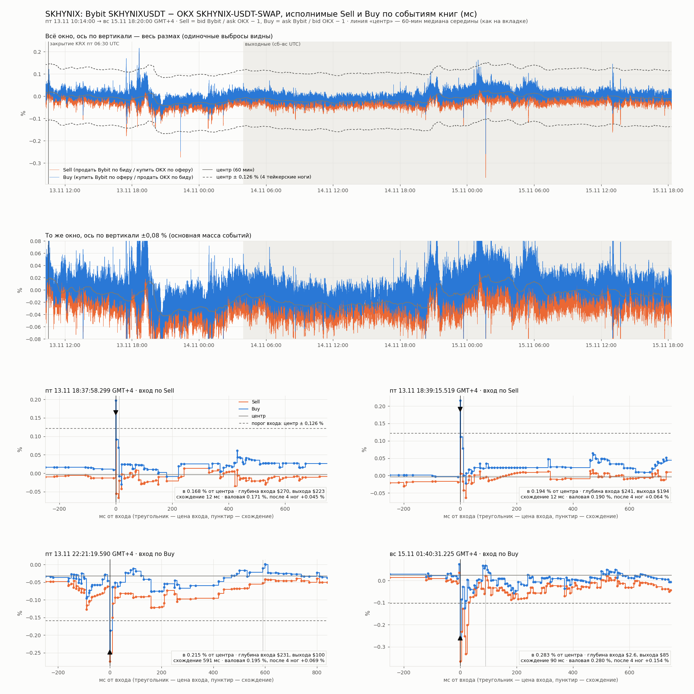

# SKHYNIX, Bybit — OKX: что происходит и окупается ли круг после комиссий (15.11.2026)

Вопрос владельца (дословно): «а глянь монету skhy bybit - okx / глянь че там происходит. кажется там можно заработать даже после комиссии не?»

- Окно: пт 13.11 10:14 → вс 15.11 18:20 GMT+4 (56,1 ч; 13.11 06:14 → 15.11 14:20 UTC). Конец окна — конец разобранных книг `/data/swings/b/parsed`; сбор идёт дальше, разбор до «сейчас» не делался.
- Инструменты: Bybit `SKHYNIXUSDT` (A) и OKX `SKHYNIX-USDT-SWAP` (B) — это акция SK hynix (цена ≈ 885 $). Отдельная монета `SKHY` (≈ 131 $) — другой инструмент на обеих биржах, ей отведён § 8; в § 1–7 — только SKHYNIX.
- Код: `tools/arb_stats/pair_look.py` (счёт), `pair_plot.py` (график); запуск `KRX=1 systemd-run --nice=15 -p CPUQuota=200% python3 pair_look.py …`, 13 с. Результаты на srv — `/data/swings/skhynix/` (`res.json`, `res.json.eps`, `series.npz`).
- График: [skhynix-bybit-okx-2026-11-15.png](skhynix-bybit-okx-2026-11-15.png) (копия у владельца — `Downloads/skhynix-bybit-okx.png`). Почасовая таблица — [skhynix-bybit-okx-2026-11-15-hourly.csv](skhynix-bybit-okx-2026-11-15-hourly.csv).
- Все числа — измеренные на этих данных за 56,1 ч; прогнозов нет.

## Итог (измерено на 56,1 ч)

- **Типичные исполнимые цены лежат у нуля**: Sell p50 -0,0203 %, Buy p50 -0,0034 %; p1…p99 — Sell -0,0578…0,0289 %, Buy -0,0422…0,0486 %; полуспред пары p50 0,0069 %. Спред p50 в тиках: Bybit 2 (0,0023 %), OKX 1 (0,0113 %; OKX на 1 тике 99,9 % времени).
- **Выше 0,1260 % — единичные события.** Вкладочный счёт (I): 4 эпизода за 56,1 ч (1,71/сут), у всех валовая ≥ 0,1260 %, чистая 0,045…0,154 %, Σ 0,333 %. Порог ≥ 0,1260 % держится после входа 4 мс (медиана), максимум 10 мс; **на t + 50 мс порог держится в 0 из 4** эпизодов (при 0,1071 % — 0 из 7, при 0,0882 % — 0 из 15); круг при входе на t + 50 мс окупается в 0 из 4 / 0 из 7 / 0 из 15.
- Глубина этих 4 кругов (меньшее из входа и выхода): 3, 100, 194, 223 $; по времени — 0 в сессии KRX, 3 в будни после закрытия, 1 в выходные; при размере, равном глубине, Σ чистой прибыли = 0,30 $ за окно.
- **Круги задним числом (II, верхняя граница)**: 23 при 0,1260 % (9,8/сут; валовая p50 0,172 %, макс 0,386 %), 48 при 0,1071 %, 87 при 0,0882 %. Жизнь круга (оба конца окупаются) — медиана 3 мс; ≥ 50 мс у 2 из 23, ≥ 300 мс у 0, ≥ 10 с у 0. Глубина p50 55 $ (p10 3, p90 438); Σ чистой прибыли при размере = глубине: 1,64 $ (0,1260 %), 3,04 $ (0,1071 %), 6,01 $ (0,0882 %) за окно.
- Размер на лучшем уровне: Bybit p50 321 $ (bid) / 369 $ (ask), OKX 7373 $ / 7338 $; пара — 287 $ (Sell) / 355 $ (Buy).
- Выходные и закрытие KRX (§ 5): событий OKX в час — 6 523 при открытой KRX (пт 04:44–06:30 UTC), 3 563 в будни после закрытия, 997 в выходные; спред Bybit p50 3 / 1 / 3 тика соответственно.

## 1. Данные и определения

- События книг (лучший bid/ask и размер на нём), время — E биржи (не момент приёма на srv). В разобранных книгах запись есть только при смене пары (bid, ask) (повторы цены сняты при разборе): размер на лучшем уровне — на момент смены цены, изменения одного размера между сменами цены не записаны. Поэтому глубина входа и выхода круга точна на момент события (вход и выход — события смены цены), а квантили размера в § 3 — по размеру в момент последней смены цены. Отброшены пустые и пересечённые записи: Bybit 0 из 1 359 005, OKX 0 из 112 113.
- В окне: событий Bybit 1 255 816, OKX 101 592; событий объединённого ряда пары (с 13.11 08:44 GMT+4, за 1,5 ч до окна — для центра) 1 462 568. Наибольший промежуток без событий в окне: Bybit 136,8 с, OKX 488,3 с. Пропусков сбора внутри окна нет (`dead0.json`: у Bybit и OKX пропуски только после конца окна).
- **Размер контракта OKX**: `ctVal` = 1 SKHYNIX на контракт, `lotSz`/`minSz` = 0,001, `tickSz` = 0,1 $. Глубина в $ = размер × цена × `ctVal` (масштаб 1, поправки нет). Шаг цены Bybit — 0,01 $ (по данным: наименьшая разность цен); у OKX по данным 0,1 $ (совпадает с `tickSz`). В % от цены 885 $: шаг Bybit 0,0011 %, шаг OKX 0,0113 % (в 10 раз грубее).
- Sell = bid(Bybit) / ask(OKX) − 1 (продать Bybit по биду, купить OKX по оферу); Buy = ask(Bybit) / bid(OKX) − 1. Sell ≤ Buy всегда (книги не пересекаются внутри биржи); Buy − Sell = сумма спредов обеих бирж.
- Комиссии (тариф владельца, `.claude/preferences.md` п. 12: фьючерс мейкер 1,26 bps, тейкер 3,15 bps после возврата 10 %): 4 тейкерские ноги = **0,1260 %**; 1 мейкер + 3 тейкера = 0,1071 %; 2 мейкера + 2 тейкера = 0,0882 %. Эти три числа взяты как пороги на исполнимых (тейкерских) ценах; заполнение мейкерских заявок не моделировалось.
- Центр c — 60-минутная медиана середины (Sell + Buy)/2 по закрытиям минутных баров, как на вкладке (`core.rolling_centre`, нужно ≥ 30 баров, считается по прошлому).
- Два счёта «круга» (цены исполнимые, вход и выход — разные стороны):
  - **(I) как на вкладке**: вход — первое событие, где Sell ≥ c + F (или Buy ≤ c − F); выход — первое событие, где середина вернулась к c; валовая = Sell(вход) − Buy(выход) (или Sell(выход) − Buy(вход)); чистая = валовая − F. «Порог держится» — время от входа до первого события, где Sell − c (Buy-вариант: c − Buy) < F. Устойчивость на L мс: (а) порог ≥ F по последнему событию ≤ t + L; (б) круг при входе по цене на t + L (а не t) и выходе тем же — всё ещё валовая ≥ F.
  - **(II) наилучший круг задним числом** (верхняя граница; решение «знает будущее»): зигзаг по Sell (верхушки) и Buy (впадины) с размахом ≥ F; вход и выход — сами экстремумы. «Жизнь» конца круга — время непрерывно, пока круг ещё окупается (валовая ≥ F) при входе (или выходе) по этой цене и выходе (входе) в экстремуме; жизнь круга = меньшая из двух (условие обоих концов).
  - Глубина = минимум по двум биржам размера на лучшем уровне в $ (для входа по Sell — bid Bybit и ask OKX; для Buy — ask Bybit и bid OKX); у круга — меньшая из глубины входа и выхода. Глубже лучшего уровня стакан не рассматривался.

## 2. Уровень Sell/Buy и как он двигался

Время-взвешенные квантили за окно (56,1 ч, вес интервала ≤ 60 с), %:

| ряд | 0,1 % | 1 % | 5 % | 25 % | 50 % | 75 % | 95 % | 99 % | 99,9 % | мин | макс |
|---|---:|---:|---:|---:|---:|---:|---:|---:|---:|---:|---:|
| Sell | -0,0790 | -0,0578 | -0,0471 | -0,0317 | -0,0203 | -0,0069 | 0,0115 | 0,0289 | 0,0463 | -0,366 | 0,190 |
| Buy | -0,0633 | -0,0422 | -0,0316 | -0,0159 | -0,0034 | 0,0098 | 0,0301 | 0,0486 | 0,0666 | -0,260 | 0,216 |
| середина (Sell+Buy)/2 | -0,0707 | -0,0497 | -0,0390 | -0,0238 | -0,0119 | 0,0011 | 0,0207 | 0,0383 | 0,0551 | — | — |

- Время, когда Sell > 0 (бид Bybit выше офера OKX): 13,9 %; когда Buy < 0: 55,9 %. Средний центр c за окно -0,0111 %.
- Полуспред пары (Buy − Sell)/2: p5 / p50 / p95 = 0,0060 / 0,0069 / 0,0144 %.
- Как двигался уровень: почасовая медиана середины (по часам окна, [CSV](skhynix-bybit-okx-2026-11-15-hourly.csv)) — от -0,0434 % до 0,0207 %; центр c на конец часа — от -0,0426 % до 0,0209 %. Блоки по 6 ч (границы суток GMT+4):

| блок GMT+4 | событий Bybit | событий OKX | середина p50, % | середина p5 / p95, % | Sell p50, % | Buy p50, % | Sell макс, % | Buy мин, % | полуспред p50, % | спред Bybit, тиков (p50) | спред OKX, тиков (p50) | центр (среднее), % |
|---|---:|---:|---:|---:|---:|---:|---:|---:|---:|---:|---:|---:|
| пт 13.11 10:14 → пт 13.11 12:00 | 39 973 | 3 446 | 0,0076 | -0,017 / 0,031 | 0,0011 | 0,0152 | 0,075 | -0,032 | 0,0060 | 1 | 1 | 0,0094 |
| пт 13.11 12:00 → пт 13.11 18:00 | 138 230 | 12 999 | -0,0054 | -0,023 / 0,015 | -0,0120 | 0,0011 | 0,055 | -0,125 | 0,0060 | 1 | 1 | -0,0045 |
| пт 13.11 18:00 → сб 14.11 00:00 | 370 334 | 38 036 | -0,0283 | -0,054 / 0,029 | -0,0357 | -0,0205 | 0,190 | -0,248 | 0,0068 | 2 | 1 | -0,0229 |
| сб 14.11 00:00 → сб 14.11 06:00 | 127 720 | 9 842 | -0,0180 | -0,042 / 0,004 | -0,0260 | -0,0101 | 0,034 | -0,102 | 0,0068 | 2 | 1 | -0,0203 |
| сб 14.11 06:00 → сб 14.11 12:00 | 89 488 | 3 952 | -0,0243 | -0,040 / -0,007 | -0,0318 | -0,0159 | 0,045 | -0,068 | 0,0068 | 2 | 1 | -0,0217 |
| сб 14.11 12:00 → сб 14.11 18:00 | 34 604 | 1 108 | -0,0237 | -0,040 / -0,009 | -0,0316 | -0,0158 | 0,028 | -0,052 | 0,0062 | 1 | 1 | -0,0243 |
| сб 14.11 18:00 → вс 15.11 00:00 | 132 010 | 7 177 | -0,0120 | -0,038 / 0,020 | -0,0207 | -0,0023 | 0,074 | -0,098 | 0,0075 | 3 | 1 | -0,0137 |
| вс 15.11 00:00 → вс 15.11 06:00 | 188 663 | 16 953 | 0,0121 | -0,011 / 0,038 | 0,0023 | 0,0219 | 0,126 | -0,260 | 0,0092 | 6 | 1 | 0,0107 |
| вс 15.11 06:00 → вс 15.11 12:00 | 73 399 | 4 643 | -0,0029 | -0,019 / 0,013 | -0,0114 | 0,0057 | 0,041 | -0,041 | 0,0075 | 3 | 1 | -0,0025 |
| вс 15.11 12:00 → вс 15.11 18:00 | 57 123 | 3 146 | -0,0074 | -0,024 / 0,012 | -0,0159 | 0,0000 | 0,073 | -0,079 | 0,0074 | 3 | 1 | -0,0070 |
| вс 15.11 18:00 → вс 15.11 18:20 | 4 272 | 290 | -0,0091 | -0,025 / 0,005 | -0,0182 | -0,0011 | 0,011 | -0,031 | 0,0074 | 3 | 1 | -0,0111 |

## 3. Спреды в тиках и глубина на лучшем уровне

Время-взвешенно за окно:

| биржа | тик, $ | тик, % цены | спред, тиков: p10 / p50 / p90 / p99 | спред = 1 тик, доля времени | спред ≤ 2 тика | спред p50, % |
|---|---|---:|---:|---:|---:|---:|
| Bybit | 0,01 | 0,0011 | 1 / 2 / 12 / 22 | 42,9 % | 50,2 % | 0,0023 |
| OKX | 0,1 | 0,0113 | 1 / 1 / 1 / 1 | 99,9 % | 100,0 % | 0,0113 |

Размер на лучшем уровне, $ (p10 / p50 / p90, время-взвешенно):

| сторона | Bybit | OKX | пара (для входа/выхода) |
|---|---:|---:|---:|
| bid (для Sell: продать Bybit / для Buy: продать OKX) | 13 / 321 / 949 | 894 / 7373 / 39724 | Sell: 11 / 287 / 937 |
| ask (для Sell: купить OKX / для Buy: купить Bybit) | 18 / 369 / 947 | 851 / 7338 / 39450 | Buy: 15 / 355 / 939 |

Пара ограничена тонким лучшим уровнем Bybit: медиана глубины пары 287 $ (Sell) и 355 $ (Buy) при медиане лучшего уровня OKX 7373 $.

## 4. Круги против комиссий

Окно 56,1 ч = 2,34 сут. Сверка со вкладкой: тем же счётом (I) при 0,1260 % за 24 ч до вс 15.11 17:14 GMT+4 — 1 эпизод, пик 0,283 %, схождение 90 мс, чистая 0,154 %, как в строке вкладки (1 эпизод, 0,283 %, 90 мс, +0,154 %). Оборот бирж (19,5 / 36,1 млн $ на вкладке) здесь не пересчитывался.

### 4.1 (I) эпизоды как на вкладке

| порог F | эпизодов (в сутки) | вход Sell / вход Buy | вход выше центра, % (медиана / макс) | порог держится, мс (медиана / макс) | схождение, мс (медиана / p90 / макс) | валовая ≥ F | чистая, % (медиана / p95) | Σ чистой, % |
|---|---:|---:|---:|---:|---:|---:|---:|---:|
| 0,1260 % (4 тейкера) | 4 (1,71) | 2 / 2 | 0,205 / 0,283 | 4 / 10 | 51 / 441 / 591 | 4 из 4 | 0,067 / 0,142 | 0,333 |
| 0,1071 % (1 мейкер + 3 тейкера) | 7 (2,99) | 4 / 3 | 0,168 / 0,283 | 4 / 10 | 350 / 12 356 / 28 280 | 6 из 7 | 0,064 / 0,148 | 0,405 |
| 0,0882 % (2 мейкера + 2 тейкера) | 15 (6,42) | 9 / 6 | 0,107 / 0,283 | 4 / 13 | 760 / 393 086 / 537 773 | 10 из 15 | 0,013 / 0,132 | 0,530 |

| порог F | глубина круга, $ (мин / медиана / макс) | порог ≥ F на t+50 / 300 / 10 000 мс, эпизодов | круг при входе на t+L всё ещё ≥ F, эпизодов (50 / 300 / 10 000) | порог держится непрерывно ≥ L, эпизодов | прибыль при размере круга = его глубине, $ (Σ) |
|---|---:|---:|---:|---:|---:|
| 0,1260 % (4 тейкера) | 3 / 147 / 223 | 0 / 0 / 0 | 0 / 0 / 0 | 0 / 0 / 0 | 0,30 |
| 0,1071 % (1 мейкер + 3 тейкера) | 3 / 100 / 245 | 0 / 0 / 0 | 0 / 0 / 0 | 0 / 0 / 0 | 0,39 |
| 0,0882 % (2 мейкера + 2 тейкера) | 3 / 100 / 391 | 0 / 0 / 0 | 0 / 0 / 0 | 0 / 0 / 0 | 0,50 |

Список эпизодов (I) порога 0,0882 % (он включает все эпизоды порогов 0,1260 и 0,1071 %); «окупает» — валовая ≥ F для F = 0,1260 / 0,1071 / 0,0882 %:

| вход, GMT+4 | сторона | выше центра, % | порог держится, мс | схождение, мс | валовая, % | глубина вход / выход, $ | окупает 0,1260 / 0,1071 / 0,0882 |
|---|---|---|---:|---:|---:|---:|---:|
| пт 13.11 17:31:09.483 | Buy | 0,108 | 10 | 1 740 | 0,108 | 2585 / 245 | нет / да / да |
| пт 13.11 18:37:46.119 | Sell | 0,107 | 2 | 20 | 0,101 | 249 / 628 | нет / нет / да |
| пт 13.11 18:37:58.299 | Sell | 0,168 | 2 | 12 | 0,171 | 270 / 223 | да / да / да |
| пт 13.11 18:38:22.739 | Sell | 0,112 | 2 | 350 | 0,101 | 135 / 100 | нет / нет / да |
| пт 13.11 18:38:54.029 | Sell | 0,098 | 2 | 10 | 0,090 | 5 / 8 | нет / нет / да |
| пт 13.11 18:39:15.519 | Sell | 0,194 | 2 | 12 | 0,190 | 241 / 194 | да / да / да |
| пт 13.11 19:50:21.658 | Buy | 0,092 | 10 | 537 773 | 0,065 | 338 / 385 | нет / нет / нет |
| пт 13.11 20:07:06.498 | Buy | 0,100 | 13 | 760 | 0,086 | 2805 / 87 | нет / нет / нет |
| пт 13.11 22:21:19.590 | Buy | 0,215 | 10 | 591 | 0,195 | 231 / 100 | да / да / да |
| сб 14.11 20:30:43.688 | Sell | 0,089 | 3 | 197 020 | 0,086 | 21 / 403 | нет / нет / нет |
| сб 14.11 20:41:26.498 | Sell | 0,101 | 3 | 337 990 | 0,084 | 391 / 879 | нет / нет / нет |
| сб 14.11 23:41:33.364 | Buy | 0,091 | 7 | 10 207 | 0,084 | 3 / 109 | нет / нет / нет |
| вс 15.11 00:59:36.207 | Sell | 0,116 | 4 | 28 280 | 0,109 | 8 / 124 | нет / да / да |
| вс 15.11 01:05:14.991 | Sell | 0,103 | 6 | 429 816 | 0,102 | 7727 / 5 | нет / нет / да |
| вс 15.11 01:40:31.225 | Buy | 0,283 | 10 | 90 | 0,280 | 3 / 85 | да / да / да |

### 4.2 (II) наилучшие круги задним числом (верхняя граница)

| порог F | кругов (в сутки) | первым Sell / первым Buy | валовая, % (p50 / p95 / макс) | чистая, % (p50 / p95) | Σ чистой, % | удержание позиции, с (p10 / p50 / p90) |
|---|---:|---:|---:|---:|---:|---:|
| 0,1260 % (4 тейкера) | 23 (9,8) | 12 / 11 | 0,172 / 0,332 / 0,386 | 0,046 / 0,206 | 1,664 | 4 / 1407 / 11902 |
| 0,1071 % (1 мейкер + 3 тейкера) | 48 (20,5) | 24 / 24 | 0,132 / 0,264 / 0,376 | 0,025 / 0,157 | 2,318 | 5 / 296 / 11202 |
| 0,0882 % (2 мейкера + 2 тейкера) | 87 (37,2) | 44 / 43 | 0,116 / 0,231 / 0,363 | 0,028 / 0,143 | 3,572 | 4 / 250 / 6170 |

| порог F | жизнь входа, мс (p10 / p50 / p90) | жизнь выхода, мс | жизнь круга = min, мс | кругов с жизнью ≥ 50 / 300 / 10 000 мс | глубина круга, $ (p10 / p50 / p90) | прибыль при размере = глубине, $ (Σ) |
|---|---:|---:|---:|---:|---:|---:|
| 0,1260 % (4 тейкера) | 1 / 5 / 17 318 | 1 / 5 / 133 890 | 1 / 3 / 24 | 2 / 0 / 0 | 3 / 55 / 438 | 1,64 |
| 0,1071 % (1 мейкер + 3 тейкера) | 1 / 6 / 11 471 | 1 / 5 / 870 | 1 / 3 / 12 | 3 / 1 / 1 | 4 / 65 / 589 | 3,04 |
| 0,0882 % (2 мейкера + 2 тейкера) | 1 / 7 / 2 524 | 2 / 8 / 415 | 1 / 3 / 17 | 6 / 2 / 0 | 5 / 65 / 459 | 6,01 |

Все 23 круга (II) порога 0,1260 %, по времени входа (GMT+4); «первым» — какой стороной входит; жизнь входа / выхода — сколько непрерывно круг ещё окупается при этой цене и экстремуме на другом конце (длинная жизнь — значит, другой конец был редким выбросом):

| вход, GMT+4 | выход, GMT+4 | первым | валовая, % | удержание | жизнь входа / выхода | глубина вход / выход, $ |
|---|---|---|---|---:|---:|---:|
| пт 13.11 10:15:53.730 | пт 13.11 13:37:57.463 | Sell | 0,161 | 3,4 ч | 1 мс / 30 мс | 592 / 4644 |
| пт 13.11 13:37:57.463 | пт 13.11 16:18:35.756 | Buy | 0,141 | 2,7 ч | 12 мс / 5 мс | 4644 / 480 |
| пт 13.11 16:18:35.756 | пт 13.11 17:30:01.551 | Sell | 0,136 | 71,4 мин | 5 мс / 1 мс | 480 / 3593 |
| пт 13.11 17:30:01.551 | пт 13.11 17:30:04.021 | Buy | 0,127 | 2 470 мс | 1 мс / 2 мс | 3593 / 100 |
| пт 13.11 17:30:04.021 | пт 13.11 17:31:09.483 | Sell | 0,172 | 65,5 с | 192 мс / 18 мс | 100 / 2585 |
| пт 13.11 17:31:09.483 | пт 13.11 18:28:42.420 | Buy | 0,205 | 57,5 мин | 68 мс / 279 мс | 2585 / 32 |
| пт 13.11 18:28:42.420 | пт 13.11 18:30:02.080 | Sell | 0,156 | 79,7 с | 1 мс / 1 мс | 32 / 592 |
| пт 13.11 18:30:02.080 | пт 13.11 18:37:58.299 | Buy | 0,239 | 7,9 мин | 470 мс / 2 мс | 592 / 270 |
| пт 13.11 18:37:58.299 | пт 13.11 18:37:58.319 | Sell | 0,193 | 20 мс | 2 мс / 418 мс | 270 / 1441 |
| пт 13.11 18:37:58.319 | пт 13.11 18:38:22.739 | Buy | 0,138 | 24,4 с | 2 мс / 2 мс | 1441 / 135 |
| пт 13.11 18:38:22.739 | пт 13.11 18:39:06.719 | Sell | 0,131 | 44,0 с | 2 мс / 2 мс | 135 / 5 |
| пт 13.11 18:39:06.719 | пт 13.11 18:39:15.519 | Buy | 0,212 | 8 800 мс | 21,5 с / 2 мс | 5 / 241 |
| пт 13.11 18:39:15.519 | пт 13.11 18:40:51.181 | Sell | 0,242 | 95,7 с | 2 мс / 2,8 мин | 241 / 668 |
| пт 13.11 18:40:51.181 | пт 13.11 19:17:43.630 | Buy | 0,130 | 36,9 мин | 10 мс / 1 мс | 668 / 5 |
| пт 13.11 19:17:43.630 | пт 13.11 22:21:19.590 | Sell | 0,326 | 3,1 ч | 80,3 мин / 61 мс | 5 / 231 |
| пт 13.11 22:21:19.590 | сб 14.11 20:12:09.116 | Buy | 0,296 | 21,8 ч | 10 мс / 21,5 ч | 231 / 235 |
| сб 14.11 20:12:09.116 | сб 14.11 20:17:59.196 | Sell | 0,131 | 5,8 мин | 5 мс / 5 мс | 235 / 55 |
| сб 14.11 20:17:59.196 | сб 14.11 20:41:26.498 | Buy | 0,157 | 23,5 мин | 5 мс / 3 мс | 55 / 391 |
| сб 14.11 20:41:26.498 | сб 14.11 23:41:33.364 | Sell | 0,172 | 3,0 ч | 3 мс / 7 мс | 391 / 3 |
| сб 14.11 23:41:33.364 | вс 15.11 00:59:36.207 | Buy | 0,224 | 78,0 мин | 637 мс / 4 мс | 3 / 8 |
| вс 15.11 00:59:36.207 | вс 15.11 01:40:31.225 | Sell | 0,386 | 40,9 мин | 24,8 ч / 26 мс | 8 / 3 |
| вс 15.11 01:40:31.225 | вс 15.11 13:02:15.151 | Buy | 0,333 | 11,4 ч | 10 мс / 11,4 ч | 3 / 504 |
| вс 15.11 13:02:15.151 | вс 15.11 13:02:15.184 | Sell | 0,152 | 33 мс | 3 мс / 7 мс | 504 / 4 |

### 4.3 Сколько кругов с достаточной глубиной

| порог F | (I) кругов с глубиной ≥ 100 / 300 / 1000 $ | (I) наибольшая глубина, $ | (II) кругов с глубиной ≥ 100 / 300 / 1000 $ | (II) наибольшая глубина, $ |
|---|---:|---:|---:|---:|
| 0,1260 % (4 тейкера) | 2 / 0 / 0 | 223 | 10 / 3 / 0 | 592 |
| 0,1071 % (1 мейкер + 3 тейкера) | 4 / 0 / 0 | 245 | 22 / 12 / 1 | 1181 |
| 0,0882 % (2 мейкера + 2 тейкера) | 7 / 2 / 0 | 391 | 37 / 19 / 1 | 1181 |

## 5. Торговые часы KRX и выходные

Акция SK hynix торгуется на KRX пн–пт 00:00–06:30 UTC (09:00–15:30 по Сеулу). В данных есть только одна сессия: **пт 13.11 с 04:44 UTC** (данные пары начинаются за 1,5 ч до окна) **до закрытия 06:30 UTC**. Открытия KRX (пт 00:00 UTC, пн 16.11 00:00 UTC) в данных нет. Режимы (время UTC; последний час сессии до 06:14 UTC — до начала окна, но в ряду):

| режим (UTC) | часов | событий Bybit / ч | событий OKX / ч | середина p5 / p50 / p95, % | Sell p50; p99, % | Buy p1; p50, % | Sell макс / Buy мин, % | полуспред p50, % | спред Bybit, тиков (p50 / p90) | Bybit = 1 тик, доля времени | глубина пары Sell / Buy, $ (p50) | (I) эпизодов 0,1260 / 0,1071 / 0,0882 | (II) кругов 0,1260 / 0,1071 / 0,0882 |
|---|---:|---:|---:|---:|---:|---:|---:|---:|---:|---:|---:|---:|---:|
| KRX открыта: пт 04:44 → 06:30 | 1,8 | 64 352 | 6 523 | -0,007 / 0,0142 / 0,032 | 0,0055; 0,031 | -0,007; 0,0220 | 0,075 / -0,046 | 0,0071 | 3 / 11 | 37 % | 609 / 709 | 0 / 0 / 0 | 1 / 4 / 10 |
| пт 06:30 → сб 00:00 (будни, KRX закрыта) | 17,5 | 36 820 | 3 563 | -0,045 / -0,0141 / 0,018 | -0,0217; 0,032 | -0,053; -0,0066 | 0,190 / -0,248 | 0,0062 | 1 / 9 | 50 % | 580 / 581 | 3 / 5 / 9 | 15 / 33 / 49 |
| сб 00:00 → вс 14:20 (выходные) | 38,3 | 15 667 | 997 | -0,035 / -0,0108 / 0,021 | -0,0194; 0,028 | -0,036; -0,0023 | 0,126 / -0,260 | 0,0074 | 3 / 13 | 39 % | 129 / 185 | 1 / 2 / 6 | 7 / 14 / 37 |

В строке «KRX открыта» эпизоды (I) считаются с 05:14 UTC (первый известный центр), круги (II) — с 04:44 UTC; остальные режимы целиком в окне.

Вокруг закрытия KRX (пт 13.11 06:30 UTC), бины по 10 мин (UTC):

| бин с (UTC) | событий Bybit | событий OKX | середина p50, % | Sell p50, % | Buy p50, % | Sell макс, % | Buy мин, % | полуспред p50, % | спред Bybit, тиков | спред OKX, тиков |
|---|---:|---:|---:|---:|---:|---:|---:|---:|---:|---:|
| 05:30 | 12 260 | 1 254 | 0,0161 | 0,0077 | 0,0244 | 0,058 | -0,040 | 0,0072 | 3 | 1 |
| 05:40 | 14 017 | 1 451 | 0,0131 | 0,0044 | 0,0219 | 0,037 | -0,046 | 0,0077 | 4 | 1 |
| 05:50 | 13 331 | 1 480 | 0,0175 | 0,0088 | 0,0262 | 0,071 | -0,034 | 0,0076 | 4 | 1 |
| 06:00 | 12 682 | 1 382 | 0,0165 | 0,0077 | 0,0252 | 0,065 | -0,037 | 0,0077 | 4 | 1 |
| 06:10 | 9 782 | 978 | 0,0159 | 0,0077 | 0,0241 | 0,075 | -0,032 | 0,0071 | 3 | 1 |
| 06:20 | 5 347 | 477 | 0,0246 | 0,0175 | 0,0317 | 0,048 | -0,018 | 0,0060 | 1 | 1 |
| 06:30 | 6 062 | 455 | 0,0257 | 0,0175 | 0,0328 | 0,059 | 0,004 | 0,0066 | 2 | 1 |
| 06:40 | 2 699 | 261 | 0,0115 | 0,0044 | 0,0175 | 0,031 | -0,008 | 0,0060 | 1 | 1 |
| 06:50 | 2 625 | 283 | 0,0060 | -0,0011 | 0,0131 | 0,022 | -0,024 | 0,0060 | 1 | 1 |
| 07:00 | 4 511 | 430 | -0,0098 | -0,0174 | -0,0033 | 0,011 | -0,027 | 0,0060 | 1 | 1 |
| 07:10 | 2 900 | 240 | -0,0049 | -0,0119 | 0,0022 | 0,012 | -0,024 | 0,0060 | 1 | 1 |
| 07:20 | 3 006 | 228 | -0,0103 | -0,0174 | -0,0033 | 0,011 | -0,024 | 0,0060 | 1 | 1 |

Почасовая таблица (все 59 ч ряда, UTC и GMT+4) — в CSV. Наибольшая активность по часам — пт 13.11 15:00 UTC (124 568 событий Bybit, 12 614 OKX), пт 13.11 14:00 UTC (84 831 событий Bybit, 13 791 OKX), пт 13.11 05:00 UTC (69 089 событий Bybit, 7 022 OKX); наименьшая у OKX — сб 14.11 11:00 UTC (106 событий).

## 6. График

[skhynix-bybit-okx-2026-11-15.png](skhynix-bybit-okx-2026-11-15.png): сверху — Sell и Buy по **каждому событию** за всё окно (1 349 247 событий пары; без укрупнения по слотам), линия центра и «центр ± 0,126 %»; ниже — то же окно с осью ±0,08 %; снизу — четыре эпизода (I) порога 0,1260 % в миллисекундах от входа (точки — события, пунктир — момент схождения).

## 7. Чего здесь нет

- Время — E биржи; задержка доставки до srv и заявки не входит: «порог держится 2–10 мс» — в времени бирж.
- Мейкерские заявки не моделировались (нет модели заполнения), пороги 0,1071 и 0,0882 % применены к тейкерским исполнимым ценам.
- Глубина — только лучший уровень; исполнение крупнее глубины идёт по следующим уровням, их цены здесь не считались.
- Фандинг и оборот бирж не считались; сроки удержания (II) показаны без платы за фандинг.
- Окно 56,1 ч включает 16 минут сессии KRX (до закрытия 06:30 UTC) и выходные; открытие KRX в данных не попало.

## 8. Монета SKHY (другой инструмент, ≈ 131 $)

Тем же счётом, то же окно: Bybit `SKHYUSDT`, OKX `SKHY-USDT-SWAP` (`ctVal` 1, `lotSz` 0,01, `tickSz` 0,01 $; шаг Bybit 0,01 $). Событий в окне: Bybit 482 881, OKX 216 318.

| ряд | 0,1 % | 1 % | 5 % | 25 % | 50 % | 75 % | 95 % | 99 % | 99,9 % | мин | макс |
|---|---:|---:|---:|---:|---:|---:|---:|---:|---:|---:|---:|
| Sell | -0,0539 | -0,0443 | -0,0311 | -0,0228 | -0,0149 | -0,0074 | 0,0078 | 0,0313 | 0,0469 | -0,162 | 0,228 |
| Buy | -0,0309 | -0,0231 | -0,0149 | 0,0000 | 0,0077 | 0,0155 | 0,0311 | 0,0471 | 0,0628 | -0,114 | 0,252 |

Спред, тиков (p10 / p50 / p90 / p99): Bybit 1 / 1 / 3 / 4, OKX 1 / 1 / 1 / 2. Глубина пары, $ (p10 / p50 / p90): Sell 15 / 158 / 558, Buy 12 / 154 / 577.

| порог F | (I) эпизодов (в сутки) | (I) порог ≥ F на t+50 / 300 / 10 000 мс | (I) прибыль при размере = глубине, $ (Σ) | (II) кругов (в сутки) | (II) с жизнью ≥ 50 / 300 / 10 000 мс | (II) глубина круга, $ (p10 / p50 / p90) | (II) прибыль при размере = глубине, $ (Σ) |
|---|---:|---:|---:|---:|---:|---:|---:|
| 0,1260 % (4 тейкера) | 1 (0,43) | 0 / 0 / 0 | 0,03 | 9 (3,9) | 1 / 0 / 0 | 3 / 19 / 99 | 0,18 |
| 0,1071 % (1 мейкер + 3 тейкера) | 1 (0,43) | 0 / 0 / 0 | 0,04 | 19 (8,1) | 2 / 1 / 0 | 7 / 21 / 176 | 0,42 |
| 0,0882 % (2 мейкера + 2 тейкера) | 3 (1,28) | 0 / 0 / 0 | 0,05 | 41 (17,5) | 3 / 1 / 0 | 5 / 19 / 217 | 0,84 |
