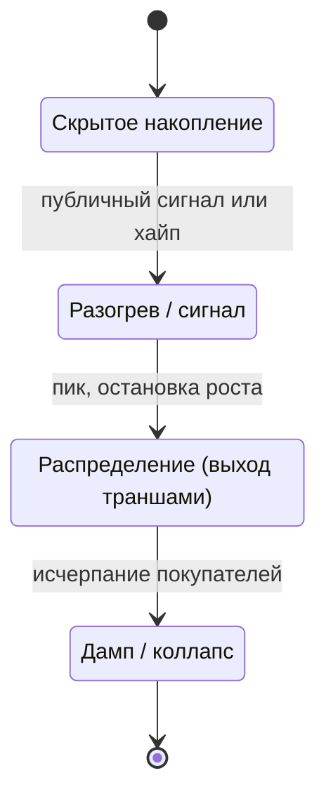
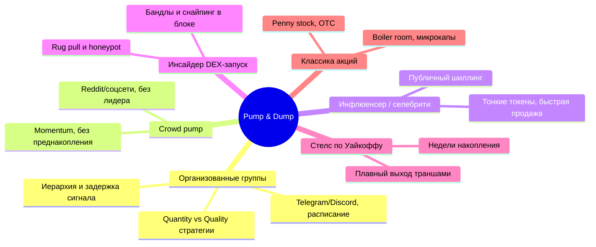

# Pump & Dump: таксономия сценариев и фундамент для стартовой стратегии

## Вопрос

Описать все сценарии и классификации пампов и дампов (крипта + классические рынки), понять, существуют ли современные книжные описания, и решить: строить теорию из литературы или собрать стаканы по реальным событиям. Конечная цель — пайплайн: библиотека сценариев → общие признаки («точки соприкосновения») → стартовая стратегия → форвард-тест на конкретном пампе с «теневым флотом» (параллельные виртуальные счета) → ротация стратегий или их частей с целевой функцией «плюсовой баланс к концу пампа».

---

## Резюме (главные выводы, по убыванию важности)

1. **Книги с полной таксономией не существует.** Современное описание пампов живёт в академических статьях 2018–2026 гг. и в систематиках rug pull. Лучшие точки входа: Dhawan & Putnins (Review of Finance, 2023), La Morgia et al. (ACM TOIT, 2023), Li–Shin–Wang (JFQA, 2025), SoK по rug pulls (2024), Karbalaii (2025). Книги — только практические адаптации метода Уайкоффа, они дают фазовый скелет, но не статистику.
2. **Все сценарии укладываются в один скелет из четырёх фаз:** скрытое накопление → разогрев/сигнал → распределение (выход) → дамп. Различаются только три переменные: *кто организует, как быстро идут фазы, есть ли преднакопление*. Это и есть каркас классификатора.
3. **Ключевая развилка для детекции:** «pre-accumulation» пампы (~70% событий — у инсайдеров есть заметная фаза накопления) против «on-the-spot» (~30% — накопление почти мгновенное или скрыто в стакане). Около 70% пред-событийного объёма у организаторов проходит в **последний час** перед сигналом — мониторинг нужен суб-часовой granularity.
4. **Стаканы собирать — да, но не «все подряд» и не с нуля.** Опубликованные датасеты — это в основном трейды и минутные OHLCV; полная L2-история продаётся (Tardis, Kaiko, CoinAPI), а для live-форвард-теста теневой флот всё равно пишет свой depth-рекордер. Рабочий вердикт: скелет и признаки взять из статей, собственную статистику исполнения — собирать точечно по выбранному семейству сценариев.
5. **Общие признаки («точки соприкосновения») уже измеримы:** дормантный токен (плоские минутные цены до события), аномальный всплеск рыночных покупок (market-buy), тонкий стакан, пред-сигнальный объёмный паттерн, траншированный выход организаторов (нижняя оценка доходности инсайдеров: медиана >100%, верхний квартиль >2000% при выходе 20%/50% — 30%/60% – 50%/80% от пика).
6. **Для форвард-теста:** теневой флот = N виртуальных счетов, каждый со стратегией-кандидатом, общий классификатор сценария в реальном времени, ротация по явным триггерам (недостижение milestone фаз, drawdown, изменение микроструктуры). Целевая функция — «плюс к концу пампа», поэтому exit-логика важнее entry-логики, и slippage на тонком стакане надо моделировать честно.
7. **Юридическая рамка:** организованный памп — это манипуляция/мошенничество почти во всех юрисдикциях (SEC/CFTC активно преследуют, включая селебрити-шиллинг мем-коинов). Детекция, мониторинг и защита позиций — легальны; участие в организованных схемах как организатор или «ранний инсайдер» — нет.

---

## Методология

**Углы поиска:** академическая литература (arXiv, Review of Finance, JFQA, ACM TOIT, MDPI, Springer), регуляторные источники (SEC), отраслевые on-chain расследования (Bitquery), микроструктурные работы по спуфингу и лимитным стаканам, практические фреймворки (метод Уайкоффа), поставщики исторических L2-данных.

**Типы источников:** рецензируемые статьи (основная опора), препринты, документация вендоров данных, практические блоги (использованы только для фреймворка Уайкоффа, с пометкой о низком формальном статусе).

**Ограничения:**

- Значительная часть классической статистики собрана на Poloniex 2017–2019 гг.; DEX-эпоха (pump.fun, bonding curves) изменила механику запуска и дампа, классические CEX-модели там работают частично.
- Публикации оперируют трейдами и OHLCV; данных именно по стакану (L2) в них почти нет — микроструктурный слой придётся строить самому.
- Доходности «инсайдеров» в статьях — это консервативные **нижние оценки** по воображаемым стратегиям выхода, а не наблюдаемые PnL реальных кошельков (кроме on-chain расследований по DEX).
- Все торговые выводы — описательные; исполнение на тонких стаканах предполагает большой slippage, который бэктест на OHLCV систематически занижает.

---

## Результаты

### 1. Универсальный скелет: четыре фазы любого пампа

Независимо от площадки и организатора, жизненный цикл один:

Соответствие классической схеме Уайкоффа (аккумуляция → markup → дистрибуция → markdown, с событиями Spring/UTAD) и крипто-реальности:

| Фаза | Уайкофф (композитный оператор) | Организованный крипто-памп | Rug pull / DEX-запуск |
|---|---|---|---|
| Накопление | Недели, тихо, «spring» — ложный пробой вниз | Минуты–часы до сигнала; ~70% объёма в последний час | Квазимгновенно: бандл-закупка в блоке запуска |
| Разогрев | Markup, «sign of strength» | Сигнал в Telegram, иерархия получает его на 0,5–1 c раньше | Хайп в соцсетях, боты, снайперы |
| Распределение | UTAD — ложный пробой вверх, распродажа в силу | Выход админов на пике, транши | Продажа дев-кошельков, снятие LP |
| Дамп | Markdown | Обвал за секунды–минуты | Ликвидность исчезает одним действием |

Исторический якорь: прототип — «Radio Pool» конца 1920-х, раскрутивший RCA до $549 и сбросивший ниже $10 ([La Morgia et al.](https://arxiv.org/html/2105.00733v2)).

### 2. Классификация по механизму (академическая база)

Фундаментальная типология манипуляций (Allen & Gale; Kyle & Viswanathan) делит всё по *инструменту воздействия*:

| Тип | Механизм | Примеры |
|---|---|---|
| **Информационная** | Ложная/вводящая в заблуждение информация | Шиллинг, фейковые новости, «сигналы», селебрити-посты |
| **Торговая (trade-based)** | Сделки, искажающие цену и объём | Спуфинг, лейеринг, wash trading, корнер/squeeze, mark-the-close |
| **Action-based** | Действия, меняющие реальную стоимость актива | Контрактные ловушки rug pull (скрытый owner, сжигание, снятие LP) |

- Основа: [Allen & Gale, Stock-Price Manipulation (1992)](https://rodneywhitecenter.wharton.upenn.edu/wp-content/uploads/2014/04/9013.pdf) — торговая манипуляция возможна даже без информационного преимущества; [Kyle & Viswanathan, How to Define Illegal Price Manipulation (2008)](https://www.aeaweb.org/articles?id=10.1257/aer.98.2.274) — формальные критерии «незаконной» манипуляции (pricing accuracy vs market efficiency).
- Спуфинг/лейеринг на крипто-биржах: детекция по order-flow признакам на базе Hawkes-процессов ([Spoofability of Limit Order Books, 2025](https://arxiv.org/html/2504.15908v1)); многоуровневая манипуляция в LOB ([Cascaded Contrastive Learning, 2025](https://arxiv.org/html/2508.17086)); [Do & Putniņš, Detecting layering and spoofing](https://papers.ssrn.com/sol3/Delivery.cfm/SSRN_ID4620997_code855598.pdf?abstractid=4525036&mirid=1&type=2).

Практический смысл для стратегии: **класс механизма определяет, какой датасет нужен** — информационная схема детектируется по чатам/соцсетям + цене, торговая — только по стакану, action-based — по on-chain состоянию контракта.

### 3. Классификация по организатору и каналу (крипто-специфика)

**3.1. Организованные группы (Telegram/Discord, CEX).** Наиболее изученный класс: расписание пампов, публичный «сигнал» (тикер + время), иерархия доступа — верхние уровни получают тикер на 0,5–1 с раньше нижних (максимум преимущества 1–10 с), приглашение новых членов поднимает ранг ([La Morgia et al., ACM TOIT 2023](https://arxiv.org/html/2105.00733v2); ~900 событий за 3 года мониторинга; кейс Big Pump Signal — 5 176 BTC ≈ $300M в одной операции). Экономика: среднее искажение цены ~65%, аномальные объёмы в миллионы долларов, крупный перенос богатства от «меди» к «ранним» ([Dhawan & Putnins, Review of Finance 2023](http://revfin.org/a-new-wolf-in-town-pump-and-dump-manipulation-in-cryptocurrency-markets/)). Организаторы балансируют стратегии «quantity vs quality» — частые мелкие пампы против редких крупных ([Pump, Dump, and Then What?, 2023](https://arxiv.org/pdf/2309.06608v1); [Li–Shin–Wang, JFQA 2025](https://www.cambridge.org/core/journals/journal-of-financial-and-quantitative-analysis/article/abs/cryptocurrency-pumpanddump-schemes/97149DCD519BAF838F269F98DC76D682)).

**3.2. Crowd pump (децентрализованный).** Без назначенного организатора: толпа договаривается в соцсетях и раскачивает крупный актив (Dogecoin, XRP, GameStop-эпоха). Нет преднакопления «по дизайну», поэтому жизненный цикл длиннее, дамп плавнее; детектируется тем же детектором всплеска market-buy ([La Morgia et al.](https://arxiv.org/html/2105.00733v2)).

**3.3. Инфлюенсер/селебрити-шиллинг.** Публичный пост про низколиквидный токен с заблаговременной закупкой и продажей в окно хайпа; активная зона SEC/CFTC-принуждения в 2024–2025 ([Crypto Enforcement Tracker](https://astraea.law/insights/crypto-enforcement-tracker-2026); [SEC Crypto Task Force, сентябрь 2025](https://www.sec.gov/about/crypto-task-force/written-submission/ctf-written-technical-proposal-regulation-09-08-2025)).

**3.4. Инсайдерский DEX-запуск (новый доминирующий класс).** On-chain расследование 8,2 млн запусков на pump.fun: «бандлы» дев-кошельков (закупка в слоте запуска, до того как внешние покупатели вообще могут транзактировать) принесли $579M+, обычные снайперы — всего $31,5M ([Bitquery](https://bitquery.io/investigations/pump-fun-snipers-bundles)). Систематика rug pull: **34 root-причины в 6 новых категориях** — burn, hidden owner, ownership transfer, unverified contract, external call, fake LP lock ([Sun et al., SoK 2024](https://arxiv.org/abs/2403.16082)). Отдельная ветка — «bait-and-trap»: публичный памп в Telegram по токену, который является honeypot (продать нельзя) — помпа и rug слиты в одну операцию ([Cernera et al., октябрь 2026](https://arxiv.org/html/2610.10149v1)).

**3.5. Стелс-схема «по Уайкоффу».** Композитный оператор: недели тихого накопления, markup, распределение через ложные пробои (UTAD), плавный markdown. В крипте переосмыслена как «smart money»-фреймворк; это единственная «книжная» традиция по теме (источник 1930-х, современные описания — практические блоги, напр. [HornX](https://hornx.trading/en/blog/wyckoff-metoda-trading), [BH Terminal](https://www.bhterminal.com/en/insights/wyckoff-accumulation-distribution-in-crypto-reading-the-phases) — статус: образовательный, не рецензируемый).

**3.6. Классика фондового рынка.** Boiler room / микрокап-фрод: телефонные продажи, рассылочные кампании в penny stocks; структурно идентичен организованному крипто-пампу — тонкий рынок + канал доступа к покупателям ([Rice Business, микрокап-мошенничества](https://business.rice.edu/wisdom/peer-reviewed-research/what-you-absolutely-need-know-about-microcap-stock-scams); [MarketsWiki, Pump and Dump Schemes](https://marketswiki.com/wiki/Pump_and_Dump_Schemes)).

### 4. Классификация по площадке и инструменту

| Площадка | Механика пампа | Механика дампа | Что критично мерить |
|---|---|---|---|
| CEX, мелкие листинги | Маркет-бай по тонкому стакану | Продажа вBid-сторону, обвал за секунды | Стакан (L2), поток market-buy |
| DEX / AMM (bonding curve) | Скупка доли supply в блоке запуска | Продажа из дев-кошельков, снятие LP | On-chain: держатели, LP-локи, слоты |
| Мем-коины с селебрити | Публичный шиллинг + пред-закупка | Выход в окно хайпа | Соцсети-сигнал + стакан |
| Микрокап-акции / OTC | Рассылка + boiler room | Распределение по рознице | Лента сделок + disclosures |
| Крупные активы (crowd) | Координация толпы | Плавное затухание momentum | Агрегированный поток, соцсети |

### 5. Микроструктурные сигнатуры — то, что реально видно в стакане/ленте

Это «точки соприкосновения» всех сценариев, пригодные для фичей классификатора:

1. **Дормантность цели.** До события минутные OHLCV подолгу «плоские» — дормантные низколиквидные токены таргетируются непропорционально часто ([Karbalaii, 2025](https://arxiv.org/html/2504.15790v1); подтверждается в [Kamps & Kleinberg, 2018](https://link.springer.com/content/pdf/10.1186/s40163-018-0093-5)).
2. **Пред-сигнальное накопление.** ~70% событий имеют детектируемую фазу накопления (часто за дни), и ~70% пред-событийного объёма проходит в **последний час** до сигнала. Остальные ~30% — накопление мгновенное или скрытое в стакане → двухконтурная детекция: длительный мониторинг накопления + суб-минутная чувствительность ([Karbalaii, 2025](https://arxiv.org/html/2504.15790v1)).
3. **Всплеск рыночных покупок.** Детектор не по цене, а по аномальному росту числа/объёма **market-buy** ордеров — работает и для обычных, и для crowd-пампов ([La Morgia et al.](https://arxiv.org/html/2105.00733v2)).
4. **Пороговые модели.** EWMA-волатильность + двойные объёмные условия на минутных данных — базовый unsupervised-детектор ([Kamps & Kleinberg, 2018](https://link.springer.com/content/pdf/10.1186/s40163-018-0093-5); обзор ML-методов: [Rajaei & Mahmoud, 2023](https://www.mdpi.com/1999-5903/15/8/267/xml)).
5. **Стандартный выход организаторов — транши.** Модельный транш-выход 20% на 50% пика, 30% на 60%, 50% на 80% даёт медианную доходность >100%, верхний квартиль >2000% (консервативная нижняя оценка; [Karbalaii, 2025](https://arxiv.org/html/2504.15790v1)). Это готовый шаблон exit-логики для стартовой стратегии.
6. **Спуфинг/лейеринг как спутник.** На CEX перед сигналом встречаются манипуляции со стаканом — ложные лимитные стены; детекция требует полноценного L2, не снапшотов раз в секунду ([Spoofability of LOB, 2025](https://arxiv.org/html/2504.15908v1)).

### 6. «Книжные описания»: что реально читать

Книги с современной таксономией пампов **не существуют** — state of the art в статьях. Рабочая полка (по убыванию ценности):

| Что читать | Что даёт |
|---|---|
| [Dhawan & Putnins, Review of Finance 2023](http://revfin.org/a-new-wolf-in-town-pump-and-dump-manipulation-in-cryptocurrency-markets/) | Экономическая модель, мотивации участников, статистика (~65% средний памп) |
| [La Morgia et al., ACM TOIT 2023](https://arxiv.org/html/2105.00733v2) | Устройство групп, хронология событий, real-time детектор по market-buy |
| [Li–Shin–Wang, JFQA 2025](https://www.cambridge.org/core/journals/journal-of-financial-and-quantitative-analysis/article/abs/cryptocurrency-pumpanddump-schemes/97149DCD519BAF838F269F98DC76D682) | Формальное определение P&D, перенос богатства, долгосрочные последствия |
| [Kamps & Kleinberg 2018](https://link.springer.com/content/pdf/10.1186/s40163-018-0093-5) | Минутные пороговые фичи детекции |
| [Karbalaii 2025](https://arxiv.org/html/2504.15790v1) | Архетипы pre-accumulation vs on-the-spot, tranche-выход, минутная granularity |
| [Sun et al., SoK 2024](https://arxiv.org/abs/2403.16082) | 34 причины rug pull, датасеты, инструменты проверки |
| [Rajaei & Mahmoud 2023 (MDPI)](https://www.mdpi.com/1999-5903/15/8/267/xml) | Обзор ML-детекции (сводка методов и фич) |
| Метод Уайкоффа (практические адаптации, напр. [HornX](https://hornx.trading/en/blog/wyckoff-metoda-trading)) | Фазовый скелет и словарь событий (Spring, UTAD) — но без статистики |

### 7. Книги vs сбор стаканов — вердикт

**Гибрид, с чётким разделением труда:**

- **Из литературы берём скелет и фичи** (недели работы вместо месяцев): фазы, признаки, пороги, tranche-шаблон выхода, список проверок контракта для DEX-сценариев. Это дёшево и воспроизводимо.
- **Стаканы придётся собирать самому, но точечно.** Публикации работают на трейдах/OHLCV; готовая полная L2-история — коммерческая ([Tardis.dev: tick-by-tick L2](https://docs.tardis.dev/faq/order-books), [CoinAPI L2 datasets](http://www.coinapi.io/datasets/crypto-order-book-l2-data)). «Выбрать все пампы и собрать по ним стаканы» целиком — избыточно: 80% сценариев различимы на трейдах+минутках; L2 нужен для (а) спуфинга/стен, (б) честной модели slippage/exit-ликвидности, (в) подтверждения «on-the-spot» архетипа.
- **Теневой флот закрывает главный пробел литературы:** опубликованные доходности — это нижние оценки для инсайдеров, а тебе нужна статистика исполнения для *твоей* роли и *твоего* входа. Именно её даёт только собственная запись стакана в live.

Практический минимум данных для старта: minute OHLCV всех таргетируемых токенов (дёшево/бесплатно) + trades с таймстампами + точечная L2-запись (свой depth-рекордер или Tardis) по выбранному семейству сценариев.

### 8. Конвейер: от таксономии к теневому флоту

1. **Карточки сценариев.** Каждое событие = вектор признаков: {класс организатора, площадка, дормантность, наличие/длительность накопления, амплитуда, длительность фаз, объёмный профиль, стиль выхода, доля организатора в обороте}. Разметка — полуавтоматом: пороговый детектор (Kamps/Karbalaii) + ручная валидация на старте.
2. **Общие признаки как точки соприкосновения.** Из раздела 5: дормантность → пред-сигнальный объёмный всплеск → всплеск market-buy → траншированный выход. Все четыре наблюдаются почти во всех классах — это и есть стартовая стратегия в миниатюре.
3. **Стартовая стратегия (v0).** Наблюдение дормантного токена с аномальным пред-накоплением → вход малой долей на детекции накопления (не на сигнале — к сигналу поздно) → выход строго траншами по траектории пика (шаблон 20/50–30/60–50/80 как приор, не как догма) → жёсткий kill-switch по времени удержания.
4. **Форвард-тест с теневым флотом.** N виртуальных счетов: варианты стратегии с разными (а) триггерами входа, (б) гранулярностью траншей, (в) kill-switch-условиями. Все видят одинаковый стакан, одинаковый классификатор сценария; различается только логика. Замер: не средний PnL на сделку, а **баланс к концу пампа** + просадка + смоделированный slippage (реалистичный, по записанной глубине стакана).
5. **Ротация стратегий / частей стратегий.** Явные триггеры переключения между судами флота: (а) milestone фаз не достигнут за расчётное время → переключить exit-профиль на агрессивный; (б) drawdown судна > порога → судно в стоп; (в) микроструктура сменилась (появились стены/спуфинг, иссяк bid) → ротация exit-части. Ротация — это перераспределение «виртуального капитала» между судами по ходу события, аналог байеса по наблюдаемым фазам.
6. **Целевая функция.** Плюсовой баланс к концу пампа при ограничениях: максимальный доля потерь в одной попытке, реалистичный slippage, отсутствие исполнения по цене внутри «гэпа» между снапшотами стакана.
7. **Правовая граница.** Флот работает как детектор/защитная логика на собственных позициях — легально. Координация пампа, торговля по инсайдерскому раннему сигналу организованной группы, «помощь» пампу своими покупками — составы мошенничества/манипуляции (SEC/CFTC-практика 2024–2026 по мем-коинам).

---

## Примечания об источниках

| Источник | Достоверность | Обновлено |
|---|---|---|
| [Dhawan & Putnins — Review of Finance](http://revfin.org/a-new-wolf-in-town-pump-and-dump-manipulation-in-cryptocurrency-markets/) | 5/5 | май 2023 |
| [La Morgia et al. — ACM TOIT / arXiv](https://arxiv.org/html/2105.00733v2) | 5/5 | фев. 2023 (v2 — сент. 2024) |
| [Li, Shin, Wang — JFQA](https://www.cambridge.org/core/journals/journal-of-financial-and-quantitative-analysis/article/abs/cryptocurrency-pumpanddump-schemes/97149DCD519BAF838F269F98DC76D682) | 5/5 | 2025 |
| [Allen & Gale — Stock-Price Manipulation](https://rodneywhitecenter.wharton.upenn.edu/wp-content/uploads/2014/04/9013.pdf) | 5/5 | 1992 |
| [Kyle & Viswanathan — AER](https://www.aeaweb.org/articles?id=10.1257/aer.98.2.274) | 5/5 | 2008 |
| [Karbalaii — Microstructure and Manipulation](https://arxiv.org/html/2504.15790v1) | 4/5 | апрель 2025 |
| [Kamps & Kleinberg — To the moon](https://link.springer.com/content/pdf/10.1186/s40163-018-0093-5) | 4/5 | дек. 2018 |
| [Sun et al. — SoK: Rug Pulls in DeFi](https://arxiv.org/abs/2403.16082) | 4/5 | март 2024 |
| [Rajaei & Mahmoud — MDPI Survey](https://www.mdpi.com/1999-5903/15/8/267/xml) | 3/5 | авг. 2023 |
| [Pump, Dump, and Then What? — arXiv](https://arxiv.org/pdf/2309.06608v1) | 4/5 | сент. 2023 |
| [Spoofability of Limit Order Books — arXiv](https://arxiv.org/html/2504.15908v1) | 4/5 | апрель 2025 |
| [Cascaded LOB Manipulation Detection — arXiv](https://arxiv.org/html/2508.17086) | 4/5 | окт. 2025 |
| [Cernera et al. — Honeypot Bait-and-Trap](https://arxiv.org/html/2610.10149v1) | 3/5 | окт. 2026 |
| [Do & Putniņš — Layering and Spoofing Detection](https://papers.ssrn.com/sol3/Delivery.cfm/SSRN_ID4620997_code855598.pdf?abstractid=4525036&mirid=1&type=2) | 4/5 | июль 2023 |
| [Bitquery — Pump.fun bundles investigation](https://bitquery.io/investigations/pump-fun-snipers-bundles) | 3/5 | - |
| [SEC Crypto Task Force — мем-коины](https://www.sec.gov/about/crypto-task-force/written-submission/ctf-written-technical-proposal-regulation-09-08-2025) | 4/5 | сент. 2025 |
| [Astraea — Crypto Enforcement Tracker 2024–2026](https://astraea.law/insights/crypto-enforcement-tracker-2026) | 3/5 | - |
| [Rice Business — микрокап-мошенничества](https://business.rice.edu/wisdom/peer-reviewed-research/what-you-absolutely-need-know-about-microcap-stock-scams) | 4/5 | - |
| [MarketsWiki — Pump and Dump Schemes](https://marketswiki.com/wiki/Pump_and_Dump_Schemes) | 3/5 | - |
| [Tardis.dev — Order Books FAQ](https://docs.tardis.dev/faq/order-books) | 4/5 | - |
| [CoinAPI — L2 Order Book Data](http://www.coinapi.io/datasets/crypto-order-book-l2-data) | 3/5 | - |
| [HornX — Wyckoff Method in Crypto](https://hornx.trading/en/blog/wyckoff-metoda-trading) | 2/5 | - |
| [BH Terminal — Wyckoff Phases in Crypto](https://www.bhterminal.com/en/insights/wyckoff-accumulation-distribution-in-crypto-reading-the-phases) | 2/5 | - |

**Конфликты и оговорки:**

- Цифры «65% среднего пампа» (Poloniex-эпоха) и доходности инсайдеров (>100% медиана) получены на разных датасетах и не переносятся напрямую на pump.fun-сценарии 2025–2026 гг.
- Классификация Уайкоффа — практика, а не рецензируемая модель; использовать как словарь фаз, не как доказательство.
- Данные Bitquery — отраслевое расследование одной площадки; масштабируемость на другие launchpad'ы не проверена.

## Открытые вопросы

1. Насколько архетипы pre-accumulation/on-the-spot устойчивы на DEX- launchpad'ах, где накопление сжато в один блок? Публичной статистики пока нет.
2. Какова реальная доля спуфинга в организованных пампах на CEX (в статьях есть детекторы, но нет оценок распространённости именно внутри пампов)?
3. Работает ли tranche-шаблон выхода (20/50–30/60–50/80) для участника-неинсайдера, входящего позже, — в литературе смоделирован только инсайдерский вход.
4. Оптимальная частота снапшотов L2 для твоего теневого флота: полная потоковая запись vs снапшоты 100 мс — компромисс между стоимостью и честностью slippage-модели.

## Рекомендации / следующие шаги

1. **Собрать скелет:** выписать пороговый детектор из Kamps/Karbalaii на минутных OHLCV (бесплатные данные) и разметить 50–100 исторических пампов в карточки сценариев.
2. **Выбрать одно семейство сценариев** для первого форвард-теста (рекомендация: организованные CEX-пампы — самые описанные; или DEX-запуски, если фокус на мем-коинах) и по нему закупить/записать L2.
3. **Поднять теневой флот из 5–7 судов:** варьировать только exit-логику и kill-switch при общей entry-логике — так ротация проверяется изолированно.
4. **Зафиксировать целевую функцию заранее:** баланс к концу пампа, лимит просадки на судно, slippage-модель по записанной глубине; иначе тест выродится в подгонку.
5. **Юридический чек:** определить допустимую роль (детекция/защита своих позиций) до старта живого теста.